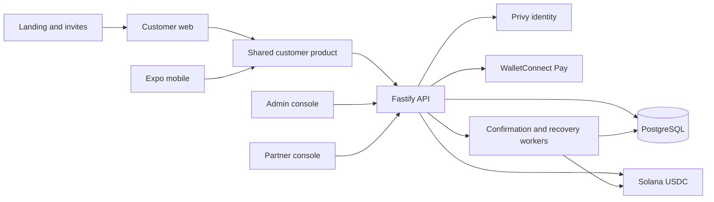
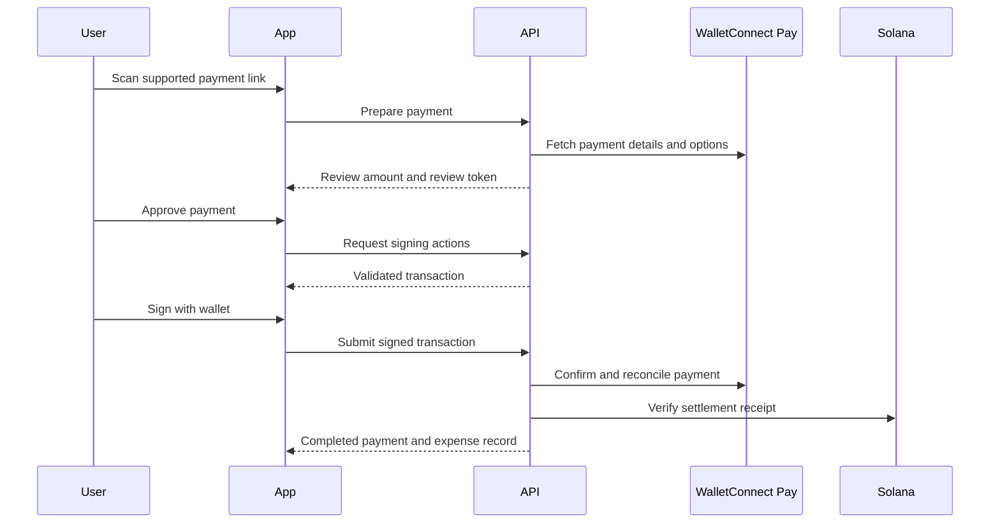

# Frenspay project context

The active release direction is an **invite-only Monad UPI simulation beta**, selected on 13 October 2026 for the Metropolis Consumer Products & Payments submission. Real UPI settlement is deferred until an eligible provider arrangement exists.

Users hold real native USDC in their own embedded wallet on Monad mainnet (Dynamic for the new beta, with Privy retained for recovery). A verified peak balance unlocks test spending credits. Scanning an Indian UPI QR spends only those credits and awards in-app points and badges: **the merchant receives no payment**. Receipt attestations use Monad testnet. There are no free starting credits or issued reward tokens.

Start with [the simulation beta runbook](monorepo/docs/simulation-beta.md) for the flow, implementation, activation gates and demo. The code is implemented locally; production activation has not been verified. The older [production audit](monorepo/docs/production-pilot.md) and [provider selection](monorepo/docs/upi-provider-selection.md) remain references for deferred real settlement.

The sections below describe retained architecture. In simulation mode, the web campaign has its own store and API, and the backend blocks new real-payment intents. Native mobile remains outside this beta; do not distribute the existing native build as the simulation product.

## Repository structure

The Git root is `payments/`; the Yarn workspace root is `monorepo/`. The repository pins Node 24 in `.nvmrc` and Yarn 1.22.22 in `package.json`.

| Location under monorepo | Responsibility | Delivery |
| --- | --- | --- |
| `apps/web` | Customer entry, Privy integration, browser signing and platform adapters | Next.js on Vercel |
| `apps/mobile` | Expo customer app, native signing and platform adapters | Separate native development build |
| `apps/backend` | Fastify API, PostgreSQL persistence, payment verification and background workers | Root Dockerfile on Railway |
| `apps/admin` | Users, invites, transactions, LPs, risk and operational controls | Next.js on Vercel |
| `apps/lp` | Partner onboarding, stake, order claiming and settlement | Next.js on Vercel |
| `apps/landing` | Public introduction and invite/waitlist entry | Next.js on Vercel |
| `packages/app` | Shared customer store, sheets, API client and payment experience | Source imported by web and mobile |
| `packages/ui` | Shared visual components | Source package |
| `packages/shared` | Contracts, money units, QR parsing and rail definitions | Shared types and helpers |
| `anchor` | Shelved Solana escrow program | Not the active settlement implementation |

Many customer files in `apps/web` re-export `packages/app`. Make product changes in the shared implementation; inspect the platform adapters before assuming web and native signing behave identically.

## Customer access and onboarding

1. An invite code is redeemed against an email through the waitlist or authenticated F-list join flow.
2. Privy authenticates the customer. The backend derives their email from the verified identity; a body-supplied email cannot grant access.
3. `/auth/sync` creates or updates the local account and wallet mapping. Customer route scopes enforce `requireFlist` independently of the UI.
4. The client hydrates state and resolves authentication and `/me` before deciding whether to show onboarding or Home.

`services/flist.ts`, `routes/flist.ts`, `routes/auth.ts`, `auth.ts` and `packages/app/src/lib/bootRoute.ts` are the main entry points. Admin and partner routes have separate authorization. The spoofable `x-dev-user-id` fallback is local-only and requires Privy to be unconfigured.

Membership currently grants three onward invitations. Invite-only therefore does not mean a fixed-size cohort. `PAYMENT_PILOT_USERS` restricts merchant payments and card funding, but does not cap all wallet users or all P2P transfers.

## Current payment flows

### Wallet and peer transfers

The customer resolves a friend, handle or address, prepares a transfer, reviews and signs it, and submits its signature. Backend verification and the confirmer establish settlement before recording dependent expense outcomes. Transfers use real Solana mainnet USDC, including in the stage tier. A stage URL is not a test-money boundary.

`routes/money.ts`, `services/solana.ts`, `services/transferVerify.ts` and `services/confirmer.ts` own this path. `routes/expenses.ts`, `db/expenses.ts` and `services/expenseRecovery.ts` maintain bills, groups and settlement recovery.

### WalletConnect scan and pay

The capability requires `MERCHANT_PAY_ENABLED=true`, a configured `WCP_PROJECT_ID`, supported Solana USDC settings and a user ID in `PAYMENT_PILOT_USERS`. These are internal user IDs, not emails. External collection pages must match the explicit HTTPS host allowlist in `PAYMENT_COLLECT_HOSTS`.

Read `services/paymentPolicy.ts`, `services/merchantPayments.ts`, `services/merchantTransaction.ts`, `routes/merchantPayments.ts` and `packages/app/src/sheets/MerchantPayment.tsx` together. A submitted signature or provider response alone is not the final receipt. The worker reconciles processing payments and verifies chain evidence.

The current scanner rejects UPI and QRIS with an unsupported-code message. Their `live` labels in `packages/shared/src/rails.ts` describe the older corridor registry and do not prove availability in the current customer journey.

### Older LP settlement path

The backend retains quotes, routing, pool escrow and partner settlement. Its usual order progression is `quote_locked → pay_instructions → waiting_payment → payment_detected → merchant_confirms → funds_released → completed`, with delayed, dispute, reroute and refund branches.

Escrow is a backend-controlled token pool, not the Anchor program. `ESCROW_SECRET_KEY` and `PLATFORM_FEE_DESTINATION` determine whether new escrow payments can be prepared. The fee payer, escrow owner, platform earnings address and stake treasury have distinct roles.

Read `services/quoteEngine.ts`, `services/routing.ts`, `services/orderMachine.ts`, `services/merchantOps.ts` and `services/payout/provider.ts`. Do not activate this path merely because keys are present; it also requires operational LPs or a configured payout provider.

### Features outside the initial pilot

Singapore PayNow payouts remain unavailable; StraitsX is sandbox-only. The older Singapore Monad campaign remains retired; its account/history/withdrawal recovery routes remain. The new Indian UPI simulation uses separate campaign tables and routes. Cross-chain CCTP requires additional signer and RPC configuration. Mobile store delivery is separate from the web deployment.

## Data and runtime boundaries

There are 35 SQL migrations under `apps/backend/src/db/migrations`, ending in `0035_campaign_identity_provider.sql`. Main domains include users and wallets, invite codes and waitlist, transfers and orders, merchants and stake, groups and expenses, merchant payments, and retained campaign data.

Production uses bare backend environment names. Stage reads `STAGE_` names; local reads `LOCAL_` with stage fallback. Privy credentials are the deliberate unprefixed exception across tiers. A local invocation can therefore inherit the stage database: use isolated fixtures for tests and inspect the selected tier before any database command.

The deployment runs migrations before starting the API. Database tier stamping rejects a database stamped for another tier, but an unstamped database is accepted and claimed during deployment. Verify the database target independently. Session-level advisory locks require a direct/session PostgreSQL connection rather than a transaction pooler.

The API process also runs transfer confirmation, payment reconciliation, bridge, FX and KYC workers. Keep the existing single replica for the initial pilot until worker concurrency has been verified. `/health` reports process liveness and database configuration presence; it does not prove current database, provider or settlement readiness.

## Deployment ownership

The root `.github/workflows/backend-image.yml` uploads backend builds to Railway: `stage` selects stage, `sacred` selects production. `monorepo/scripts/vercel-ignore.mjs` gates affected builds. Documentation-only changes do not trigger deployment.

Vercel serves four separate projects. Web uses `monorepo/vercel.json`; admin, LP and landing have app-local configuration. Their actual production branch, domains and environment variables live in Vercel and must match the release. Public frontend environment values are compiled into the bundle, so changing them requires a rebuild.

Backend and frontend deployment timing is independent. Preserve API compatibility across a release and verify the backend before promoting a frontend that requires new routes.
