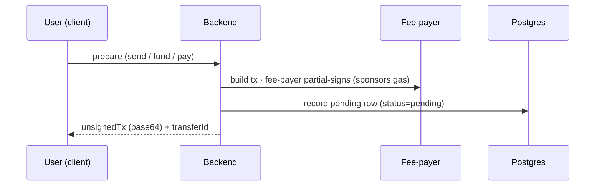
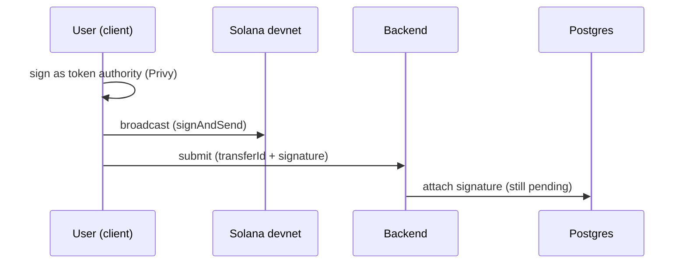
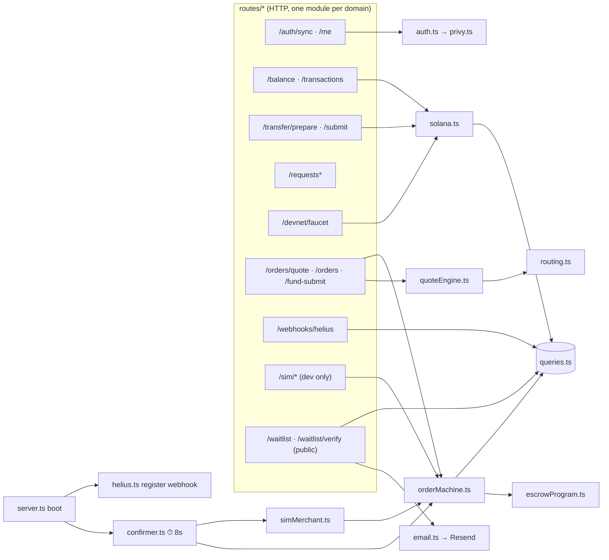

# 01 · Architecture

## What it is

A **yarn-workspaces monorepo** with five apps (one parked) and a shared package. The backend is the brain (it
builds transactions, runs the order lifecycle, talks to the chain and the database); the clients are
thin (they render, collect a signature, and poll). Everything is **always-real against Solana** —
mainnet on deployed envs (mainnet-lite, see `DEPLOY.stage.md`), devnet in local dev; there is no
mock toggle; "simulation" only ever means a *simulated merchant/LP*, never a fake chain.

```
monorepo/
├── apps/
│   ├── backend/     Fastify API (tsx, ESM) — the brain
│   ├── web/         Next.js consumer app (full feature set incl. cash-out)
│   ├── admin/       Next.js ops console (backend enforces role='admin')
│   ├── landing/     Next.js static export — marketing site + the f-list waitlist
│   └── mobile/      Expo app, PARKED — out of the workspace, no installed deps
├── packages/
│   └── shared/      @fpay/shared — TypeScript types + the money module (units.ts) + formatters
└── anchor/          Solana program (Rust + Anchor) — the on-chain escrow
```

| Layer | Tech | Notes |
|---|---|---|
| Backend | **Fastify 5 + tsx** (no build step), ESM | one process; a background poller runs inside it |
| Web | **Next.js App Router + Zustand + Privy web SDK** | mobile-first browser UI |
| Admin / Landing | **Next.js** console / **static export** marketing site | admin role-gated by the backend; landing hosts the f-list |
| Mobile | **Expo + Privy Expo SDK** (parked) | consumer P2P; cash-out flow not ported |
| Shared | raw TS (`main: ./src/index.ts`), one runtime dep (bignumber.js) | backend imports **types only** (see below) |
| Chain | **Solana, SPL USDC** (6 dp), Anchor 0.32 | mainnet USDC on deployed envs; controlled devnet mint in local dev |
| Data | **Postgres on Supabase** (session pooler — advisory locks) | access control in the API layer, no RLS |
| Infra | Privy (wallets), Helius (RPC + webhooks) | both have free tiers |
| Hosting | **Railway** (backend, Dockerfile) + **Vercel** (frontends, one project per app per env) | web gated by a shared access key until launch — runbooks: `../DEPLOY.stage.md`, `../DEPLOY.md` |

> **Quirk worth knowing:** the backend imports from `@fpay/shared` as **types only** (`import type`).
> Runtime *value* imports from the raw-TS workspace package fail under `tsx`, so shared constants
> (e.g. the quote fee constants in `quoteEngine.ts`) are **mirrored locally** in the backend rather
> than imported. If you add a shared runtime value the backend needs, copy it, don't import it.

---

## Flow — the universal "build → sign → submit → confirm" lifecycle

Almost every money action (send, fund-escrow, faucet) follows the **same four beats**. The backend
never holds the user's key; it *prepares* a transaction, the *user* signs it, and the fee-payer
*sponsors* the gas.

The four beats are shown as four small diagrams so each stays readable.

**1 · Build (prepare)**



**2 · Sign & submit**



**3 · Confirm (async)**


**The "prepare/submit seam"** (`solana.ts` comment) is the whole trick: because the client signs an
already-fee-payer-sponsored transaction, **users never need SOL** and the platform **never custodies
the user's key**. The same seam carries the on-chain escrow `deposit` unchanged — see
[03-custody-and-gas](03-custody-and-gas.md).

---

## Component map



**Who calls whom, in words:**
- **`server.ts`** boots Fastify, registers routes, starts the **confirmer** poller (8s), and registers
  the **Helius** webhook (no-op locally).
- **`routes/`** is the HTTP surface, split by domain — `system, auth, money, orders, kyc,
  notifications, webhooks, waitlist` — with `routes/index.ts` as a thin registrar that attaches the
  shared hooks (rate limit → auth) before any module registers. The `authPreHandler` populates
  `req.userId` from a Privy bearer token (or `x-dev-user-id` in dev). List endpoints
  (`/transactions`, `/orders`, `/notifications`) use keyset pagination (`?limit=&cursor=` →
  `nextCursor`). **`waitlist` is the exception to all of it**: the landing site is not logged in, so
  those two routes never see `req.userId` and are bounded by the IP-keyed rate limiter alone — see
  [20 · Waitlist & referral loop](20-waitlist-referral-loop.md).
- **`config.ts`** is the only env reader; NODE_ENV picks the tier — local/development →
  `LOCAL_*` → `STAGE_*`, stage → `STAGE_*`, production → bare names that exist ONLY on the prod
  host. Boot logs which var the database came from and warns when a local run resolves the stage DB.
- **`solana.ts`** owns the chain primitives: `connection()`, `feePayer()`, `buildUsdcTransfer`,
  `mintUsdcTo` (faucet), `getUsdcBalance`, `getTransferStatus`.
- **`escrowProgram.ts`** owns the Anchor program: `buildDepositTx`, `releaseEscrow`, `refundEscrow`.
- **`quoteEngine.ts` → `routing.ts`** price a quote and pick a merchant.
- **`orderMachine.ts`** runs the 7-state order lifecycle and is the *only* writer of order state.
- **`confirmer.ts`** (every 8s) confirms pending transfers **and** ticks **`simMerchant.ts`** (the
  simulated LP + escalation timers).
- **`queries.ts`** is the single SQL module (no ORM).

---

## Money & decimals

Floats and money don't mix, and on a chain the failure isn't a rounding error — it's a reverted
transaction. So one invariant, everywhere:

> **An amount is a decimal string at rest and on the wire, a `BigNumber` inside a calculation, a
> `bigint` of base units at the chain edge, and a `number` only at the moment it is printed.**

Four states, four conversions, each with exactly one function — all in
`packages/shared/src/units.ts`:

| State | Looks like | How you leave it |
|---|---|---|
| **At rest** — Postgres `numeric(20,6)` | `"25.000000"` | `pg` hands back a string; pass it through |
| **On the wire** — every money field in `contracts.ts` | `"25.000000"` | `normalizeAmount(raw, dec)` on the way in |
| **In a calculation** — BigNumber | — | `parseAmount` / `formatAmount` |
| **At the chain edge** — SPL `u64`, ERC-20 `uint256` | `25000000n` | `toBaseUnits` / `fromBaseUnits` |
| **On screen** — a `number`, finally | `$25.00` | `Number()` at the render call site, and nowhere else |

**`decimals` is always a parameter, never baked in.** On Solana it comes from the mint itself
(`solana.ts:decimals()`, memoized), which is the runtime authority; `USDC_DECIMALS = 6` is the
compile-time default for paths with no mint to read. **Never write `1e6`.** This matters more than
the single-asset lock suggests — at 6dp a `number` is exact below $1e9, but at **18dp it stops being
exact above 0.009 units**, so the day a non-6dp asset arrives, code that assumed a scale is already
wrong.

**The rounding law — round so the platform is never short.** What the user *owes* rounds **up**;
what fpay *delivers* rounds **down**; a fee ceiling handed to a protocol rounds **up**. Both
directions are named functions (`divUp` / `divDown`, `roundUp` / `roundDown`) so no call site leans
on a default. The last clause is the one that isn't about money: round a CCTP `maxFee` down and the
**burn reverts on-chain** — a failed transaction, not a lost cent.

Bignumber.js is configured through `BigNumber.clone()`, not `.config()`, because the latter is
process-global and any dependency could move our arithmetic under us. The clone also disables
exponential notation entirely — `"1e-7"` is not a valid `numeric` literal and is wrong on the wire.

> **Quirk worth knowing:** `pg` returns `numeric` as a **string**, and that is correct and
> load-bearing — it's what makes the value exact from the column to the client. **Never add
> `pg.types.setTypeParser(1700, parseFloat)`**: it would silently downgrade every money read in the
> system and nothing would fail loudly. `yarn check:money` asserts nobody has.

> **Quirk worth knowing:** `units.ts` exists **twice** — `packages/shared/src/units.ts` and
> `apps/backend/src/lib/units.ts` — for exactly the types-only reason 60 lines up. `check:money`
> compares them byte-for-byte, because a client and a trust boundary that disagree on what a valid
> amount is would be worse than either being wrong alone.

**The costs, named.** Display parses back to `number` — printing is where exactness stops mattering
and readability starts. Routing, compliance, and merchant-stats thresholds also stay `number`: they
compare and score, they never move money, so a 1-ulp difference only shifts a decision at an exact
cap boundary. Those sites carry a `money:number` comment, which is a claim a reader can check rather
than a silent exception. And TypeScript cannot help with the two traps that survive the flip — `<`
between two decimal strings compares them **lexically**, and `+` **concatenates** — so `check:money`
greps for both against the fields `contracts.ts` currently declares as strings. Finally, there is
**no token registry and none should be added**: single-asset is a locked product decision
([docs/16](16-direct-address-send-plan.md)), and because every helper already takes `decimals` as a
parameter, a second asset is a new constant rather than a new subsystem.

Run it: `yarn check:money`.

---

## Why this shape

- **Thin clients, fat backend.** Pricing, state, and chain logic live server-side so web + mobile stay
  simple and consistent, and so the order machine has one authoritative writer.
- **No build step (tsx).** Fast iteration for a solo builder; the cost is the types-only `@fpay/shared`
  quirk above.
- **One poller inside the API process.** Rate-limiting, metrics, and notifications are in-process (M6);
  a separate worker/Redis (multi-instance) is the remaining M7 scale step. The 8s confirmer doubles as
  the order-escalation clock. Simple, good enough for devnet, explicitly temporary.
- **Always-real.** Avoids mock/real drift: the code you test is the code that ships (mainnet when
  deployed, devnet locally); only the *counterparty* (merchant/LP) is simulated.

## Legalities (system-level)

The architecture is deliberately **non-custodial** (user signs; platform sponsors gas) — this is the
single biggest regulatory lever, because **not holding customer funds or keys** keeps us out of the
heaviest money-transmitter / custody obligations during the build phase. The one place funds *do* sit
under program control is the **per-order escrow** (07), and even there the user authorizes the deposit
and the program enforces release/refund rules on-chain. Full detail in
[11-compliance-and-legalities](11-compliance-and-legalities.md).

## Status

✅ The architecture itself is complete and stable: monorepo, backend services, web app, shared types,
the build→sign→submit→confirm seam, and the on-chain escrow are all wired and typecheck-clean across
4 workspaces. 🟡 Gray spots are *what flows through it* — a simulated LP network, a faucet instead of a
real on-ramp, and a simulated KYC vendor (live FX + enforced KYC tiers already shipped) — each called
out in its own doc.

## Key files

- `apps/backend/src/server.ts` · `routes/index.ts` · `config.ts`
- `apps/backend/src/services/{solana,escrowProgram,quoteEngine,routing,orderMachine,simMerchant,confirmer,helius,email}.ts`
- `apps/backend/src/db/{schema.sql,queries.ts}` · `db/migrations/*.sql`
- `apps/backend/src/lib/{units.ts,amount.ts}` — the mirrored money module + its HTTP-side wrapper
- `packages/shared/src/{contracts.ts,units.ts,money.ts}` · `scripts/check-money.ts`
- `anchor/programs/escrow/src/lib.rs`
