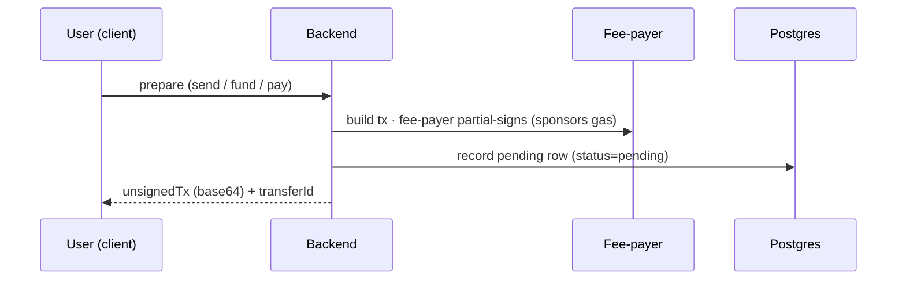
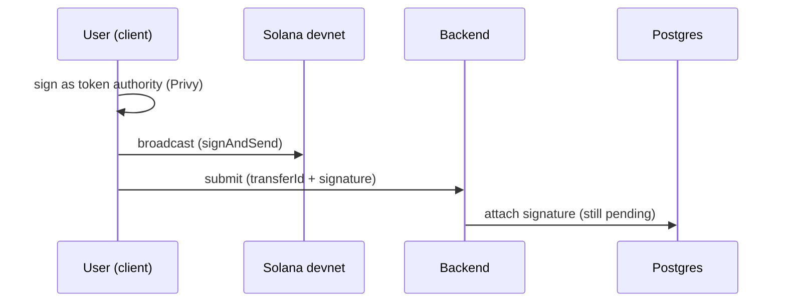
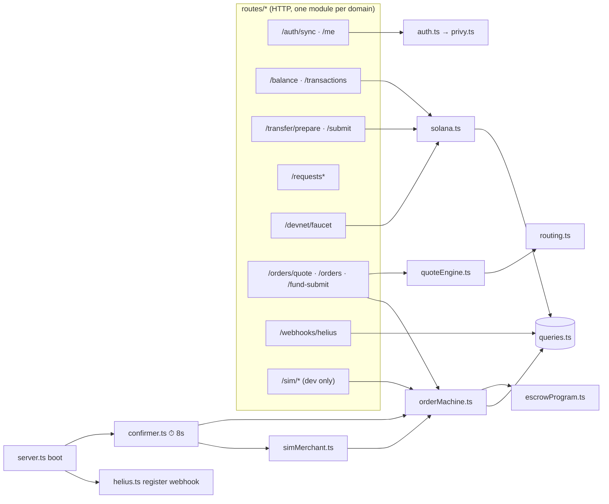

# 01 · Architecture

## What it is

A **yarn-workspaces monorepo** with four apps and two shared packages. The backend is the brain (it
builds transactions, runs the order lifecycle, talks to the chain and the database); the clients are
thin (they render, collect a signature, and poll). Everything is **always-real against Solana
devnet** — there is no mock toggle; "simulation" only ever means a *simulated merchant/LP*, never a
fake chain.

```
monorepo/
├── apps/
│   ├── backend/     Fastify API (tsx, ESM) — the brain
│   ├── web/         Next.js consumer app (full feature set incl. cash-out)
│   └── mobile/      Expo app (P2P only today; no order flow yet)
├── packages/
│   └── shared/      @fpay/shared — TypeScript types + money helpers (RATE, inr(), usd())
└── anchor/          Solana program (Rust + Anchor) — the on-chain escrow
```

| Layer | Tech | Notes |
|---|---|---|
| Backend | **Fastify 5 + tsx** (no build step), ESM | one process; a background poller runs inside it |
| Web | **Next.js App Router + Zustand + Privy web SDK** | mobile-first browser UI |
| Mobile | **Expo + Privy Expo SDK** | consumer P2P; cash-out flow not ported |
| Shared | raw TS (`main: ./src/index.ts`) | backend imports **types only** (see below) |
| Chain | **Solana devnet, SPL "USDC"** (6 dp), Anchor 0.32 | controlled devnet mint in dev |
| Data | **Postgres** (Railway/Supabase) | access control in the API layer, no RLS |
| Infra | Privy (wallets), Helius (RPC + webhooks) | both have free tiers |

> **Quirk worth knowing:** the backend imports from `@fpay/shared` as **types only** (`import type`).
> Runtime *value* imports from the raw-TS workspace package fail under `tsx`, so shared constants
> (e.g. the quote fee constants in `quoteEngine.ts`) are **mirrored locally** in the backend rather
> than imported. If you add a shared runtime value the backend needs, copy it, don't import it.

---

## Flow — the universal "build → sign → submit → confirm" lifecycle

Almost every money action (send, fund-escrow, faucet) follows the **same four beats**. The backend
never holds the user's key; it *prepares* a transaction, the *user* signs it, and the fee-payer
*sponsors* the gas.

The four beats are shown as four small diagrams so each stays readable.

**1 · Build (prepare)**



**2 · Sign & submit**



**3 · Confirm (async)**


**The "prepare/submit seam"** (`solana.ts` comment) is the whole trick: because the client signs an
already-fee-payer-sponsored transaction, **users never need SOL** and the platform **never custodies
the user's key**. The same seam carries the on-chain escrow `deposit` unchanged — see
[03-custody-and-gas](03-custody-and-gas.md).

---

## Component map



**Who calls whom, in words:**
- **`server.ts`** boots Fastify, registers routes, starts the **confirmer** poller (8s), and registers
  the **Helius** webhook (no-op locally).
- **`routes/`** is the HTTP surface, split by domain — `system, auth, money, orders, kyc,
  notifications, webhooks` — with `routes/index.ts` as a thin registrar that attaches the shared
  hooks (rate limit → auth) before any module registers. The `authPreHandler` populates `req.userId`
  from a Privy bearer token (or `x-dev-user-id` in dev). List endpoints (`/transactions`, `/orders`,
  `/notifications`) use keyset pagination (`?limit=&cursor=` → `nextCursor`).
- **`config.ts`** is the only env reader; NODE_ENV picks the tier — local/development →
  `LOCAL_*` → `STAGE_*`, stage → `STAGE_*`, production → bare names that exist ONLY on the prod
  host. Boot logs which var the database came from and warns when a local run resolves the stage DB.
- **`solana.ts`** owns the chain primitives: `connection()`, `feePayer()`, `buildUsdcTransfer`,
  `mintUsdcTo` (faucet), `getUsdcBalance`, `getTransferStatus`.
- **`escrowProgram.ts`** owns the Anchor program: `buildDepositTx`, `releaseEscrow`, `refundEscrow`.
- **`quoteEngine.ts` → `routing.ts`** price a quote and pick a merchant.
- **`orderMachine.ts`** runs the 7-state order lifecycle and is the *only* writer of order state.
- **`confirmer.ts`** (every 8s) confirms pending transfers **and** ticks **`simMerchant.ts`** (the
  simulated LP + escalation timers).
- **`queries.ts`** is the single SQL module (no ORM).

---

## Why this shape

- **Thin clients, fat backend.** Pricing, state, and chain logic live server-side so web + mobile stay
  simple and consistent, and so the order machine has one authoritative writer.
- **No build step (tsx).** Fast iteration for a solo builder; the cost is the types-only `@fpay/shared`
  quirk above.
- **One poller inside the API process.** Rate-limiting, metrics, and notifications are in-process (M6);
  a separate worker/Redis (multi-instance) is the remaining M7 scale step. The 8s confirmer doubles as
  the order-escalation clock. Simple, good enough for devnet, explicitly temporary.
- **Always-real, devnet.** Avoids mock/real drift: the code you test is the code that ships; only the
  *counterparty* (merchant/LP) is simulated.

## Legalities (system-level)

The architecture is deliberately **non-custodial** (user signs; platform sponsors gas) — this is the
single biggest regulatory lever, because **not holding customer funds or keys** keeps us out of the
heaviest money-transmitter / custody obligations during the build phase. The one place funds *do* sit
under program control is the **per-order escrow** (07), and even there the user authorizes the deposit
and the program enforces release/refund rules on-chain. Full detail in
[11-compliance-and-legalities](11-compliance-and-legalities.md).

## Status

✅ The architecture itself is complete and stable: monorepo, backend services, web app, shared types,
the build→sign→submit→confirm seam, and the on-chain escrow are all wired and typecheck-clean across
4 workspaces. 🟡 Gray spots are *what flows through it* — a simulated LP network, a faucet instead of a
real on-ramp, and a simulated KYC vendor (live FX + enforced KYC tiers already shipped) — each called
out in its own doc.

## Key files

- `apps/backend/src/server.ts` · `routes/index.ts` · `config.ts`
- `apps/backend/src/services/{solana,escrowProgram,quoteEngine,routing,orderMachine,simMerchant,confirmer,helius}.ts`
- `apps/backend/src/db/{schema.sql,queries.ts}`
- `packages/shared/src/{contracts.ts,money.ts}`
- `anchor/programs/escrow/src/lib.rs`
