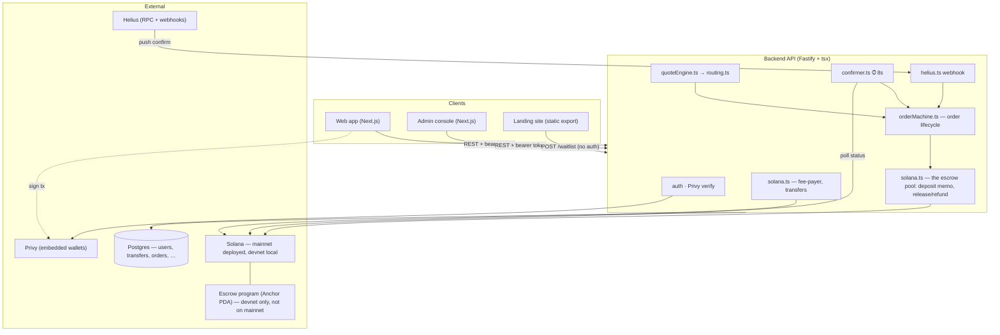
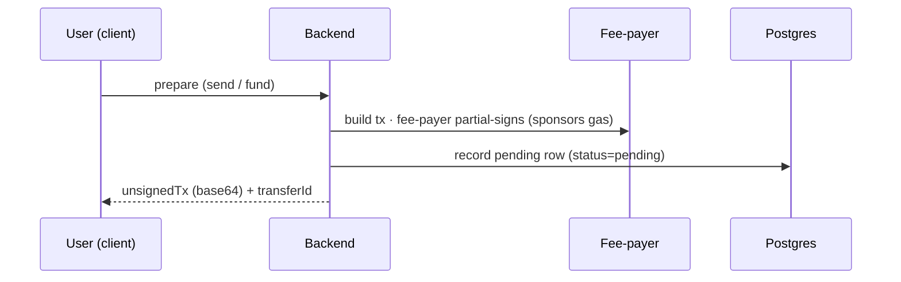
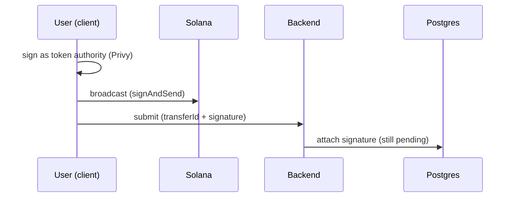
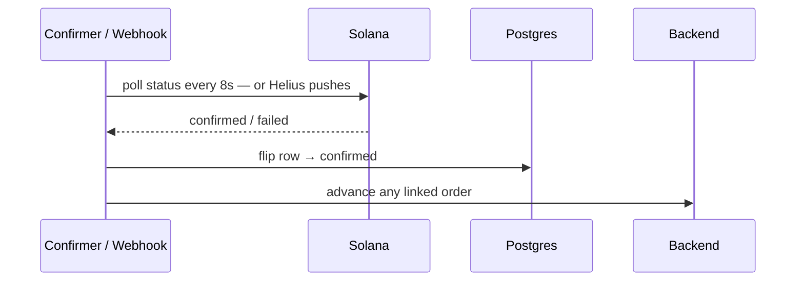

# 01 · Architecture

## What it is

A **yarn-workspaces monorepo**: six apps (`admin`, `backend`, `landing`, `lp`, `web`, `mobile`)
plus three shared packages. The backend is the brain (builds transactions, runs the order lifecycle, talks to
the chain and the database); clients are thin (render, collect a signature, poll).

**One-line mental model:** the **client** asks the **backend** to *build* a transaction, the
**user** signs it (via Privy), the **fee-payer** sponsors the gas, the **chain** executes it, and a
**confirmer + webhook** tell the backend it landed so the **order machine** can advance. Money
"in flight" for a merchant payout sits in an **on-chain escrow** until released or refunded.

```
monorepo/
├── apps/
│   ├── backend/     Fastify API (tsx, ESM) — the brain
│   ├── web/         Next.js consumer app (full feature set incl. cash-out)
│   ├── admin/       Next.js ops console (backend enforces role='admin')
│   ├── lp/          Next.js LP console — separate app, separate domain (see 11)
│   ├── landing/     Next.js static export — marketing site + the f-list waitlist
│   └── mobile/      Expo / React Native app — the same product, rendered natively (see 12)
├── packages/
│   ├── shared/      @fpay/shared — TypeScript types + the money module (units.ts) + formatters
│   ├── ui/          @fpay/ui — the design system (RN-over-DOM shim + .native twins, primitives, theme, icons)
│   └── app/         @fpay/app — the product: store, backend client, sheets, components; one platform seam
└── anchor/          Solana program (Rust + Anchor) — the on-chain escrow
```

| Layer | Tech | Notes |
|---|---|---|
| Backend | **Fastify 5 + tsx** (no build step), ESM | one process; several background pollers run inside it |
| Web | **Next.js App Router + Zustand + Privy web SDK** | mobile-first browser UI; ships as a Next **server**, not a static export (see Environments) |
| Admin / Landing | **Next.js** console / **static export** marketing site | admin role-gated by the backend; landing hosts the f-list |
| LP | **Next.js + Privy web SDK** | the LP console ([11](11-lp-console.md)) — its own app and domain, so the marketplace never ships in a payer's bundle. Auth depth matches web, not admin: staking signs a real USDC transfer; behind its own deploy access gate, like web |
| Shared | raw TS (`main: ./src/index.ts`), one runtime dep (bignumber.js) | backend imports **types only** — `import type` (runtime value imports fail under tsx) |
| UI | raw TSX, same source-only pattern; `react`/`react-dom` are **peer** deps | shared by `web`, `lp` and `mobile`. Consumers must list it in `transpilePackages`; `apps/web`'s own `components/ui/*` are one-line re-export shims, so its ~40 import sites never moved. Every module with a `.native.tsx` twin is what Metro hands the phone instead |
| App | raw TSX, source-only; the store (Zustand), the API client, the sheets and product components | shared by `web` and `mobile` — one product, two renderers. What a platform does differently goes through ONE seam (`src/platform.ts`) each app fills in at boot; the store hydrates from `configure()`, never at import |
| Mobile | **Expo SDK 56 + expo-router + Privy Expo SDK** | Android dev build over adb (no Expo Go — Privy needs native modules; no EAS). Routes per page, Persona in an in-app browser, push via Expo's service ([12](12-mobile-app.md)) |
| Chain | **Solana, SPL USDC** (6 dp), Anchor | **mainnet** on deployed envs (stage + prod); devnet only in local dev |
| Data | **Postgres on Supabase** (session pooler — advisory locks) | access control in the API layer, no RLS; local dev also writes to the shared stage DB |
| Infra | Privy (wallets), Helius (RPC + webhooks) | both have free tiers |
| Hosting | **Railway** (backend — **GitHub Actions** uploads the checkout, Railway builds it; nothing is published to a registry) + **Vercel** (frontends, one project per app per env) | web and lp each gated by their own access key until public launch |

---

## Environments — mainnet posture

**Every environment is Solana mainnet — there is no testnet tier** (2026-08-30). `USDC_MINT`
defaults to Circle's mainnet mint, `SOLANA_RPC_URL` to a mainnet RPC, and the things a devnet used to
make safe — the faucet, the `/sim/orders/*` controls, simulated LPs, the Sepolia CCTP table — are
deleted rather than gated. Local dev talks to the same chain and the shared stage Postgres; without
a fee-payer key it is read-only for money.

| Tier | Branch | Notes |
|---|---|---|
| local | — | `NODE_ENV` local/development; shared stage Postgres (no local DB); no fee-payer ⇒ money is read-only |
| stage | `stage` | Railway stage env + the Vercel `frenspay-stage` project (web only; admin, lp and landing deploy from `sacred`); real USDC |
| production | `sacred` | same shapes, bare env var names, separate access keys (one per gated project); the Railway service needs its **own** database — the tier stamp makes sharing stage's fatal at boot |

> The Branch column means two different mechanisms: for Vercel it is the project's Production
> Branch, for the backend it is the CI workflow's trigger. They are kept in step by hand, not by a
> shared setting.

What a tier can *do* is a **capability** the backend derives from its own config at boot, never
from `NODE_ENV` and never from a cluster flag: `escrowLive` (merchant-pay), `personaLive`
(identity), the stake treasury (LP staking), the EVM minter (cross-chain). Each answers a clean 503
when its config is absent — `DEPLOY.stage.md` has the table.

**Deployment quirk:** the web app and the LP console ship server-side code — the access-key deploy
gate (`src/middleware.ts` + `/gate`, byte-for-byte in `apps/web` and `apps/lp`) — so they deploy as
**Next servers**, not static exports, unlike `landing`. Until a device presents that project's key,
every route serves the gate form instead of the app; this is a door-lock for unreleased/pre-launch builds, not the real auth (Privy is).

---

## System at a glance



**Who calls whom, in words:**
- **`server.ts`** boots Fastify, registers routes, then starts several in-process workers: the
  **confirmer** (8s, transfers → order advance), a cross-chain bridge poller (5s), a rate-limit
  sweeper, an FX-rate refresher, a KYC-vendor reconciliation poller (15s), and Helius webhook
  registration (no-op locally).
- **`routes/`** is the HTTP surface, one module per domain — `system, auth, money, orders,
  merchant, crosschain, kyc, notifications, webhooks, waitlist, admin` — registered by
  `routes/index.ts`, which attaches the shared hooks (rate limit → auth) before any module
  registers. `crosschain` registers on every tier and 503s until the EVM minter is configured.
- **`envConfig.ts`** is the only env reader per app (backend, web, admin, landing each have one);
  `NODE_ENV` (backend) / `NEXT_PUBLIC_APP_ENV` (Next apps) picks the tier, which picks the
  variable prefix.
- **`solana.ts`** owns the chain primitives: `connection()`, `feePayer()`, `buildUsdcTransfer`,
  `getUsdcBalance`, `getTransferStatus`.
- **`solana.ts`** also owns the **escrow pool** (`escrowKeypair`, `escrowPoolAddress`,
  `sendFromEscrowPool`, the deposit memo) — detailed in 06 and 16. The Anchor program in `anchor/`
  is audited and shelved, not deployed.
- **`orderMachine.ts`** runs the order lifecycle and is the *only* writer of order state.

---

## Request lifecycle — the universal "build → sign → submit → confirm" seam

Almost every money action (send, fund-escrow) follows the same four beats. The backend never holds
the user's key; it *prepares* a transaction, the *user* signs it, and the fee-payer *sponsors* the
gas.

**1 · Build (prepare)**



**2 · Sign & submit**



**3 · Confirm (async)**



Because the client signs an already-fee-payer-sponsored transaction, **users never need SOL** and
the platform **never custodies the user's key**. The same seam carries the on-chain escrow
`deposit` unchanged. Full walk-through (deposit → release/refund, the 7-state order machine) is
[03-custody-money-in-and-confirmation](03-custody-money-in-and-confirmation.md) and
[06-offramp-and-settlement](06-offramp-and-settlement.md).

---

## Why this shape

- **Thin clients, fat backend.** Pricing, state, and chain logic live server-side so every client
  stays simple and consistent, and the order machine has one authoritative writer.
- **No build step (tsx).** Fast iteration for a solo builder; the cost is the types-only
  `@fpay/shared` quirk above.
- **Workers in-process.** Rate-limiting, confirmation, FX refresh, and KYC reconciliation all run
  as timers inside the one API process — simple, no separate worker/Redis yet, and an explicit
  scale step to take later (10-ops-and-roadmap).
- **Capability-derived switches, not tier-derived.** Nothing keys money behaviour off `NODE_ENV`
  or a cluster flag; a capability exists when its config does (`escrowLive`, `personaLive`, the
  stake treasury, the EVM minter) and answers 503 otherwise — the same shape on every tier.
- **Fees.** A platform fee is folded into the quoted conversion rate rather than shown as a line
  item — mechanics and current gap are [05-fees-fx-and-display](05-fees-fx-and-display.md).

## Legalities (system-level)

The architecture is deliberately **non-custodial** (user signs; platform sponsors gas) — this is
the single biggest regulatory lever, since not holding customer funds or keys keeps the product out
of the heaviest money-transmitter / custody obligations during the build phase. The one place funds
*do* sit under program control is the per-order escrow, and even there the user authorizes the
deposit and the program enforces release/refund on-chain. Full detail in
[08-compliance-and-legalities](08-compliance-and-legalities.md).

## Status

✅ The architecture itself is stable: monorepo, backend services, the four workspace apps, shared
types, and the build→sign→submit→confirm seam are wired and typecheck-clean. 🟡 The on-chain escrow
program is being deployed to mainnet under a new id (docs/15) — merchant-pay orders return `503`
until `escrowLive` is true. ⬜ Cross-chain (CCTP) is built and registered everywhere; live once the
EVM minter and mainnet RPCs are configured.

## Key files

- `apps/backend/src/server.ts` · `routes/index.ts` · `envConfig.ts`
- `apps/backend/src/services/{solana,escrowProgram,quoteEngine,routing,orderMachine,confirmer,helius}.ts`
- `apps/web/src/middleware.ts` · `apps/web/src/services/envConfig.ts`
- `anchor/programs/escrow/src/lib.rs` · `anchor/Anchor.toml`
- `DEPLOY.stage.md` · `DEPLOY.md`
