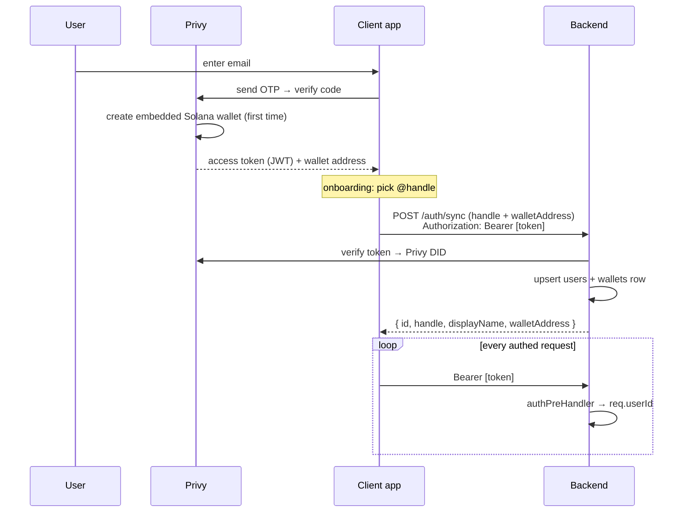

# 02 · Auth & Identity

## What it is

How a person becomes a user. **Privy** provides email-OTP login and silently creates an **embedded
Solana wallet** for them (no seed phrase, no "connect wallet"). The user picks an **`@handle`** (like
Venmo/Cash App) so friends can pay them by name, not by address. Identity verification (**KYC**) is
modelled as tiers that **enforce** money-movement limits (M5; see Status below), backed by a simulated
verification vendor for now.

Three identities are tracked per person:
- **Privy DID** — the login identity (`did:privy:…`), the source of truth for "who is this request."
- **DB user id** — our internal `users.id`, created on first `/auth/sync`.
- **`@handle`** — the human-facing payment ID; unique, canonical (`'@' + [a-z0-9_.]{3,30}`, lowercased
  and validated server-side at `/auth/sync`), and **immutable after first sync** — a freed handle could
  be re-claimed and misdirect payments.

Two optional aliases extend the directory UPI-mapper-style (docs 17/18):
- **Phone (E.164)** — strict opt-in: enrolling IS the consent (`users.phone IS NOT NULL` is the flag).
  The number always comes from the caller's own Privy-verified account (`POST /me/phone`; Privy runs
  the SMS OTP). Resolution never returns the phone — reverse lookup is structurally impossible — and
  `?phone=` lookups are authenticated + rate-limited against enumeration.
- **Country (ISO alpha-2)** — a *dialing default only* (a local-format number typed in the search box
  assumes this country's code). Learned silently: browser locale fills-if-null at sync → verified
  phone's code overwrites on enroll → manual Settings pick overwrites (`POST /me/country`). KYC
  document country is deliberately NOT a source (expats' passports diverge from dialing country).

## Flow — login → sync → authenticated requests

**On the backend** (`auth.ts`): an `authPreHandler` runs before every route. In **Privy mode** it
verifies the `Authorization: Bearer` JWT (`verifyAccessToken`), maps the **Privy DID → DB user**, and
sets `req.userId`. Before the user exists, `/auth/sync` uses `req.privyDid` to create them. In **dev
mode** (Privy unconfigured), it falls back to an `x-dev-user-id` header so the API is testable without
Privy. `requireUserId(req)` throws 401 if unmapped.

## Why this way

- **Email + embedded wallet, not "connect a wallet."** The target user has no wallet and shouldn't
  need one. Privy's embedded wallet means **no seed phrase ever touches the user** — onboarding feels
  like any fintech app ("No passwords, just your email").
- **`@handle` over address.** Nobody pays a base58 string. Handles are the entire P2P UX; addresses
  are resolved server-side and never shown.
- **DID as the spine.** Tying our user to the Privy DID (not email, which can change) keeps identity
  stable and lets Privy own the sensitive auth surface.
- **Tiered KYC as a gate, not a wall.** The design lets low-value P2P work at tier 0–1 and only asks
  for documents when the user does something that legally needs it (paying merchants) — "progressive
  KYC," JIT.

## Legalities

- **KYC/AML (Customer Identification).** The **tiered** model (caps scale with verification) is now
  **enforced** (M5): `users.kyc_tier` (0–3) gates money movement — tier 1 caps P2P at $100/tx, tier 2
  unlocks merchant pay — checked server-side against rolling-24h ledger volume, with a simulated
  verification upgrade (`/kyc/verify`) and sanctions screening. **Still simulated** for the *vendor*
  leg: no real document collection / KYC-AML provider — that seam (Persona/Onfido/Sumsub) lands at **M7**.
- **Custody of credentials.** By delegating auth + key management to Privy, we avoid storing passwords
  or private keys ourselves — smaller breach surface and smaller compliance burden. See
  [03-custody-and-gas](03-custody-and-gas.md).
- **Data/PII.** `users` stores handle + opt-in E.164 phone (unique, removable via `DELETE /me/phone`)
  + best-effort country; email column exists but is unwritten. A real launch needs a privacy policy,
  data-retention rules, and regional handling (e.g. India DPDP, GDPR).

## Status

- ✅ Privy email-OTP login + embedded wallet creation, `@handle` selection, `/auth/sync`, bearer-token
  verification, dev `x-dev-user-id` fallback.
- ✅ **UPI-style directory (docs 17/18)** — canonical immutable handles, opt-in pay-by-phone with
  Privy-verified numbers, country dialing default with Settings override. 🟡 Privy-mode phone
  enrollment is pending the **OTP channel decision (deliberately parked, 2026-07-22)**: Privy SMS is
  US/Canada-only on every plan (international = Enterprise), Privy WhatsApp covers all WhatsApp
  regions incl. India, and the dashboard choice is **irreversible** ("either SMS or WhatsApp …
  cannot be switched") — so nothing gets enabled until Bridge decides. Both channels use the same
  SDK hooks, so no code is blocked. Fallback option: own OTP vendor (Twilio Verify / MSG91) at M7.
- ✅ **KYC tiers enforced (M5)** — `kyc_tier` per-tier caps enforced at the money-movement endpoints
  (structured `limit_exceeded`), a simulated verification upgrade, `/me` returns the tier, sanctions
  screening + a fraud score, and the Verify UI reflects the real tier.
- 🟡 **Vendor leg still simulated** — no real document capture / KYC-AML provider (M7).
- ✅ **Invite-only** — real one-time codes (`invite_codes`), not handles. A code is validated and
  **burned inside the account-creation transaction**, where `select … for update` on the single code
  row is the whole concurrency control: two people racing one code, one wins. The gate fires only
  when the sync *creates* the row, so existing users are grandfathered and an empty database founds
  itself. Unknown, used and revoked collapse to one `invalid_invite` so the endpoint can't be used
  as an oracle for which codes exist.
  - **The landing page is the door.** `POST /invite/check` is public and check-only (it never burns
    and never reserves), then a valid code is handed to the app as `?invite=`. The f-list is the
    fallback for people without one.
  - **Three codes, shown once.** Minted at signup, returned by `/me` only until
    `POST /me/invites/ack` stamps `users.invites_revealed_at`, then never again — lose it, lose a
    fren. Settings shows counts only. The admin console is the sole place a code stays readable,
    which is why they are stored in plain text.
  - **Admin mints, lists and revokes** (`/admin/invites`). Codes with no owner are *house* codes,
    constrained by nobody's allowance. Before this, no code could be generated by anyone.
  See [20 · Waitlist & referral loop](20-waitlist-referral-loop.md).

## Key files

- Backend: `apps/backend/src/auth.ts` (`requireAdmin`, `isRootAdminEmail`), `services/privy.ts`,
  `services/invites.ts` (`mintCode`, `canonicalInviteCode`), identity + directory + gate routes in
  `routes/auth.ts` (`/auth/sync`, `/me`, `/invite/check`, `/me/invites/ack`, `/users/resolve`,
  `/me/phone`, `/me/country`), `db/queries.ts` (`upsertUserByPrivyDid`, `ensureInviteCodes`,
  `getInviteStats`, `inviteCodeStatus`, `canonicalHandle`, `normalizePhone`, `findUserByPhone`).
- Landing: `src/lib/invite.ts`, `components/frenspay/inline-f-list-form.tsx` (the door).
- Web: `src/services/privy/PrivyBridge.tsx`, `app/onboarding/{faceid,handle,invites}/page.tsx`,
  `app/(tabs)/layout.tsx` (the one-look reveal guard), `components/sheets/identity.tsx`.
- Admin: `src/app/invites/page.tsx` (mint / revoke / who-has-what), `src/app/users/page.tsx` (team).
- Self-check: `apps/backend/scripts/check-invites.ts` (`yarn check:invites`).
- Schema: `users`, `wallets`, `invite_codes` (see [10-data-model](10-data-model.md)).
