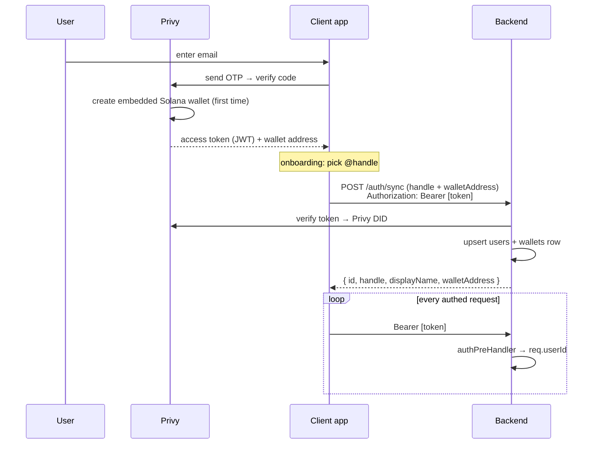

# 02 · Auth & Identity

## What it is

How a person becomes a user. **Privy** provides email-OTP login and silently creates an **embedded
Solana wallet** for them (no seed phrase, no "connect wallet"). The user picks an **`@handle`** (like
Venmo/Cash App) so friends can pay them by name, not by address. Identity verification (**KYC**) is
modelled as tiers that **enforce** money-movement limits (M5; see Status below), backed by a simulated
verification vendor for now.

Three identities are tracked per person:
- **Privy DID** — the login identity (`did:privy:…`), the source of truth for "who is this request."
- **DB user id** — our internal `users.id`, created on first `/auth/sync`.
- **`@handle`** — the human-facing name; unique, used for resolve/pay.

## Flow — login → sync → authenticated requests

**On the backend** (`auth.ts`): an `authPreHandler` runs before every route. In **Privy mode** it
verifies the `Authorization: Bearer` JWT (`verifyAccessToken`), maps the **Privy DID → DB user**, and
sets `req.userId`. Before the user exists, `/auth/sync` uses `req.privyDid` to create them. In **dev
mode** (Privy unconfigured), it falls back to an `x-dev-user-id` header so the API is testable without
Privy. `requireUserId(req)` throws 401 if unmapped.

## Why this way

- **Email + embedded wallet, not "connect a wallet."** The target user has no wallet and shouldn't
  need one. Privy's embedded wallet means **no seed phrase ever touches the user** — onboarding feels
  like any fintech app ("No passwords, just your email").
- **`@handle` over address.** Nobody pays a base58 string. Handles are the entire P2P UX; addresses
  are resolved server-side and never shown.
- **DID as the spine.** Tying our user to the Privy DID (not email, which can change) keeps identity
  stable and lets Privy own the sensitive auth surface.
- **Tiered KYC as a gate, not a wall.** The design lets low-value P2P work at tier 0–1 and only asks
  for documents when the user does something that legally needs it (paying merchants) — "progressive
  KYC," JIT.

## Legalities

- **KYC/AML (Customer Identification).** The **tiered** model (caps scale with verification) is now
  **enforced** (M5): `users.kyc_tier` (0–3) gates money movement — tier 1 caps P2P at $100/tx, tier 2
  unlocks merchant pay — checked server-side against rolling-24h ledger volume, with a simulated
  verification upgrade (`/kyc/verify`) and sanctions screening. **Still simulated** for the *vendor*
  leg: no real document collection / KYC-AML provider — that seam (Persona/Onfido/Sumsub) lands at **M7**.
- **Custody of credentials.** By delegating auth + key management to Privy, we avoid storing passwords
  or private keys ourselves — smaller breach surface and smaller compliance burden. See
  [03-custody-and-gas](03-custody-and-gas.md).
- **Data/PII.** `users` stores email/phone/handle. Minimal today; a real launch needs a privacy policy,
  data-retention rules, and regional handling (e.g. India DPDP, GDPR).

## Status

- ✅ Privy email-OTP login + embedded wallet creation, `@handle` selection, `/auth/sync`, bearer-token
  verification, dev `x-dev-user-id` fallback.
- ✅ **KYC tiers enforced (M5)** — `kyc_tier` per-tier caps enforced at the money-movement endpoints
  (structured `limit_exceeded`), a simulated verification upgrade, `/me` returns the tier, sanctions
  screening + a fraud score, and the Verify UI reflects the real tier.
- 🟡 **Vendor leg still simulated** — no real document capture / KYC-AML provider (M7).

## Key files

- Backend: `apps/backend/src/auth.ts`, `services/privy.ts`, route `/auth/sync` + `/me` in
  `routes/index.ts`, `db/queries.ts` (`upsertUserByPrivyDid`, `findUserByPrivyDid`).
- Web: `src/services/privy/PrivyBridge.tsx`, `app/onboarding/{faceid,handle}/page.tsx`,
  `components/sheets/identity.tsx` (the KYC/recovery sheets).
- Schema: `users`, `wallets` (see [10-data-model](10-data-model.md)).
