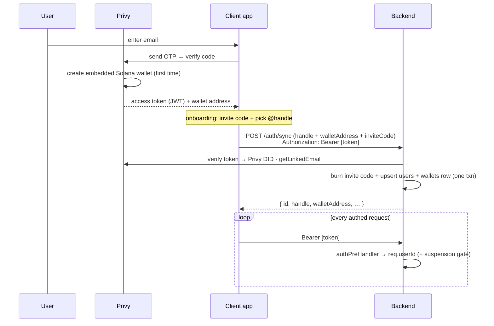

# 02 · Identity & onboarding

## What it is

How a person becomes a user, and the rule the whole identity model hangs on
(**decided 2026-08-13**): **one user = one email = one handle.** Email is the only entrance —
**Privy** runs email-OTP login and silently creates an **embedded Solana wallet** (no seed phrase,
no "connect wallet"), so the wallet is bound to the email identity. The user picks an **`@handle`**
(like Venmo/Cash App) so friends pay them by name, never by address.

Three identities are tracked per person:

- **Privy DID** — the login identity (`did:privy:…`), the source of truth for "who is this
  request" and the DB's identity key (`users.privy_did`, unique).
- **Email** — the entrance. Synced from Privy on every `/auth/sync` (`getLinkedEmail` →
  `coalesce(excluded.email, users.email)` in `db/queries.ts` — Privy's value wins when present).
  Also the admin bootstrap key (`ADMIN_EMAILS` → `isRootAdminEmail`).
  ✅ **Enforced (2026-08-13):** migration 0010 adds a partial unique index (`where email is not
  null`, duplicate-guarded so it fails loudly on dirty data) and `/auth/sync` maps the collision
  to **409 `email_in_use`** — admin resolves which account keeps the address
  ([07-admin-and-moderation](07-admin-and-moderation.md)). 🟡 until `db:migrate` applies on stage;
  before it, "one email" was inherited from Privy's login model, not enforced by us.
- **`@handle`** — the human-facing payment ID; unique, canonical
  (`'@' + [a-z0-9_.]{3,30}`, lowercased/validated server-side). **Users can never change it** —
  not at onboarding's end, not later ("can't be changed later" in onboarding is literally true).
  Only admin edits it, as a support action. A freed handle **releases instantly** — anyone can
  claim it and saved QR codes follow the claimant; Bridge weighed and accepted this
  ("you have to manage your username"). See [07-admin-and-moderation](07-admin-and-moderation.md).

Two optional directory aliases (UPI-mapper style):

- **Phone (E.164)** — strict opt-in: enrolling IS the consent (`users.phone IS NOT NULL` is the
  flag). The number always comes from the caller's own Privy-verified account (`POST /me/phone`);
  resolution never returns the phone (reverse lookup structurally impossible); `?phone=` lookups
  are authed + rate-limited against enumeration.
- **Country (ISO-2)** — a *dialing default only*: browser locale fills-if-null at sync → verified
  phone's code overwrites on enroll → manual Settings pick overwrites (`POST /me/country`). KYC
  document country is deliberately NOT a source (expats). Also seeds the local display currency —
  see [05-fees-fx-and-display](05-fees-fx-and-display.md).

## Flow — login → sync → authenticated requests

On the backend (`apps/backend/src/auth.ts`): `authPreHandler` runs before every route — verifies
the Bearer JWT, maps Privy DID → DB user, sets `req.userId`, and enforces the **suspension gate**
(`users.status != 'active'` → 403 `account_suspended`; admins exempt — see
[07-admin-and-moderation](07-admin-and-moderation.md)). Before the user exists, `/auth/sync` uses
`req.privyDid` to create them. In dev mode (Privy unconfigured) an `x-dev-user-id` header fallback
keeps the API testable; it fetches the user row too, so the gate holds there as well.

## Invite gate — real codes, invite-only

Signup requires a **one-time invite code** (`invite_codes` table — plain-text code PK, minted
objects, not derived strings):

- A code is validated and **burned inside the account-creation transaction** — `select … for
  update` on the single code row is the whole concurrency control; two people racing one code, one
  wins. The gate fires only when sync *creates* the row: existing users are grandfathered, an empty
  database founds itself. Unknown/used/revoked all collapse to one `invalid_invite` (no oracle).
- **Two doors, one "spent".** Signup is one; joining the f list (waitlist) is the other. Both burn
  the same `redeemed_at` — a code spent at either is dead at the other. They differ only in who is
  recorded: `redeemed_by` (user id, UNIQUE — an account burns at most one code, ever) or
  `redeemed_email` (an f-list member with no account yet).
- **Three codes, shown once.** Minted at signup, returned by `/me` only until
  `POST /me/invites/ack` stamps `users.invites_revealed_at` — then never again. Settings shows
  counts only. The admin console is the only place a code stays readable (why they're plain text).
  The reveal lives at `/invites`, reached from the tabs guard — deliberately outside `/onboarding/*`,
  since it is not a step in the chain.
- **Admin mints, lists, revokes** (`/admin/invites`); owner-less codes are *house* codes,
  constrained by nobody's allowance. Revoke = `revoked_at` timestamp, never a delete.
- ✅ **FREN remint (code shipped 2026-08-13; cutover = Bridge runs `scripts/remint-invites.ts`):**
  every existing `FP-XXXX-XXXX` code is bulk-revoked and
  reminted as **`FREN-XXXX-XXXX`** — 3 per user + fresh house codes; in-flight FP redemptions die
  at the cutover (acceptable: revoked codes read as `invalid_invite`). Until it ships, live codes
  are `FP-` format.

## Why this way

- **Email + embedded wallet, not "connect a wallet."** The target user has no wallet and shouldn't
  need one; no seed phrase ever touches them. Onboarding feels like any fintech app.
- **`@handle` over address.** Nobody pays a base58 string; addresses are resolved server-side and
  never shown.
- **DID as the spine, email as the door.** The DB keys on the DID (stable even if Privy's email
  flows evolve); the email is what the human knows and types. One email ↔ one DID ↔ one row.
- **Handles admin-only.** Payment IDs are load-bearing (QRs, links, history) — a support-request
  model beats self-service renames that break inbound references. The instant-release tradeoff was
  chosen consciously over tombstoning.
- **Tiered KYC as a gate, not a wall.** Low-value P2P works at tier 1; documents are asked for only
  when an action legally needs them (progressive KYC).

## KYC

`users.kyc_tier` (0–3) gates money movement server-side against rolling-24h ledger volume
(structured `limit_exceeded` errors): tier 1 caps P2P (~$100/tx, $300/day), tier 2 unlocks
merchant cash-out + external-address sends. The vendor seam is real — `services/kyc/`
(`provider.ts` interface, `didit.ts` vendor, `sim.ts` simulator, `poller.ts` lifecycle) — with
**sim as the active provider on stage** (`STAGE_KYC_PROVIDER=sim`); flipping to Didit is config,
not code. Testing runbook: [10-ops-and-roadmap](10-ops-and-roadmap.md).

## Legalities

- Delegating auth + key custody to Privy means no passwords or private keys stored here — smaller
  breach surface. See [03-custody-money-in-and-confirmation](03-custody-money-in-and-confirmation.md).
- PII held: email (Privy-synced), handle, opt-in phone (removable via `DELETE /me/phone`),
  best-effort country. No retention policy exists yet — stated honestly in
  [08-compliance-and-legalities](08-compliance-and-legalities.md).

## Status

- ✅ Privy email-OTP + embedded wallet, `@handle` selection, `/auth/sync` (burn-in-txn invite
  gate), bearer verification, suspension gate, dev fallback.
- ✅ Directory aliases (phone opt-in, country dialing default). 🟡 Privy-mode phone enrollment
  waits on the **parked OTP-channel decision** (Privy SMS = US/CA-only; WhatsApp = all regions;
  the dashboard choice is irreversible — nothing gets enabled without Bridge).
- ✅ KYC tiers enforced; 🟡 sim provider active (Didit wired, config-flip away).
- ✅ Invite codes as real minted objects (0007/0008). ✅ `FREN-` prefix + remint script (🟡 cutover run pending).
- ✅ Email unique index + 409 collision policy (migration 0010; 🟡 until applied on stage).

## Key files

- Backend: `apps/backend/src/auth.ts`, `services/privy.ts` (`getLinkedEmail`),
  `services/invites.ts` (`mintCode`, `canonicalInviteCode`), `routes/auth.ts` (`/auth/sync`, `/me`,
  `/me/invites/ack`, `/users/resolve`, `/me/phone`, `/me/country`), `routes/waitlist.ts` (the
  f-list door), `db/queries.ts` (`upsertUserByPrivyDid`, `joinWaitlistWithCode`, `mintCodesFor`,
  `canonicalHandle`, `normalizePhone`), `services/kyc/*`.
- Web: `src/services/privy/PrivyBridge.tsx`, `app/onboarding/{faceid,handle}/page.tsx`,
  `app/invites/page.tsx` (the one look), `app/(tabs)/layout.tsx` (the reveal guard),
  `components/sheets/identity.tsx`.
- Admin: `src/app/invites/page.tsx`, `src/app/users/page.tsx`.
- Self-checks: `apps/backend/scripts/check-invites.ts` (pure) · `check-flist-gate.ts` (needs DB).
- Schema: `users`, `wallets`, `invite_codes` — [09-data-model](09-data-model.md).
