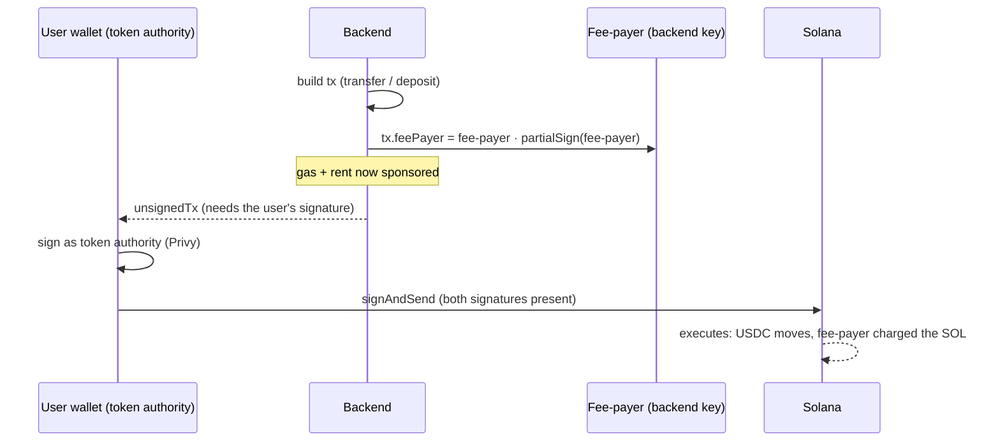

# 03 · Custody & Gas Sponsorship

> This is the **single most important page for understanding the product's legal posture.** The
> custody model is what keeps us out of the heaviest regulation while we build.

## What it is

Two linked decisions:

1. **Self-custody.** The user's funds live in *their own* embedded wallet (a Solana account whose key
   Privy manages for them). The platform **never holds the user's private key** and **never moves
   their money without their signature.**
2. **Gas sponsorship (fee-payer model).** Solana transactions cost a tiny amount of SOL in fees. Users
   don't have SOL and shouldn't have to. So a backend **fee-payer** account pays the network fee (and
   any account-creation rent) on every transaction. The user only ever signs as the **token
   authority** (the owner of the USDC being moved).

The result: the user experiences "tap to pay," while under the hood **they** authorize the movement
and **we** pay the gas.

## Flow — who signs what



Two signatures, two roles:
- **Fee-payer** signs to say *"I'll pay the network fee."* (added server-side, `partialSign`)
- **User** signs to say *"I authorize moving my USDC."* (added client-side, via Privy)

Neither can act alone: the fee-payer can't move the user's tokens (it isn't the token authority), and
the user can't broadcast a fee-less tx (no SOL). This is enforced by Solana itself.

In code (`solana.ts`):
```
tx.feePayer = payer.publicKey;
tx.recentBlockhash = (await connection().getLatestBlockhash()).blockhash;
tx.partialSign(payer);                 // fee-payer sponsors
// → client adds the user (token-authority) signature and broadcasts
const unsignedTx = tx.serialize({ requireAllSignatures: false }).toString('base64');
```

The fee-payer is also the **mint authority** for the controlled devnet USDC (so it can run the
faucet, [04](04-money-in.md)) and the **escrow program authority** (so it can release/refund,
[07](07-onchain-escrow.md)). Its secret is `FEE_PAYER_SECRET_KEY`, loaded once and cached.

## Why this way

- **No SOL for users = no dead-end.** The #1 reason normal users churn out of crypto apps is "now buy
  some gas token." Sponsorship removes it entirely.
- **Self-custody = smaller legal + security surface.** We can't lose what we don't hold. No key vault,
  no "we got hacked and lost customer funds," and a much lighter regulatory classification (see
  Legalities).
- **One seam for everything.** Send, fund-escrow, and faucet all reuse the same prepare→sign→submit
  shape, so the on-chain escrow `deposit` (M2) dropped in with **near-zero client change** — the
  client signer is transaction-agnostic.

## Legalities

- **Money transmission / custody.** Holding customer funds typically triggers **money-transmitter
  licensing** (US state MTLs / FinCEN MSB), an EU **VASP/EMI** registration, or equivalent. A
  **non-custodial** design — where the user holds and authorizes their own funds — generally carries a
  **materially lighter** classification. By never holding the user's key, we stay on the lighter side
  during the build phase. *(Not legal advice; the line is fact-specific and varies by jurisdiction —
  this must be confirmed with counsel before real funds move at M7.)*
- **The escrow caveat.** The one place value sits under *program* control is the per-order escrow. It's
  designed to be **trust-minimized** (the user authorizes the deposit; the program's rules govern
  release/refund; funds are either paid to the merchant or returned to the user), which keeps it closer
  to "conditional settlement" than "custody." Still, **who controls the release authority** (today:
  our fee-payer) is the key legal question for that flow — detailed in [07](07-onchain-escrow.md) and
  [11](11-compliance-and-legalities.md).
- **Gas sponsorship.** Paying users' network fees is a product cost, not a regulated activity — but at
  scale it's an abuse vector (someone could drain the fee-payer with spam), so M6 adds rate-limiting.

## Status

- ✅ Self-custodial embedded wallets; fee-payer gas + rent sponsorship on every transaction; the
  prepare→sign→submit seam; fee-payer doubling as mint + escrow authority on devnet.
- 🟡 The fee-payer is a **single hot key** in env config — fine for devnet, but production needs an
  HSM/KMS or multisig and spend controls (M6/M7).

## Key files

- `apps/backend/src/services/solana.ts` (`feePayer`, `buildUsdcTransfer`, `mintUsdcTo`)
- `apps/backend/src/services/escrowProgram.ts` (fee-payer = escrow authority)
- `apps/backend/src/config.ts` (`FEE_PAYER_SECRET_KEY`), `scripts/setup-devnet.ts` (generates it)
- Client signer: `apps/web/src/services/privy/PrivyBridge.tsx` (`signAndSend`)
