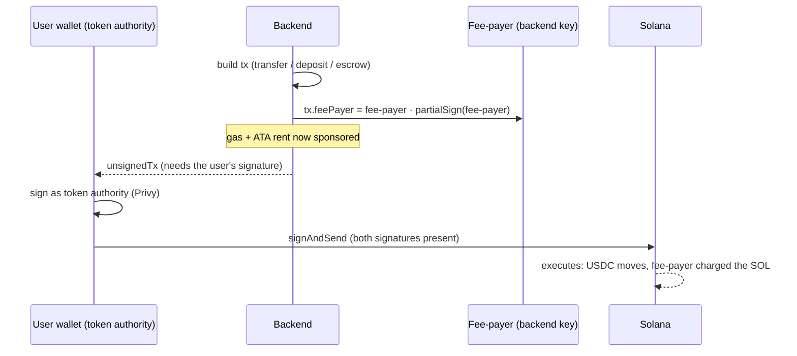
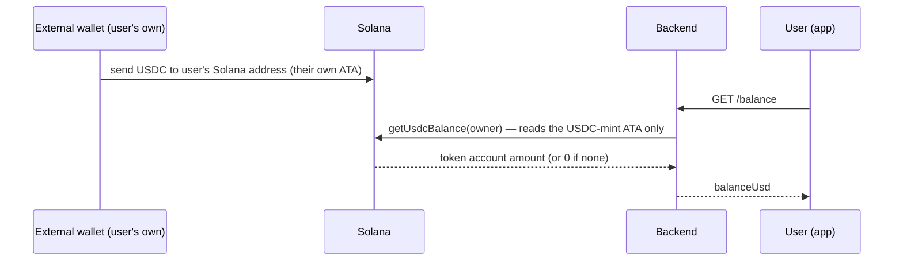
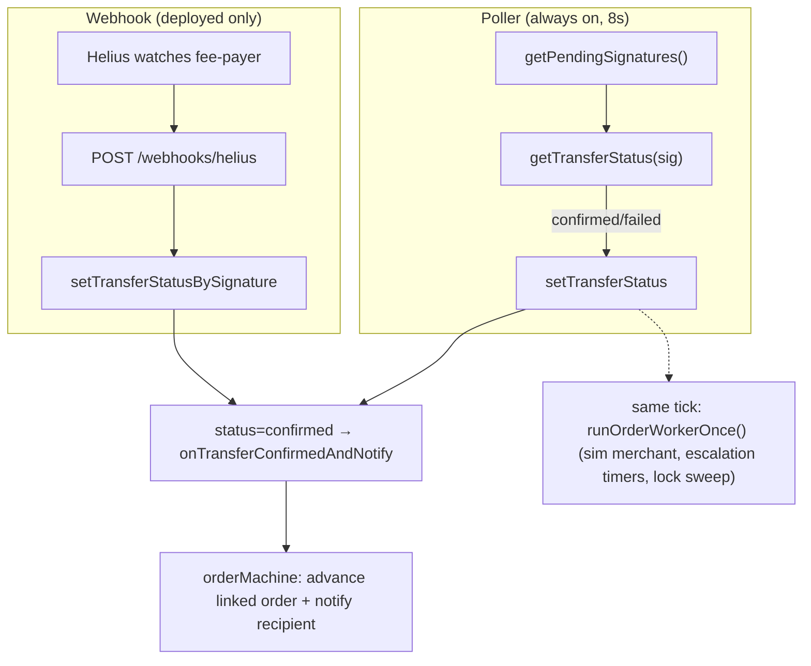

# 03 · Custody, Money In & Confirmation

> This is the **single most important page for understanding the product's legal posture.** The
> custody model is what keeps us out of the heaviest regulation while we build.

## What it is

Three linked pieces, in order: how funds are held, how money enters a balance, and how the backend
learns an on-chain action actually landed.

1. **Self-custody.** The user's funds live in *their own* embedded wallet (a Solana account whose
   key Privy manages for them). The platform **never holds the user's private key** and **never
   moves their money without their signature.**
2. **Gas sponsorship (fee-payer model).** Solana transactions cost a tiny amount of SOL in fees.
   Users don't have SOL and shouldn't have to. A backend **fee-payer** account pays the network fee
   (and any account-creation rent) on every transaction. The user only ever signs as the **token
   authority** (the owner of the USDC being moved).
3. **Money in.** On deployed envs (stage + prod, both mainnet) funding is **USDC-only, deposit-only**:
   send USDC on Solana to the address the app shows you. There is no card/bank/Apple Pay on-ramp yet
   (roadmap — [06](06-offramp-and-settlement.md)) and no receiving-fiat path (also
   [06](06-offramp-and-settlement.md)).
4. **Confirmation.** Solana confirmation is asynchronous — something has to watch the chain and flip
   a database row from `pending` to `confirmed`/`failed`. Two mechanisms do this, always.

The result: the user experiences "tap to pay" and "just send me the address," while under the hood
**they** authorize every movement of their own funds, **we** pay the gas, and a poller + webhook
pair keeps the database honest about what actually happened on-chain.

## Flow — who signs what (self-custody + gas sponsorship)



Two signatures, two roles:
- **Fee-payer** signs to say *"I'll pay the network fee."* (added server-side, `partialSign`)
- **User** signs to say *"I authorize moving my USDC."* (added client-side, via Privy)

Neither can act alone: the fee-payer can't move the user's tokens (it isn't the token authority),
and the user can't broadcast a fee-less tx (no SOL). This is enforced by Solana itself. In code
(`solana.ts`, `buildUsdcTransfer`):

```ts
tx.feePayer = payer.publicKey;
tx.recentBlockhash = (await connection().getLatestBlockhash()).blockhash;
tx.partialSign(payer);                 // fee-payer sponsors
// → client adds the user (token-authority) signature and broadcasts
const unsignedTx = tx.serialize({ requireAllSignatures: false, verifySignatures: false }).toString('base64');
```

The same fee-payer key is also the **escrow-program authority** (`escrowProgram.ts` — it can
release/refund an order's escrow; see [06](06-offramp-and-settlement.md)). It is **not** a mint
authority: devnet now uses Circle's *official* devnet USDC (see Money In below), so the fee-payer
can't create USDC out of thin air on any tier — it can only move what's already in an account it
controls. Its secret is `FEE_PAYER_SECRET_KEY`, loaded once and cached
(a keypair you generate with `solana-keygen`; there is no devnet).

### Drain guards

Every fresh recipient the fee-payer sends to for the first time needs a new Associated Token
Account (ATA), and the fee-payer pays that account's rent — **~0.00204 SOL per fresh recipient**
(the SPL token-account rent-exempt minimum; created via `createAssociatedTokenAccountInstruction` in
`buildUsdcTransfer`, `apps/backend/src/services/solana.ts:130-139`). Spammed against unlimited new
raw-address recipients this is a real abuse vector — `apps/backend/src/routes/money.ts` bounds it
for external (non-`@handle`) sends:

- `MIN_EXTERNAL_SEND_USD = 1` — no dust sends that only exist to burn rent.
- `MAX_EXTERNAL_RECIPIENTS_PER_DAY = 10` (`countRecentExternalRecipients`, `db/queries.ts`) — caps
  distinct new external recipients per sender per rolling 24h.
- External sends additionally require KYC tier ≥ `KYC_APPROVED_TIER` (403 `limit_exceeded`
  otherwise) — see [08](08-compliance-and-legalities.md).

In-app `@handle` sends aren't rate-limited the same way because the recipient set is the whole
user base, not an attacker-chosen address, and per-user daily send caps (`checkSendLimit`) already
bound total volume.

## Flow — money in

**Today, on deployed envs (stage + prod, both mainnet):** deposit-only. The `AddMoney` sheet shows
the user's own Solana address with an explicit network label —
`apps/web/src/components/sheets/AddMoney.tsx:86`: *"Solana · only send on this network"* — plus a
standing warning underneath (`AddMoney.tsx:118`): *"Send only USDC on {network}. Funds sent on
another network can't be recovered."* There is no server-side action here: the balance the app
shows is read live off-chain by the same call the rest of the app uses.



`getUsdcBalance` (`apps/backend/src/services/solana.ts:98-110`) derives the ATA for `usdcMint()` and
`owner`, and reads **that account only**. State it plainly: **any other SPL token sent to the
wallet is not credited, not shown, and not recoverable through the app** — the app has no concept
of any asset but USDC. This is the actual enforcement today: the deposit screen tells the user what
to send, and the balance/read path only ever looks at the USDC ATA.

⬜ **decided 2026-08-13, gap to close** — Privy's `useFundWallet` hook accepts a `FundWalletConfig`
with an `asset` field that can restrict funding to `'USDC'`; nothing in this codebase currently
wires that up (`apps/web/src/services/privy/PrivyRoot.tsx` configures only `embeddedWallets`
creation, and `useFundWallet`/`fundWallet(` don't appear anywhere under `apps/web/src`). The app's
deposit UI is entirely custom (`AddMoney.tsx`), so Privy's native funding flow isn't in the picture
at all today — this line is a candidate lever if that changes, not a claim it's wired up.

⬜ **decided 2026-08-13, gap to close** — a direct on-chain deposit updates the *balance* (read live
from the chain) but does **not** appear in transaction history. `listTransactionsForUser`
(`apps/backend/src/db/queries.ts:331`) only reads the `transfers` table, and nothing in this repo
indexes or watches for arbitrary incoming SPL transfers to a user's ATA — the Helius webhook only
watches the **fee-payer's** address (see Confirmation below), and a wallet-to-wallet external send
never touches the fee-payer. A user who deposits this way sees their balance jump with no matching
activity row.

**There is no faucet.** `POST /devnet/faucet`, `sendUsdcFromTreasury` and the onboarding "Add
your first dollars" step were deleted on 2026-08-30 when the testnet tier went away: a faucet on
mainnet is a drain on the fee-payer's ATA, and there is no other tier. Money-in is deposit-only —
Add money shows the deposit address; the handle step finishes onboarding.

**Also exists, ops-gated off — CCTP smart-wallet inbound deposit.** `apps/backend/src/routes/crosschain.ts`
and the `AddMoney` sheet's EVM chips (Base/Arbitrum/Ethereum) implement a real inbound rail: the
user's Privy smart wallet on an EVM chain burns USDC via a sponsored userOp, Circle's CCTP attests
it, and it mints into the user's *own* Solana ATA. It's gated behind `evmMinterConfigured()`
(`services/bridge/cctp/evm.ts:45` — needs an EVM minter key + three per-chain RPC URLs configured),
and the EVM chips are hidden outright on mainnet today (`AddMoney.tsx:29`, "the smart-wallet bridge
(CCTP) is off there, so USDC sent to the EVM address would strand"). One line is all this doc needs
— full mechanics and mainnet rollout are [06-offramp-and-settlement](06-offramp-and-settlement.md).

## Flow — confirmation pipeline



1. **Confirmer poller** (`apps/backend/src/services/confirmer.ts`) — every **8 seconds**
   (`startConfirmer(intervalMs = 8000, ...)`), resolves every pending+broadcast transfer via
   `getTransferStatus` and persists a terminal status. It has a re-entrancy guard (`running` flag) so
   a slow RPC pass never overlaps the next tick, and it's a no-op without a database and a configured
   mint. **Always on, the designed fallback.**
2. **Helius webhook** (`apps/backend/src/services/helius.ts` + `POST /webhooks/helius` in
   `apps/backend/src/routes/webhooks.ts`) — Helius *pushes* the moment a watched transaction lands.
   Registration is skipped, logged, and falls back cleanly when `HELIUS_API_KEY` or
   `PUBLIC_BASE_URL` is unset (`registerHeliusWebhook`, `helius.ts:18-22`) — i.e. it's only active on
   a deployed backend with a public URL. Locally the poller carries confirmation alone.

Both write through the same downstream path (`setTransferStatus[BySignature]` →
`onTransferConfirmedAndNotify`), so they're interchangeable and idempotent — a double-delivery is
harmless (`confirmer.ts:24`, "if the webhook finalized this row first, don't double-advance/notify").

**Why watching the fee-payer catches sponsored transfers:** the fee-payer signs every sponsored
transaction (in-app sends, escrow deposits/releases, the faucet), so one Helius subscription on the
fee-payer address sees all of them (`helius.ts:2-3`). It does **not** see a raw external-wallet
deposit that never touches the fee-payer — that's the gap called out above.

**The poller does double duty.** Each 8s tick also calls `runOrderWorkerOnce()` (the simulated
merchant + order-escalation clock, [06](06-offramp-and-settlement.md)), retires stale unsigned
transfers (`expireStaleUnsignedTransfers`), **reclaims lapsed order locks** (`sweepExpiredLocks` —
an unpaid lock returns to the pool, the LP is told, and repeated abandonment earns a lock timeout),
and every 10th tick recomputes merchant stats (`recomputeMerchantStats`). The confirmer is both the
chain-watcher and the heartbeat for everything else on a clock — and the lock sweep rides it rather
than adding a sixth timer *because* these loops are unguarded against a second replica
([10](10-ops-and-roadmap.md)); one more timer is one more thing to make safe later.

**Order + notification advancement.** `onTransferConfirmedAndNotify` (`orderMachine.ts:180-190`)
calls `onTransferConfirmed` (advances any linked order: an `escrow_fund` confirmation →
`payment_detected`; an `escrow_release` confirmation → `completed`), then credits merchant stake if
the recipient was the stake treasury, advances any cross-chain bridge companion leg, and fires the
in-app "X sent you $Y" notification for a confirmed P2P send.

## Why this way

- **No SOL for users = no dead-end.** The #1 reason normal users churn out of crypto apps is "now
  buy some gas token." Sponsorship removes it entirely.
- **Self-custody = smaller legal + security surface.** We can't lose what we don't hold. No key
  vault, no "we got hacked and lost customer funds," and a materially lighter regulatory
  classification (see Legalities).
- **One seam for everything.** Send, escrow-fund, and the faucet all reuse the same
  prepare→sign→submit shape, so new transaction types (the on-chain escrow deposit, the CCTP burn)
  drop in with near-zero client change — the client signer is transaction-agnostic.
- **Deposit-only, USDC-only for now.** A real on-ramp needs a licensed partner, KYC-at-funding, and
  settlement plumbing — none of which should block the product. Restricting money-in to "send USDC
  you already have" keeps the surface small while every other flow (send, request, cash-out) gets
  built on real balances.
- **Webhook + poll, not one or the other.** The webhook is fast but depends on external infra and a
  public URL; the poller is slower but unconditional. Running both means push speed where it's
  available and guaranteed convergence everywhere else.
- **Keyed off the signature row.** Confirmation logic only needs `transfers.signature` + status, so
  it's fully decoupled from *what* the transaction did. New transaction kinds (bridge legs, escrow)
  plugged in with zero confirmer change.

## Legalities

- **Money transmission / custody.** Holding customer funds typically triggers **money-transmitter
  licensing** (US state MTLs / FinCEN MSB), an EU **VASP/EMI** registration, or equivalent. A
  **non-custodial** design — the user holds and authorizes their own funds — generally carries a
  **materially lighter** classification. By never holding the user's key, the platform stays on the
  lighter side during the build phase. *(Not legal advice; the line is fact-specific and
  jurisdiction-dependent — confirm with counsel before real funds move at scale.)*
- **The escrow caveat.** The one place value sits under *program* control is the per-order escrow
  ([06](06-offramp-and-settlement.md)). It's designed to be trust-minimized — the user authorizes the
  deposit, the program's rules govern release/refund — which keeps it closer to "conditional
  settlement" than "custody." Who controls the release authority (today: the fee-payer) is the key
  legal question for that flow ([08](08-compliance-and-legalities.md)).
- **Gas sponsorship.** Paying users' network fees is a product cost, not a regulated activity — but
  at scale it's an abuse vector, hence the drain guards above.
- **Money-in as the regulated edge.** Deposit-only USDC has no fiat-conversion moment, so no
  on-ramp licensing applies yet. The instant a card/bank/Apple Pay on-ramp lands
  ([06](06-offramp-and-settlement.md)), it needs a licensed partner and KYC enforced *before*
  funding — see [08](08-compliance-and-legalities.md).
- **Settlement finality & reconciliation.** A payments system must know, provably, whether money
  moved. The confirmation pipeline ties every sponsored-transfer DB row to an on-chain signature with
  a terminal status — the foundation for audit, dispute resolution, and reconciliation. The
  unindexed-direct-deposit gap above is a real hole in that story and should close before deposits
  are the primary funding path at scale.

## Status

- ✅ Self-custodial embedded wallets; fee-payer gas + ATA-rent sponsorship on every transaction; the
  prepare→sign→submit seam; fee-payer as escrow-program authority.
- ✅ External-send drain guards (min $1, 10 new recipients/24h, KYC-tier gate).
- ✅ Deposit-only USDC money-in on deployed envs; deposit-screen network + asset copy in `AddMoney.tsx`.
- ✅ Confirmer poller (8s) with order advancement + worker tick + stale-transfer expiry; Helius
  webhook registration (idempotent) and handler with optional shared-secret auth.
- 🟡 Webhook is only active when deployed with `HELIUS_API_KEY` + `PUBLIC_BASE_URL`; locally the
  poller alone carries confirmation. No Redis-backed retry/backoff queue (multi-instance scale step).
- 🟡 CCTP smart-wallet inbound deposit exists in code but is ops-gated (`evmMinterConfigured()`) and
  hidden outright on mainnet — [06](06-offramp-and-settlement.md).
- 🟡 The fee-payer is a **single hot key** in env config — fine pre-launch, but production at scale
  needs an HSM/KMS or multisig and spend controls.
- ⬜ decided 2026-08-13, gap to close — Privy funding-config asset restriction (`FundWalletConfig.asset`)
  isn't wired up; not load-bearing today since the app's deposit UI is fully custom, not Privy's.
- ⬜ decided 2026-08-13, gap to close — direct on-chain deposits change the balance but don't appear
  in transaction history; no indexer watches arbitrary incoming transfers to user ATAs.
- ⬜ Real fiat on-ramp (card/bank, licensed partner, KYC-gated) and fiat receiving — roadmap,
  [06](06-offramp-and-settlement.md).

## Key files

- `apps/backend/src/services/solana.ts` (`feePayer`, `buildUsdcTransfer`, `getUsdcBalance`, `getTransferStatus`)
- `apps/backend/src/services/escrowProgram.ts` (fee-payer = escrow authority)
- `apps/backend/src/routes/money.ts` (`/balance`, `/transfer/prepare|submit`, drain
  guards), `apps/backend/src/routes/crosschain.ts` (CCTP inbound/outbound)
- `apps/backend/src/services/confirmer.ts` (`confirmPendingOnce`, `startConfirmer`)
- `apps/backend/src/services/helius.ts` (webhook registration), `apps/backend/src/routes/webhooks.ts`
  (`/webhooks/helius`)
- `apps/backend/src/services/orderMachine.ts` (`onTransferConfirmed`, `onTransferConfirmedAndNotify`)
- `apps/backend/src/db/queries.ts` (`getPendingSignatures`, `setTransferStatus[BySignature]`,
  `expireStaleUnsignedTransfers`, `listTransactionsForUser`,
  `countRecentExternalRecipients`)
- `apps/backend/src/envConfig.ts` (`FEE_PAYER_SECRET_KEY`, `USDC_MINT` — defaults to Circle's mainnet mint)
- Web: `apps/web/src/components/sheets/AddMoney.tsx`, `apps/web/src/app/onboarding/fund/page.tsx`,
  `apps/web/src/services/privy/PrivyRoot.tsx`, `apps/web/src/services/envConfig.ts`
