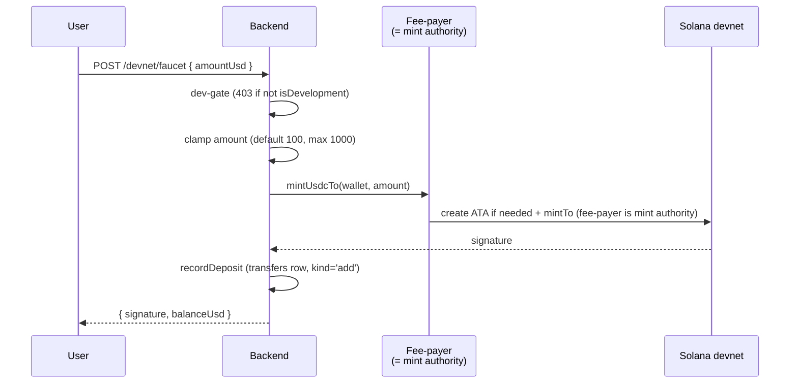
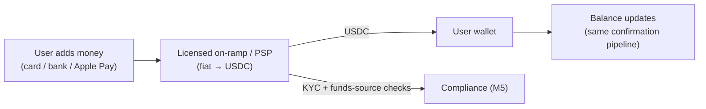

# 04 · Money In (Funding the balance)

## What it is

How dollars get into a user's balance. **On deployed envs (stage + prod, both mainnet) this is
deposit-only**: send real USDC to the address shown in Add money — the faucet UI is hidden and the
endpoint 403s. The **devnet faucet exists only in local dev**: the backend *mints* controlled
test-USDC straight into the user's wallet. Eventually this becomes a real **on-ramp** — the user
adds money with a debit card / bank transfer / Apple Pay and a licensed partner converts fiat
→ USDC. The faucet is the single most "test-environment" part of the app and is **dev-gated**.

## Flow — today (devnet faucet)

The backend's fee-payer is the **mint authority** of the controlled devnet USDC mint (created by
`scripts/setup-devnet.ts`), so it can both pay the gas and mint the tokens — no external faucet, no
rate-limited public airdrop. The route is hard **403** unless `config.isDevelopment`.

There's also a secondary **"deposit by address"** path in the web `AddMoney` sheet (show the wallet
address, user sends USDC to it) — this is the most crypto-native surface left in the app and a
candidate to hide/relabel for normal users.

## Flow — future (real on-ramp, M7)

The internals downstream (balance read, transaction history, the confirmation pipeline) **don't
change** — only the *source* of the USDC flips from "we mint it" to "a partner sells it to the user."

## Why this way

- **Faucet-first keeps us building, not integrating.** A real on-ramp means a licensed partner,
  contracts, KYC, and settlement plumbing — none of which should block building the *product*. Minting
  test-USDC gives a realistic balance to exercise every other flow.
- **Reuse the fee-payer as mint authority.** One controlled mint we own means deterministic balances
  in dev and zero dependence on flaky public devnet airdrops.
- **Dev-gated, clamped.** `isDevelopment` + a 1000-cap means the faucet can never exist in prod or be
  abused for unbounded mint.

## Legalities

- **On-ramp = the regulated edge.** Converting fiat to crypto for customers is exactly the activity
  that needs a **licensed partner** (a registered PSP / MSB / VASP), plus **KYC** and
  **source-of-funds** checks at the moment money enters. This is deliberately **deferred to M7**, and
  the faucet is explicitly **not** a money-movement feature — it mints valueless devnet tokens.
- **No real value today.** Because the mint is a controlled devnet token with no market value, the
  faucet moves nothing of legal consequence. The moment a real on-ramp lands, KYC (M5) must be
  enforced *before* funding, and the partner's licenses cover the fiat leg.

## Status

- ✅ Devnet faucet (`/devnet/faucet`) — mints controlled USDC, records a deposit, returns new balance;
  dev-gated and clamped.
- 🟡 **"Add money" is still a faucet under the hood**, but the **de-crypto pass cleaned the copy** —
  *"Test dollars on devnet"* → *"Added to your balance instantly"*, *"Or deposit USDC"* → *"Or add
  manually"*. The user no longer sees the test/crypto nature; the *funding mechanism* is still a faucet.
- ⬜ **Real on-ramp** (card/bank, licensed partner, KYC-gated) — **M7**.

## Key files

- Backend: `apps/backend/src/services/solana.ts` (`mintUsdcTo`), route `/devnet/faucet` in
  `routes/index.ts`, `db/queries.ts` (`recordDeposit`).
- Setup: `apps/backend/scripts/setup-devnet.ts` (creates the controlled mint, funds test users).
- Web: `src/components/sheets/AddMoney.tsx`, `app/onboarding/fund/page.tsx`.
