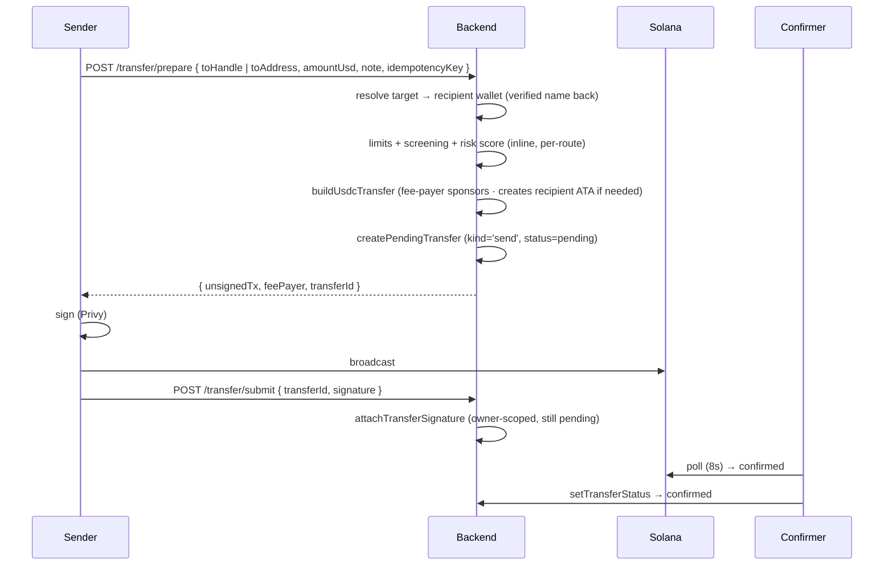

# 04 · P2P, contacts & the home screen

## What it is

The Venmo/Cash App core: **send money by `@handle`, phone number, or wallet address**, and
**request money**. Sends are real on-chain USDC transfers, gas-sponsored so they feel instant and
free. Requests are lightweight DB records that link to the transfer that fulfils them. Around it,
the **minimal home** (decided 2026-08-13): **Add and Send. Nothing else.**

**Who you can pay** — every target kind funnels into the same
resolve → **verified payee name** → confirm → send flow (the UPI anti-wrong-send model):

- **`@handle`** — exact directory match (canonical, case-insensitive input).
- **Phone number** — opt-in directory alias; `+`-prefixed input resolves directly, local-format
  input defaults to the sender's country dialing code (`98765 43210` in India → `+91…`), including
  `tel:` QRs and bare printed numbers. Unknown country → the UI asks for the `+code`, never guesses.
- **Wallet address** — external send (tier-2 KYC gated; Solana executes, EVM-family addresses get
  the honest "coming soon" network sheet). The only place chain names appear besides on/off-ramp.
  **This is also the app's "withdraw"**: moving USDC to your own external wallet is an ordinary
  send — there is deliberately no separate Withdraw flow (decided 2026-08-13, "covered by send").
  Fiat cash-out to a bank/UPI is roadmap ([10-ops-and-roadmap](10-ops-and-roadmap.md)).
- **Someone not on the app** — future phase: pay a phone number and the money lands in the UPI ID
  linked to that number (needs the licensed payout rails —
  [06-offramp-and-settlement](06-offramp-and-settlement.md) / roadmap). Today the answer is the
  invite loop: share a code, they join, then it's an internal transfer.

## Flow — send money

The two-call shape (`prepare` → `submit`) is the universal seam from
[01-architecture](01-architecture.md): the backend records *intent* at prepare, so submit only
needs id + signature. Prepare is idempotent (unsigned row → same transfer rebuilt; signed → 409),
which is what makes the client's blockhash-expiry retry safe. Compliance controls are **inline in
the prepare handler**, not middleware — any new money-moving route must re-attach them explicitly.

## Flow — request money

A request is a row in `payment_requests` ("you owe me $X" — a message, not held funds, so no
escrow). Paying it is an ordinary send; `POST /requests/:id/pay` links the fulfilling `transferId`
and marks it `paid`; the requester can cancel while open. Known accepted limitation: the payee
handle is resolved at pay time, so an admin rename between request creation and payment briefly
points at the old handle (self-corrects within one 12s refresh —
[07-admin-and-moderation](07-admin-and-moderation.md)).

## Flow — trips, circles and splitting

A **group** is a named roster (`groups`, `group_members`; the owner is a member from the first
statement, and membership is the read gate on every group query). An **expense** is an ordinary
transfer the payer put in a group (`transfers.group_id`; `PATCH /transfers/:id` moves it, `null` =
personal — the payer's own rows only, of the kinds that are spend, never one that settled a share).
A **share** is a `payment_requests` row naming the expense it divides (`split_of`): requester = the
payer, addressee = the friend, amount = their part, `note` = what it was for ("Dinner").
`POST /transfers/:id/split` replaces the open shares (and the ones ticked "already paid" by hand —
re-splitting is how a wrong tick is undone) in one transaction under `FOR UPDATE`, keeps the ones a
transfer actually settled, and refuses a set whose sum exceeds the bill (`lib/split.ts`,
`check:split`). **The payer's own part is never stored** — it is `amount − Σ shares(open|paid)`,
computed in the feed (`your_part_usdc`) and the trip view.

Settling a share IS paying a request: the Requests block shows "@a asks you $20 · Dinner", the
friend pays, `markRequestPaid` links the transfer — which now must be the payer's, to the requester,
unfailed, for at least the amount, and unused (`uq_payment_requests_transfer`). Before 0026 any id
marked any debt paid.

**The spend rule.** An outgoing row counts at *your part*; an incoming row never counts. The netting
happens once, on the row you paid, so a friend's reimbursement must not be netted again — which is
why there is no reconciliation table: the receivable is an open request, its settlement an incoming
transfer that carries `settlesNote` and adds nothing to spend. The one exception is a refunded
scan-and-pay: its money came back as an incoming `escrow_release`, so the original row's part is 0.
Activity is cash-basis (a friend's unpaid share is not their expense until they pay it); the trip
sheet is accrual (an open share is already your part). Trip totals exclude settlements and refunds.

Where it lives: Activity (Home stays Add · Send). "Spent this month" over "Your share" on the
summary card (client-summed over the loaded page — server-side when the client pages); a
Trips & circles strip; filters All · Personal · Trips; a row's caption "your part $20" / "settles
Dinner". The trip view is a sheet (`packages/app/src/sheets/groups.tsx`), one implementation for both
renderers; splitting and moving happen from a row's detail page and inside the trip. Equal splits
are cents (`splitEqual`, `@fpay/shared`): everyone but the payer rounds down, the payer keeps the
remainder — the one direction that can never make the parts exceed the bill.

Not built, on purpose: netting across a trip ("who owes whom overall"), non-fpay members (contacts
sync is not built either), an archive state (delete moves the expenses back to personal, shares
intact), a server-side spend aggregate, a "split this" button on the payment-complete sheet.

## Contacts — "Send to Contacts"

On web this is complete, and the picker is the honest maximum — the Contact Picker API is a
one-shot, gesture-gated pick with no persistent access, shipped only on Android (Chrome, Samsung
Internet); iOS Safari keeps it behind a flag and no desktop browser has it. A real address-book
*sync* (match everyone, keep it fresh) is a native-app capability — deliberately NOT built: the
phone app uses the system picker too (one contact the user chose, [12](12-mobile-app.md)).

- ✅ **Directory resolve** — `GET /users/resolve?handle=|phone=` (authed, rate-limited), consent
  model in [02-identity-and-onboarding](02-identity-and-onboarding.md).
- ✅ **PeopleSearch** (`apps/web/src/components/sheets/friends.tsx`) — one search box accepting
  name / `@handle` / phone / pasted address, debounce-resolving with the verified name shown.
- ✅ **Device contact picker** (`apps/web/src/lib/contacts.ts`) — Web Contact Picker API,
  Android-Chrome only, graceful no-op elsewhere; a picked contact's number prefills the search.
- ✅ **Contacts lead the Send sheet** (decided 2026-08-13) — where the device has a picker,
  "Pay your contacts" sits above the search box; elsewhere the search box is the sole, and so
  still leading, element. A picked number that isn't on fpay gets the invite answer above.

## The home screen ⬜ decided 2026-08-13, gap to close

Today's home grid is Scan / Send / Request / Add (`apps/web/src/app/(tabs)/home/page.tsx`), plus
the bottom nav's center Scan button. Decided: the grid becomes **Add · Send** — Scan and Request
leave the grid ("Rest UI doesn't need other unnecessary items"). Scan stays reachable from the
bottom nav; Request stays reachable inside the social surfaces (a request is still payable). The
balance hero above the grid follows the dual-currency + eye-hide spec in
[05-fees-fx-and-display](05-fees-fx-and-display.md).

## Why this way

- **Handles + server-side resolution.** The sender types a name; the backend resolves the wallet
  and sponsors the recipient's token account (ATA) on first receive — the recipient needs nothing
  set up.
- **Record-intent-first.** A dropped signature leaves a clean, expirable row (the confirmer retires
  stale unsigned transfers), never a lost payment.
- **No separate Withdraw.** One send primitive with one set of guards beats two flows that move
  money the same way — and "withdraw" framing invites fiat expectations the rails don't meet yet.
- **P2P sends are free** — no conversion happens, so no fee exists
  ([05-fees-fx-and-display](05-fees-fx-and-display.md)). Free P2P is a growth feature, not a loss.

## Legalities

- **Self-custodial sends are the user moving their own money** — not the platform transmitting on
  their behalf; the lighter classification
  ([03-custody-money-in-and-confirmation](03-custody-money-in-and-confirmation.md)).
- **Limits + screening enforced**: tier-1 caps (~$100/tx + rolling daily, aggregated over
  `kind='send'`), sanctions/denylist screening on recipients, risk scoring; external sends add the
  tier-2 gate, $1 minimum, and a new-recipients/day cap (fee-payer ATA-rent drain guard).
- **AML / travel rule** at real scale reads the `transfers` ledger — the data foundation is already
  the ledger's job ([08-compliance-and-legalities](08-compliance-and-legalities.md)).

## Status

- ✅ Send by handle / phone / address (prepare+submit, sponsorship, ATA auto-create, idempotent
  prepare, verified-name confirm), requests (create/pay/cancel), limits + screening, confirmation
  via poller/webhook.
- ✅ Contacts building blocks (directory, PeopleSearch, Android-Chrome picker).
- ✅ Trips & circles + bill splitting (0026, 2026-09-02): groups, shares-as-requests, move/split,
  the your-part feed and Spent/Your-share card, the trip sheet — web + mobile; stage walkthrough pending.
- ⬜ Home grid → Add · Send (decided 2026-08-13). ⬜ "Send to Contacts" as the leading Send entry.
- ✅ Mobile renders the same send/request sheets from `@fpay/app`; contacts = the system picker
  (one contact, no sync) — device verification pending ([12](12-mobile-app.md)).

## Key files

- Backend: `apps/backend/src/routes/money.ts` (`/transfer/prepare`, `/transfer/submit`,
  `/requests*`), `routes/auth.ts` (`/users/resolve`), `services/solana.ts` (`buildUsdcTransfer`),
  `db/queries.ts` (`createPendingTransfer`, `attachTransferSignature`, `markRequestPaid`).
- Web: `src/components/sheets/friends.tsx` (Send/Request + PeopleSearch), `src/lib/contacts.ts`,
  `src/app/(tabs)/home/page.tsx`, `src/components/BottomNav.tsx`,
  `packages/shared/src/payTarget.ts` (QR/target parsing).
- Trips & splitting: `routes/groups.ts`, `money.ts` (`PATCH /transfers/:id`, `/transfers/:id/split`),
  `db/queries.ts` (`replaceShares`, `getGroupDetail`, `EXPENSE_SQL`), `lib/split.ts` + `scripts/check-split.ts`,
  `packages/shared/src/split.ts` (`splitEqual`), `packages/app/src/sheets/groups.tsx`.
- Schema: `transfers`, `payment_requests`, `groups`, `group_members` — [09-data-model](09-data-model.md).
