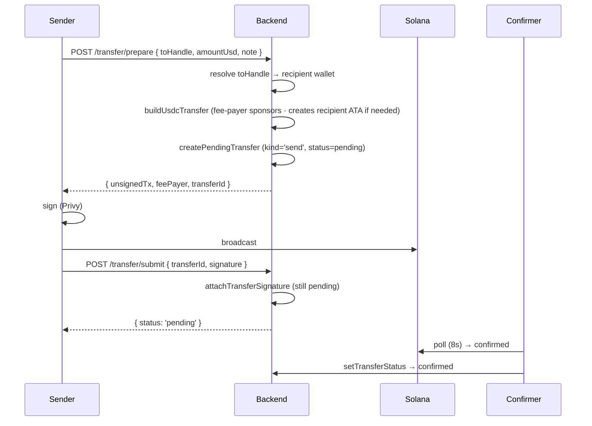
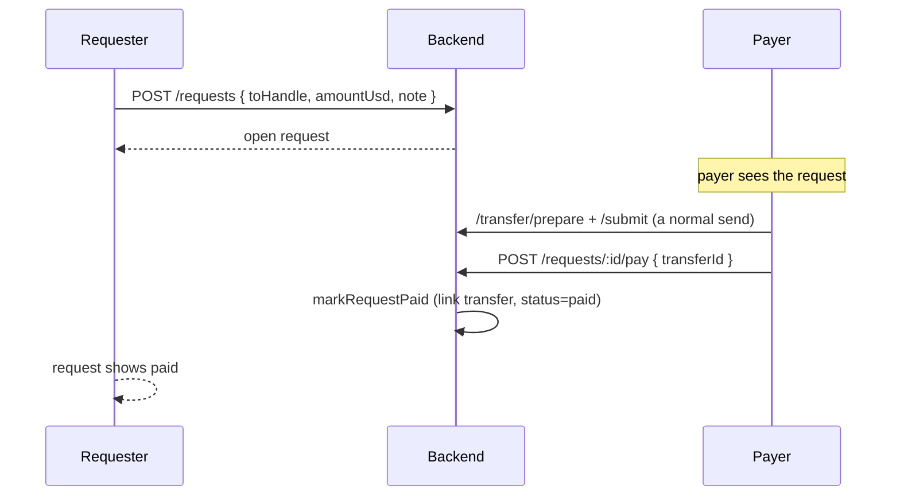

# 05 · P2P Send & Request

## What it is

The Venmo/Cash App core: **send money to a friend by `@handle`**, and **request money** from someone.
Sends are real on-chain USDC transfers, gas-sponsored so they feel instant and free. Requests are
lightweight DB records that, when paid, link to the transfer that fulfilled them. This is the **M0
base wallet** — the oldest, most complete part of the app.

## Flow — send money

The two-call shape (`prepare` then `submit`) is the universal seam from [01](01-architecture.md): the
backend records the *intent* at prepare time so submit only needs the id + signature. Status starts
`pending` and the [confirmation pipeline](09-confirmation-pipeline.md) flips it.

## Flow — request money

A request is just a row in `payment_requests`. Paying it is an ordinary transfer; `/requests/:id/pay`
links the fulfilling `transferId` and marks it `paid`. The requester can `/requests/:id/cancel` while
it's still open.

## Why this way

- **Handles + server-side resolution.** The sender types a name; the backend resolves it to a wallet
  and creates the recipient's token account (ATA) if it's their first time receiving — sponsored, so
  the recipient needs nothing set up in advance.
- **Record-intent-first.** Creating the pending transfer at prepare time means a dropped signature
  leaves a clean, expirable row (the confirmer retires stale unsigned transfers) rather than a lost
  payment.
- **Requests are not escrow.** A request is a *message* ("you owe me $X"), not held funds — so it's a
  trivial DB record, not an on-chain primitive. Only **merchant payouts** need escrow ([07](07-onchain-escrow.md)).

## Legalities

- **P2P money transfer** between identified users is generally the *lightest* activity in the app, but
  it's still where **transfer limits and KYC tiers** belong (tier 1 caps small amounts; larger sends
  should require verification). These limits are now **enforced** (M5): tier 1 caps P2P at $100/tx plus
  a rolling daily cap, checked server-side with sanctions screening on the recipient.
- **AML / travel rule.** At real scale, P2P flows need transaction monitoring and (above thresholds)
  originator/beneficiary information sharing. Not in scope until real rails; the `transfers` ledger is
  the data foundation those checks will read.
- **Funds are the user's own.** Because it's self-custodial (03), a send is the user moving their own
  money — not the platform transmitting on their behalf — which is the lighter classification.

## Status

- ✅ Send (`/transfer/prepare` + `/submit`), gas sponsorship, recipient ATA auto-creation, handle
  resolution, balance + history, payment requests (create/pay/cancel), confirmation via poller/webhook.
- ✅ **Mobile parity exists for P2P** (this is the part the Expo app *does* have; it lacks only the
  cash-out order flow).
- ✅ **Transfer limits enforced (M5)** — tier-1 caps P2P at $100/tx + a rolling daily cap, with
  sanctions screening on the recipient; over-limit returns a structured `limit_exceeded`.

## Key files

- Backend routes: `/transfer/prepare`, `/transfer/submit`, `/requests*`, `/users/resolve` in
  `routes/index.ts`; `services/solana.ts` (`buildUsdcTransfer`); `db/queries.ts`
  (`createPendingTransfer`, `attachTransferSignature`, `createRequest`, `markRequestPaid`).
- Web: `src/components/sheets/friends.tsx`, `src/services/*`.
- Schema: `transfers`, `payment_requests` (see [10-data-model](10-data-model.md)).
