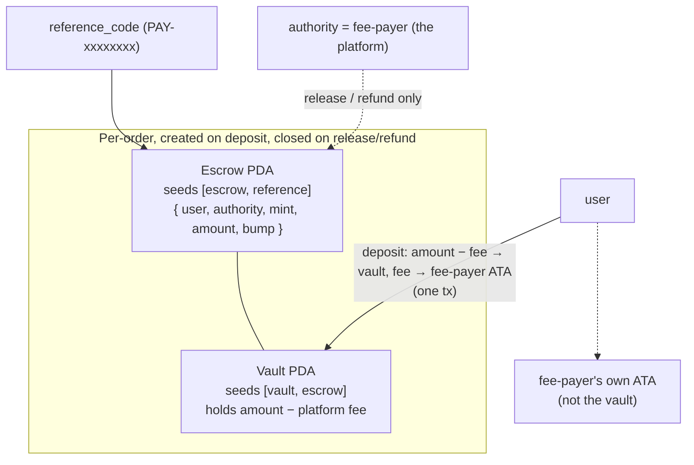
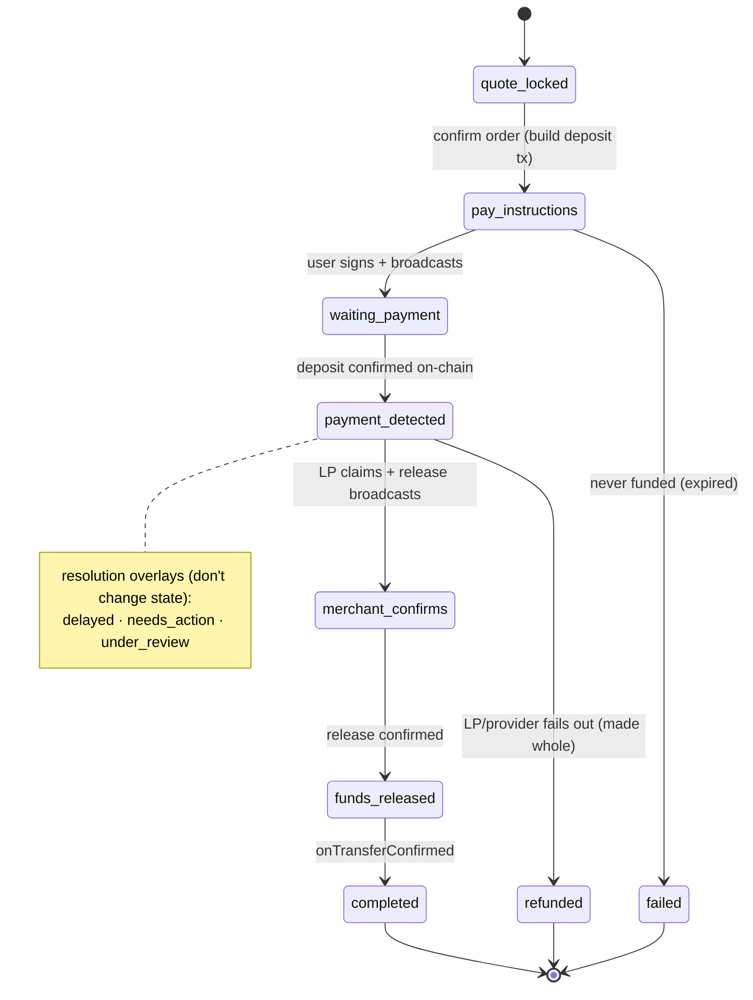
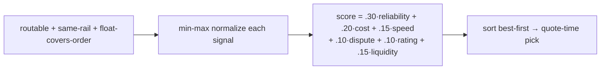

# 06 · Off-ramp & Settlement

## What it is

Cash-out / merchant-pay, told as **one machine**: a locked quote → an on-chain escrow deposit → a
routing/scoring pass over an LP marketplace (with silent failover) → a payout claim → confirmation.
A second, orthogonal layer decides **who is on the other side of that trade, per corridor**: an
external liquidity-provider (LP) marketplace (`model: 'lp'`) or the platform itself, settling
through a licensed payout vendor (`model: 'provider'`). That choice is a per-country licensing
commitment, not a UX toggle — it's the second half of this doc.

**This is 503-gated on every deployed environment today.** `config.isMainnet` (`envConfig.ts`) is
true whenever the configured SPL mint is Circle's real mainnet USDC — which it is on both stage and
prod (mainnet-lite, [01](01-architecture.md)). `routes/orders.ts` checks it first thing on both
`POST /orders/quote` and `POST /orders` and returns `503 payments_unavailable`: the Anchor escrow
program isn't deployed to mainnet yet, so merchant-pay can't run there. Everything below is real,
tested, and running on **devnet** in local dev; nothing here moves real money yet.

## Flow — quote → escrow → routing → claim → confirm

**1 · Quote (locked 45s).** `quoteEngine.createQuote` ranks LPs on a provisional USDC amount (live
mid rate, no spread), takes the top-ranked LP, then prices the real quote off *that* LP's
`spread_bps` plus the platform's own cut, both shaved off the live mid (`getMidRate`, per-currency,
cached + range-validated): `amountUsdc = amountFiat / rate`, rate rounds down, USDC owed rounds up —
the same money law as [01](01-architecture.md#money--decimals). The user sees only the all-in rate —
**the fee is never a line item**; sizing/display is [05](05-fees-fx-and-display.md)'s subject, not
restated here. The quote locks 45s (`QUOTE_TTL_MS`), re-checked for expiry on confirm.

**2 · Escrow deposit (Anchor PDA).** Confirming a quote builds one user-signed `deposit` tx on the
same prepare/sign/submit seam as everything else in [01](01-architecture.md):

Program id (devnet): `9UfJyNduUw6hJexd7zbwc6ivqPLs2ie2edQrqYAYVv3i`, Anchor 0.32. `deposit` /
`release` / `refund` are the only three instructions; escrow + vault are PDAs that get **closed**
on release or refund, so a second release/refund is impossible on-chain — no backend lock needed.
The platform's in-rate cut splits off **atomically in the deposit tx itself**: the vault only ever
holds the LP's portion (`amount − platform_fee_usdc`), and the fee rides a plain transfer to the
fee-payer's own ATA in the same transaction — not a cold treasury, specifically so a refund can pull
it back atomically too (`refundEscrow` sends both the vault portion and the fee back to the user in
one tx; `releaseToMerchant` sends the vault only, since the fee already left at deposit). 4/4
localnet Anchor tests pass (deposit→release, deposit→refund, double-release rejected, non-authority
release rejected).

The order itself runs a 7-state machine, the only writer of which is `orderMachine.ts`, using
CAS (`casOrderState`) so the worker, the confirmer, a human LP's HTTP call, and dev `/sim` routes
can't race each other:

Release/refund **broadcast first, then transition** — a failed broadcast leaves the order in its
actionable state for the worker to retry, so there's no stuck order with a dangling on-chain intent.

**3 · Routing, scoring, failover — the LP marketplace.** `routing.rankMerchants` hard-filters to
online + KYB-approved LPs **on the order's rail** (rail is a hard filter, no cross-rail fallback —
a rerouted QRIS order used to be able to release against a "happy" UPI sim, and a UPI order to quote
against the QRIS platform row into a guaranteed refund; both leaked money), whose **available**
float (`float_usdc − in-flight commitments`) covers the order, then scores the survivors:

That's the *live* weighting (`routing.ts` `WEIGHTS`) — `cost` inverts `spread_bps`, `liquidity`
caps float-vs-order-size headroom at 5×, `rating` is the payer's post-completion 👍/👎
(`positive_rate`). Signals aren't static seed numbers: `merchantStats.recomputeMerchantStats` (on a
throttled confirmer tick) derives `success_rate` / `avg_completion_secs` / `dispute_rate` /
`positive_rate` from real order outcomes, each smoothed toward the seed `base_*` prior (`k=10`) so a
low-volume LP isn't volatile — and auto-**suspends** any LP whose `bond_usdc` falls below
`MIN_BOND` (2000). Because ranking already reads those same columns, the marketplace self-corrects
with zero ranking-code change.

**Silent failover**: if the assigned LP stalls past its SLA (escalated to `under_review`),
`rerouteOrder` re-ranks excluding every LP already tried on this order and reassigns
`orders.merchant_id` — no new deposit, no on-chain change, because the escrow never named a
merchant in the first place; only *release* does. Capped at `MAX_ROUTING_ATTEMPTS = 3` (initial +
2 reroutes); every assignment/reroute/release/failure is logged to `order_routing_attempts`, which
is both the "already tried" set and the audit trail M4's scoring reads. Exhausted → `refundToUser`
(user made whole).

**4 · Payout claim — three shapes on the same rails.** Once `payment_detected`, who claims and pays
the fiat leg depends on the winning row:
- **A simulated LP** (`sim_behavior` = `happy`/`slow`/`no_receipt`/`timeout`) — `simMerchant.ts`
  plays the part on each 8s confirmer tick.
- **A real (human) LP** (`sim_behavior` NULL) — a KYC'd person who applied via `POST
  /merchants/apply` (rejected outright on `provider`-model rails: `rail_not_open_to_lps`), staked a
  bond, and pays the payee out-of-band. `POST /merchants/orders/:id/paid` with a UTR claims through
  `claimOrderPayout`'s guarded UPDATE (the CAS), resetting `expires_at` to `now + DISPUTE_WINDOW_MS`
  (2 min) so the payer can dispute before the next tick releases. The worker never auto-releases or
  applies a sim behavior on their behalf (`MERCHANT_CLAIM_MS` gives a person 10 minutes, not 30s,
  before escalation starts).
- **A payout provider** (`sim_behavior = 'psp'`, a *platform settlement row* — below) — the worker
  drives `services/payout/provider.ts` instead of a person: `initiate` then `check` each tick, and a
  `'paid'` status claims through the **same** `claimOrderPayout` CAS, gating the eventual release
  behind one more `check()` in case the vendor reversed post-claim.

**5 · Confirmation, dispute, refund.** The confirmer (`confirmer.ts`, 8s) both confirms on-chain
transfers and ticks the order worker; `onTransferConfirmed` is what advances `funds_released →
completed`. A payer can dispute a completed order, or one still inside its release window
(`POST /orders/:id/dispute`), which freezes the escrow (`expires_at → NULL`, so no SLA fires) until
`settleDispute` resolves it — the **one** implementation shared by the admin console
([07](07-admin-and-moderation.md)) and the dev `/sim` route. Upheld: an LP's bond is fined
(`DISPUTE_PENALTY_USDC` 1500) and the payer is refunded; a `psp` (platform) row is **exempt** from
its own bond draw — fining yourself is fiction, and the only top-up path is user-gated — so the
platform just eats the loss and a `risk_events` row records it for the admin dashboard.

## Why this way

- **Escrow that doesn't name a merchant until release.** The deposit only ever references the order,
  so routing/failover is a pure DB+worker change (swap `merchant_id`, retry release) — no second
  deposit, no Anchor change, escrow stays funded throughout a reroute.
- **CAS everywhere, broadcast-before-transition.** Four actor classes (payer, confirmer, LP worker,
  a human LP's own HTTP calls) touch order state; idempotent, race-safe transitions make that
  trustworthy without a lock service.
- **The fee splits off atomically at deposit, not after.** One user-signed tx moves both legs, so a
  refund can always make the fee whole from the same ATA it landed in — no separate ledger to
  reconcile.
- **One claim CAS, three claimants.** A sim worker, a real person, and a vendor API all resolve
  through `claimOrderPayout`, so release/dispute/confirmation downstream never needs to know which
  kind of LP it's dealing with.

## The settlement-model layer: `lp` vs `provider`, per corridor

A corridor's settlement is a **per-country entity and licensing commitment**, expressed as one
registry field on `lib/corridors.ts`'s `CORRIDORS[rail].model`: `'lp'` (the marketplace above
settles the fiat leg) or `'provider'` (the platform settles it itself, through a licensed payout
vendor — no external LP network on that rail at all).

| | `lp` (marketplace) | `provider` (direct) |
|---|---|---|
| Who pays the fiat leg | an external LP, their own account | a licensed PSP, driven by our worker |
| Who's onboarded | LPs: KYB, bonds, disputes, reputation | nobody — one vendor contract per country |
| Who carries payout licensing | nobody today (the recorded gap) | the provider (their license, their AML/tax incidence) |
| Who eats FX drift quote→settlement | the LP (their spread is their buffer) | the platform — an unhedged principal position |
| Payer recourse | dispute → LP bond draw | dispute → platform eats it, no bond fiction |
| Platform revenue | none (spread accrues to the LP) | the corridor's `spread_bps` — the platform's own take |

**The regulatory headline, carried honestly, not smoothed:** `lp` has **no affirmative live-phase
legal support in any corridor researched** for this app. India rules it out in writing — P2P INR
settlement through personal accounts is the documented account-freeze failure mode; Indonesia's
recorded posture ("rent a PJP") implies `provider`; other researched corridors have no analysis
either way. The `lp` marketplace above is real, tested infrastructure — but a *live* LP network
moving real fiat needs licensing analysis nobody has done yet. Full jurisdiction-by-jurisdiction
treatment is [08-compliance-and-legalities](08-compliance-and-legalities.md); this doc only carries
the settlement-mechanics consequence.

**India (`UPI`, `model: 'lp'`)** is the only rail actually running the marketplace above — real
human LPs apply, stake, and settle P2P on a payer's behalf, which is also the exact shape the
account-freeze finding is about. Direct payout to a non-onboarded UPI handle (no LP in the loop) is
**roadmap**, not built — see [10-ops-and-roadmap](10-ops-and-roadmap.md).

**Indonesia (`QRIS`, `model: 'provider'`)** settles through one platform-owned row instead (below);
no external LP can join this rail at all (`rail_not_open_to_lps`).

### The platform settlement row

A `provider`-model corridor settles through **one platform-owned `merchants` row**
(`sim_behavior = 'psp'`, `user_id NULL`, `treasury_address = PLATFORM_TREASURY_ADDRESS`,
`spread_bps` = the corridor's take) — deliberate, not a shortcut: the row *is* the platform acting
as the corridor's counterparty, so the whole existing machine (release, `claimOrderPayout` CAS, the
dispute button, SLA, stats) keeps working unmodified. `db/seed.ts` upserts the QRIS row (`fpay
Indonesia`) by a **fixed UUID**, outside the delete-and-reseed block sim LPs go through, so a reseed
can't re-key it or undo an operator's suspend — admin-suspending it is the deliberate corridor kill
switch ([07](07-admin-and-moderation.md)).

### The payout-provider registry (`payout_providers`)

One vendor is not one provider: each live country is its own vendor account and credential set
(`xendit_id`, a hypothetical `xendit_th`, …). Rows (`services/payout/provider.ts`, migration
`0005_payout_providers.sql`) are routing metadata only — `id · adapter · payout_method · priority ·
enabled`; adapters are code (`xendit`, plus a zero-key `sim` payer excluded from the adapter map in
production outright), credentials are env (`config.payoutSecretKeys`, keyed by row id), never the
DB. Safety invariants, each checked against the current code:

1. **A DB row is never sufficient to move money.** Membership = credential resolves *and* enabled.
   A keyless enabled row is inert and logged loudly at boot — enabling a money-mover needs a deploy,
   not an admin click.
2. **Refund/failover require a raw terminal status.** The worker keeps polling a payout through
   `under_review`/`delayed` rather than stopping at the first escalation — the alternative is
   refunding a payer whose fiat leg settles anyway (a double-pay).
3. **`orders.payout_provider_id` is claimed before the first `initiate`, never reassigned.** Vendor
   idempotency doesn't span accounts, so this write order stops an admin flip or crash-restart from
   double-disbursing. A sticky order keeps polling its bound provider even if that row is later
   disabled — disable affects *selection* only.
4. **`REVERSED` never fails over.** Money moved and came back; the order freezes (`payout_orphaned`
   + a `risk_events` row) for a human, pre- or post-claim (a final `check()` gates release).
   `REJECTED` is **terminal-failed**, not pending — the older mapping let a rejected payout time out
   through the slow ladder instead of failing over immediately.
5. **The webhook is a hint, never the authority.** A per-provider route
   (`/webhooks/xendit/:providerId`) checks that row's own callback token timing-safe, asserts the
   order↔provider binding, then re-derives status via `provider.check()` before touching the claim
   CAS — a claim that fails on an already-settled order is recorded, never silently 200'd away.

### QRIS / Indonesia — coded, sim-gated

The Xendit adapter (`services/payout/providers/xendit.ts`) is wired to Xendit's **TEST MODE**
sandbox (a free `xnd_development_…` key + a preloaded fake IDR balance) end to end: create →
webhook → poll → claim CAS. Not a real disbursement path yet — a QRIS NMID is an acceptance
identity, not a payout destination, so the sandbox maps every destination to one fixed test bank
channel and carries the real NMID in the description string only, just enough to exercise the seam.
The real NMID→disbursement mapping is live-phase work gated on a licensed PJP partner, per
[08](08-compliance-and-legalities.md). The seeded `payout_providers` row (`xendit_id`, priority 10)
ships **disabled** — inert until its env key exists *and* an operator turns it on.

### Corridor economics

- **The fee is no longer display-only.** `platformFeeBps` folds into the quoted rate and is
  genuinely collected at deposit, returned on refund — see step 2 above and
  [05](05-fees-fx-and-display.md) for the number and how it's shown; not restated here.
- **The FX window is ~24h, not the quote's 45s** — the mid rate refreshes every 6h from a
  once-daily source with plausibility bands, not hedging. `lp`'s LP spread buffers that drift;
  `provider` means the platform carries it, an unhedged principal position on every order.
- **`MIN_ORDER_USD = 1` is a dust guard, not a viability floor.** Vendor payout fees are flat,
  revenue is proportional to spread, and no verified Xendit fee figure exists in this repo to
  compute a real break-even against.

## Legalities

- **Off-ramp / settlement is regulated payout activity, and FX with a spread has its own
  consumer-protection and licensing edges.** Cashing USDC out needs a licensed payout partner
  wherever it goes live — in `provider` corridors that license sits with the vendor; in `lp`
  corridors it sits with nobody today, the honest gap this doc keeps flagging, not smoothing over.
  Detail: [08](08-compliance-and-legalities.md).
- **Escrow / funds-in-flight custody.** The per-order escrow is the one place value sits under
  program control. Trust-minimized: the user authorizes the deposit, the program can only pay the
  intended merchant or return the funds — it can't divert them. The **release authority** is the
  fee-payer (the platform) today, the meaningful legal gray spot in this design; a time-lock,
  verifiable payout proof, or multisig would harden it further. See
  [08](08-compliance-and-legalities.md).
- **Best-execution / fair routing.** `order_routing_attempts` plus the explicit scoring weights are
  the evidence trail that routing isn't self-dealing.

## Status

- ✅ Quote engine (live per-currency mid rate, 45s lock, in-rate fee genuinely collected + refunded),
  the 7-state order machine with CAS transitions, on-chain Anchor escrow (4/4 localnet tests,
  deployed to devnet), weighted routing + live M4-recomputed scoring + silent failover, human-LP
  onboarding/staking/claim/dispute, the payout-provider registry + its 5 safety invariants, the
  Xendit test-mode adapter end to end, the QRIS platform settlement row.
- 🟡 LP network still mostly seeded/simulated outside the one human-LP path; no real payout vendor
  is live anywhere (Xendit sandbox-only, gated on licensing/counsel); interactive web E2E on a
  funded devnet wallet pending a human; release authority is platform-held, not further constrained;
  `provider` corridor's own working-capital float model is an open business decision.
- ⬜ **503-gated on every deployed (mainnet) environment** until the Anchor escrow program deploys
  there. UPI payout to a non-onboarded handle is roadmap ([10](10-ops-and-roadmap.md)). REVERSED
  auto-resolution semantics, cross-account vendor idempotency, and a per-model order-viability floor
  remain open.

## Key files

- `apps/backend/src/services/{quoteEngine,orderMachine,escrowProgram,routing,merchantStats,simMerchant}.ts`
- `apps/backend/src/services/payout/{provider.ts,providers/xendit.ts,providers/sim.ts}`
- `apps/backend/src/routes/{orders.ts,merchant.ts,webhooks.ts}`
- `apps/backend/src/lib/corridors.ts` (the `model: 'lp' | 'provider'` registry)
- `apps/backend/src/envConfig.ts` (`isMainnet` gate, `platformFeeBps`, `payoutSecretKeys`,
  `payoutCallbackTokens`, `platformTreasuryAddress`)
- `apps/backend/src/db/migrations/{0001_baseline.sql,0005_payout_providers.sql,0006_platform_fee.sql}`,
  `db/seed.ts` (5 sim LPs + the fixed-UUID QRIS platform row + the seeded `payout_providers` rows)
- `anchor/programs/escrow/src/lib.rs`, tests `anchor/tests/escrow.ts`
