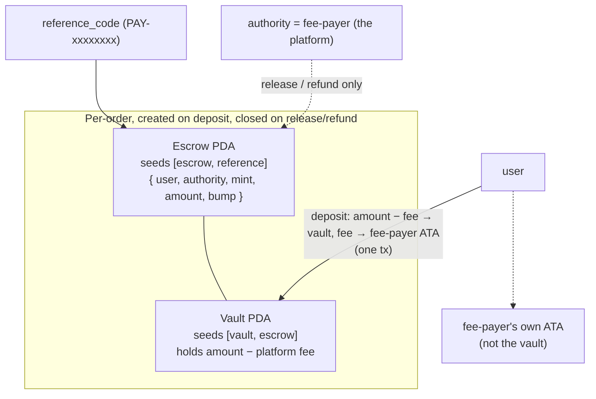
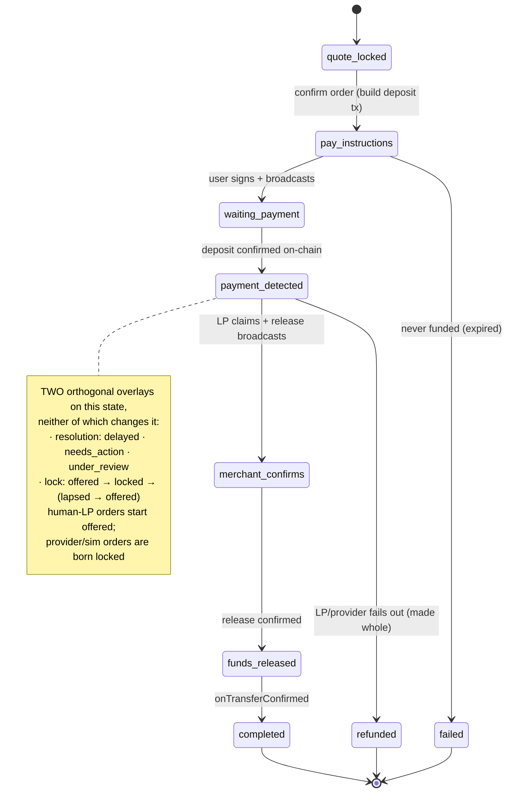
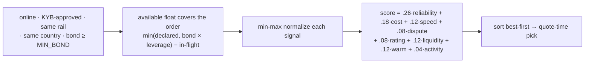

# 06 · Off-ramp & Settlement

## What it is

Cash-out / merchant-pay, told as **one machine**: a locked quote → an on-chain escrow deposit → a
routing/scoring pass over an LP marketplace → an **offer the winning LP must take before they learn
who to pay** → a payout claim → confirmation. A second, orthogonal layer decides **who is on the
other side of that trade, per corridor**: an external liquidity-provider (LP) marketplace, or the
platform itself settling through a licensed payout vendor. That is a per-country licensing
commitment, not a UX toggle — it's the second half of this doc.

The LP-facing product — what an LP actually sees, and why the score is the centre of it — is
[11](11-lp-console.md). This doc is the machine; that one is the console.

**This is 503-gated on every deployed environment today.** `config.isMainnet` (`envConfig.ts`) is
true whenever the configured SPL mint is Circle's real mainnet USDC — which it is on both stage and
prod (mainnet-lite, [01](01-architecture.md)). `routes/orders.ts` checks it first thing on both
`POST /orders/quote` and `POST /orders` and returns `503 payments_unavailable`: the Anchor escrow
program isn't deployed to mainnet yet, so merchant-pay can't run there. Everything below is real,
tested, and running on **devnet** in local dev; nothing here moves real money yet.

## Flow — quote → escrow → routing → offer → claim → confirm

**1 · Quote (locked 45s).** `quoteEngine.createQuote` ranks LPs on a provisional USDC amount (live
mid rate, no spread), takes the top-ranked LP, then prices the real quote off *that* LP's
`spread_bps` plus the platform's own cut, both shaved off the live mid (`getMidRate`, per-currency,
cached + range-validated): `amountUsdc = amountFiat / rate`, rate rounds down, USDC owed rounds up —
the same money law as [01](01-architecture.md#money--decimals). The user sees only the all-in rate —
**the fee is never a line item**; sizing/display is [05](05-fees-fx-and-display.md)'s subject, not
restated here. The quote locks 45s (`QUOTE_TTL_MS`), re-checked for expiry on confirm.

Two things the quote now carries that it didn't. The struck **`spread_bps` is persisted onto the
quote row**, because it becomes the price ceiling for the offer in step 4 — and it can't be
recovered later from `rate`, which is display-only and post-fee. And the **ETA is told the truth
about who is available**: `etaMaxSecs` widens to the human claim SLA when nobody in the eligible
pool is warm, rather than quoting a historical average that was never true of an order nobody is
awake to take. The payer sees that *before* they commit, which is the only moment it is worth
anything. The LP's identity is **not** on the quote — `merchantName` no longer reaches any
payer-facing DTO, and under the offer it would be wrong anyway, naming only a provisional holder.

**2 · Escrow deposit (Anchor PDA).** Confirming a quote builds one user-signed `deposit` tx on the
same prepare/sign/submit seam as everything else in [01](01-architecture.md):



Program id (devnet): `9UfJyNduUw6hJexd7zbwc6ivqPLs2ie2edQrqYAYVv3i`, Anchor 0.32. `deposit` /
`release` / `refund` are the only three instructions; escrow + vault are PDAs that get **closed**
on release or refund, so a second release/refund is impossible on-chain — no backend lock needed.
The platform's in-rate cut splits off **atomically in the deposit tx itself**: the vault only ever
holds the LP's portion (`amount − platform_fee_usdc`), and the fee rides a plain transfer to the
fee-payer's own ATA in the same transaction — not a cold treasury, specifically so a refund can pull
it back atomically too (`refundEscrow` sends both the vault portion and the fee back to the user in
one tx; `releaseToMerchant` sends the vault only, since the fee already left at deposit). 4/4
localnet Anchor tests pass (deposit→release, deposit→refund, double-release rejected, non-authority
release rejected).

The order itself runs a 7-state machine, the only writer of which is `orderMachine.ts`, using
CAS (`casOrderState`) so the worker, the confirmer, a human LP's HTTP call, and dev `/sim` routes
can't race each other:



Release/refund **broadcast first, then transition** — a failed broadcast leaves the order in its
actionable state for the worker to retry, so there's no stuck order with a dangling on-chain intent.

**3 · Routing and scoring — the LP marketplace.** `routing.rankMerchants` applies **five hard
filters, all in the SELECT** (`listRoutableMerchants`), then scores whoever survives:



Anything that must never be offered an order is a **hard filter, never a low score** — a filter that
quietly becomes a weight still routes the order.

- **Rail** has no cross-rail fallback. A rerouted QRIS order used to be able to release against a
  "happy" UPI sim, and a UPI order to quote against the QRIS platform row into a guaranteed refund;
  both leaked money.
- **Country** comes from the corridor, which mirrors `rails.ts` — the only country list. Today it is
  nearly implied by the rail; it stops being so the first time a rail runs in two countries, which
  bank transfer does in the real world — the reason the column exists ahead of the need for it.
- **The bond floor lives in the query.** It used to exist only inside `recomputeMerchantStats`,
  which runs every 10th confirmer tick — so a freshly-approved LP with a **zero** bond was routable
  for up to ~80 seconds. A periodic job is not a gate on money movement.
- **Available float is bond-capped**: `min(float_usdc, bond_usdc × LEVERAGE[tier]) − in-flight`.
  `float_usdc` is the LP's own claim about their capacity and nothing checked it against their
  stake, so a minimum-bond LP could declare a million and be routed it. Their stake is what makes
  the trade trustable, so it is what bounds the trade. Platform settlement rows are **exempt** — the
  same reasoning `settleDispute` uses, their bond being a seeded fiction with no top-up path.

On the scoring side, `cost` inverts `spread_bps`, `liquidity` caps headroom at 5×, `rating` is the
payer's 👍/👎, and the two availability terms are new: **`warm`** is `last_seen_at` inside
`WARM_WINDOW_MS` (2 min; provider and sim rows are always warm — a vendor API does not sleep), and
**`activity`** indexes a 168-slot day×hour histogram at the current UTC slot. Warmth carries 0.12
because it is a fact about *now*; activity carries 0.04, the smallest of the eight, because it is a
prediction and with a handful of LPs per corridor those counts are noise. Neither outranks a real
quality gap, and that asymmetry is safe: ranking first only buys 20 seconds of exclusivity (below).

Signals aren't static seed numbers. `merchantStats.recomputeMerchantStats` derives `success_rate` /
`avg_completion_secs` / `dispute_rate` / `positive_rate` from real outcomes, each smoothed toward
the seed `base_*` prior (`k=10`) so a low-volume LP isn't volatile; it also computes **`tier`** (a
step function on settled volume and those rates) and rebuilds `active_hours`. Bond enforcement runs
**both ways** here: below `MIN_BOND` an online LP is suspended, and above it a suspended LP is
reinstated to *offline* — gated on `suspend_reason = 'bond'`, so the machine can only ever reverse
its own decision and never an admin's moderation or the user-suspend cascade. Because ranking reads
the same columns, the marketplace self-corrects with zero ranking-code change.

**Silent failover**: if the LP holding an order stalls past its SLA (escalated to `under_review`),
`rerouteOrder` re-ranks excluding every LP already tried and reassigns `orders.merchant_id` — no new
deposit, no on-chain change, because the escrow never named a merchant; only *release* does. Capped
at `MAX_ROUTING_ATTEMPTS = 3`. Three guards make it safe:

- It takes the expected merchant from **the order's own `merchant_id`**, not from the attempts log.
  A lock transfers `merchant_id` without writing an attempt row, so reading the log would fail the
  CAS and **refund the payer while an LP was mid-payment**.
- It refuses to touch an order with a live lock or a reported payout, so the ladder can't yank work
  away from someone standing in their banking app.
- The lock state it writes follows the **incoming** merchant's kind. Clearing it unconditionally
  left a reroute onto a provider row un-born-locked, and its disbursement could then never be
  claimed — fiat out, escrow neither released nor refunded, and the order back in the open pool for
  a second LP to pay the same payee again.

`order_routing_attempts` remains the audit trail, and release/refund credit the outcome to the
order's **actual** merchant, not to whoever the attempt row happened to name.

**4 · The offer — an LP takes work before they learn who to pay.** Routing picks a *provisional*
holder; it does not assign the job. Once funded, a human-LP order is **offered**, and the payee's
UPI ID is invisible until somebody commits to paying it.

```
payment_detected
  t+0s    only orders.merchant_id (routing's pick) may lock      payee hidden
  t+20s   offer_widens_at passes — any eligible LP may take it   payee hidden
  locked  payee revealed to the lock holder, and only them       5 min to pay
  lapsed  cleared, re-opened to everyone, the LP is told
```

- **The lock is a CAS that transfers `merchant_id`.** `locked_at is null` is what makes exactly one
  of N concurrent callers win. No offers table, no reservation service, no advisory lock — and
  `merchant_id` is never NULL, so committed float, the routing trail and the worker are untouched.
- **The head start is the reputation reward.** Ranking first buys `HEAD_START_MS` (20s) of
  exclusivity and nothing else. It costs the platform nothing and is worth more to a good LP than a
  badge.
- **The eligible pool is derived, never stored.** It is the same question routing asks, evaluated
  fresh: same rail, same country, online, approved, capacity clear, and `spread_bps` at or below
  **the spread this quote was struck at**. That last filter is what makes broadcasting safe with
  per-LP pricing — whoever takes it earns at least their own ask, and the payer's rate is never
  repriced. It needs `quotes.spread_bps` (0015), because `rate` is display-only and post-fee and the
  struck spread cannot be recovered from it.
- **The payee is redacted in SQL, in both queries** — the open pool selects `null::text`, and an
  LP's own queue reveals it only `when locked_at is not null`. Redaction in a mapper is redaction
  someone forgets.
- **Eligibility is re-checked inside the lock's own UPDATE.** Trusting the pool query would make
  taking an order a check-then-act split across two HTTP requests.
- **Locks come back.** Handing one back early is free and unpenalised — if the honest exit costs the
  same as going quiet, everyone goes quiet. An unpaid lock lapses on the existing 8s tick (no sixth
  timer), and three abandonments in 24h cost an LP the ability to *lock* for an hour. Not routing,
  and never the bond: forgetting an order is not defaulting on one.
- **A lock holds the ladder off**, extending `expires_at`, so an escalation can't refund the payer
  out from under an LP who is paying.

Provider- and sim-settled orders are **born locked** at `payment_detected`: their merchant row *is*
the settler and no pool was ever consulted. That uniformity is what lets the claim below require a
lock with one predicate instead of carving out an exception.

**5 · Payout claim — three shapes on the same rails.** Once locked, who claims and pays the fiat leg
depends on the winning row. Every path goes through `claimOrderPayout`, which now additionally
requires `locked_at is not null` — **you cannot report paying an order you never took**:
- **A simulated LP** (`sim_behavior` = `happy`/`slow`/`no_receipt`/`timeout`) — `simMerchant.ts`
  plays the part on each 8s confirmer tick.
- **A real (human) LP** (`sim_behavior` NULL) — a person who is tier-2 KYC'd, applied via `POST
  /merchants/apply` (refused only on a rail whose `settle` omits `'lp'` — today none do), passed
  KYB, staked a bond, took the order, and paid the payee **out-of-band from their own account**. No
  money moves through our software on this leg; we hand them a destination and they pay it.
  `POST /merchants/orders/:id/paid` with a UTR claims through `claimOrderPayout`, resetting
  `expires_at` to `now + DISPUTE_WINDOW_MS` (2 min) so the payer can dispute before the next tick
  releases. The reference is **format-checked** now that it is rendered on the payer's receipt —
  unconstrained free text there is a channel from the LP onto a screen the payer reads. The worker
  never auto-releases or
  applies a sim behavior on their behalf (`MERCHANT_CLAIM_MS` gives a person 10 minutes, not 30s,
  before escalation starts).
- **A payout provider** (`sim_behavior = 'psp'`, a *platform settlement row* — below) — the worker
  drives `services/payout/provider.ts` instead of a person: `initiate` then `check` each tick, and a
  `'paid'` status claims through the **same** `claimOrderPayout` CAS, gating the eventual release
  behind one more `check()` in case the vendor reversed post-claim.

**6 · Confirmation, dispute, refund.** The confirmer (`confirmer.ts`, 8s) both confirms on-chain
transfers and ticks the order worker; `onTransferConfirmed` is what advances `funds_released →
completed`. A payer can dispute a completed order, or one still inside its release window
(`POST /orders/:id/dispute`), which freezes the escrow (`expires_at → NULL`, so no SLA fires) until
`settleDispute` resolves it — the **one** implementation shared by the admin console
([07](07-admin-and-moderation.md)) and the dev `/sim` route. Upheld: an LP's bond is fined
(`DISPUTE_PENALTY_USDC` 1500) and the payer is refunded; a `psp` (platform) row is **exempt** from
its own bond draw — fining yourself is fiction, and the only top-up path is user-gated — so the
platform just eats the loss and a `risk_events` row records it for the admin dashboard.

## Why this way

- **Escrow that doesn't name a merchant until release.** The deposit only ever references the order,
  so routing/failover is a pure DB+worker change (swap `merchant_id`, retry release) — no second
  deposit, no Anchor change, escrow stays funded throughout a reroute.
- **CAS everywhere, broadcast-before-transition.** Four actor classes (payer, confirmer, LP worker,
  a human LP's own HTTP calls) touch order state; idempotent, race-safe transitions make that
  trustworthy without a lock service.
- **The fee splits off atomically at deposit, not after.** One user-signed tx moves both legs, so a
  refund can always make the fee whole from the same ATA it landed in — no separate ledger to
  reconcile.
- **One claim CAS, three claimants.** A sim worker, a real person, and a vendor API all resolve
  through `claimOrderPayout`, so release/dispute/confirmation downstream never needs to know which
  kind of LP it's dealing with. That survived the lock only because provider and sim orders are
  *born locked* — the alternative was a second predicate carved out for the psp caller, and the one
  place a special case there would have shown up is the path that reports fiat already sent.
- **One guarded UPDATE is the whole marketplace.** No offers table, no reservation service, no queue
  — `locked_at is null` serialises N concurrent takers, and the eligible pool is a query evaluated
  fresh rather than a snapshot of capacity and price taken at the wrong moment.
- **The payer never learns any of this exists.** No LP identity on a payer DTO, no LP-aware copy, no
  LP-aware wait state. Any race on the LP side happens inside time the payer already spends — the
  first alert fires at `pay_instructions`, while they are still signing. From the payer's seat this
  is a normal person paying a normal shop, and that is a product rule, not a nicety.

## The settlement layer: an ordered preference, per corridor

A corridor's settlement is a **per-country entity and licensing commitment**, expressed as one
registry field on `lib/corridors.ts`: `settle: readonly ('provider' | 'lp')[]`.

It is an **ordered preference, not a choice**. The first entry that can actually settle wins.
Automated settlement beats waking a human, so `'provider'` leads wherever we could ever have one and
the LP pool sits underneath as the fallback. Every live corridor is `['provider', 'lp']` today.

> This replaced a single `model: 'lp' | 'provider'` field. Any doc, comment or commit describing a
> corridor as *being* one model is describing the old shape.

Crucially, **availability is not read off a DB row.** A corridor listing `'provider'` resolves it
through `services/payout/provider.ts`, which requires the row to be enabled *and* its credential to
resolve — the invariant that a row alone is never enough to move money. So UPI's `['provider','lp']`
resolves to `lp` today because no INR provider is configured, and flips to provider-first the day an
India-licensed partner is enabled, with no change to this registry.

The two settlers differ in everything that matters, on the same corridor:

| | when the **pool** settles | when a **provider** settles |
|---|---|---|
| Who pays the fiat leg | an external LP, from their own account | a licensed PSP, driven by our worker |
| Who's onboarded | LPs: KYB, bonds, disputes, reputation | nobody — one vendor contract per country |
| Who carries payout licensing | nobody today (the recorded gap) | the provider (their license, their AML/tax incidence) |
| Who eats FX drift quote→settlement | the LP (their spread is their buffer) | the platform — an unhedged principal position |
| Payer recourse | dispute → LP bond draw | dispute → platform eats it, no bond fiction |
| Platform revenue | none (spread accrues to the LP) | the corridor's `spread_bps` — the platform's own take |

**The regulatory headline, carried honestly, not smoothed:** LP settlement has **no affirmative
live-phase legal support in any corridor researched** for this app. India rules it out in writing —
P2P INR settlement through personal accounts is the documented account-freeze failure mode;
Indonesia's recorded posture ("rent a PJP") implies a provider; other researched corridors have no
analysis either way.

**And the registry currently contradicts that.** Every corridor lists `'lp'`, and on India — the
corridor the research rules out — `lp` is the entry that *resolves*, because no INR provider is
enabled. That is stated here rather than smoothed because it is the live position: the marketplace
is real, tested infrastructure running on devnet behind a 503, and a *live* LP network moving real
fiat needs licensing analysis nobody has done. Full jurisdiction-by-jurisdiction treatment is
[08-compliance-and-legalities](08-compliance-and-legalities.md).

**India (`UPI`, `['provider','lp']`)** is the rail actually running the marketplace above — real
human LPs apply, stake, and settle on a payer's behalf, which is also the exact shape the
account-freeze finding is about. Direct payout to a non-onboarded UPI handle (no LP in the loop) is
**roadmap**, not built — see [10-ops-and-roadmap](10-ops-and-roadmap.md).

**Indonesia (`QRIS`, `['provider','lp']`)** settles through the platform-owned row below, because
that is what resolves. Indonesian LPs **may now register** — the door was deliberately opened, since
a fallback pool cannot exist if applications are refused on the rail.

### The platform settlement row

A provider-settled corridor settles through **one platform-owned `merchants` row**
(`sim_behavior = 'psp'`, `user_id NULL`, `treasury_address = PLATFORM_TREASURY_ADDRESS`,
`spread_bps` = the corridor's take) — deliberate, not a shortcut: the row *is* the platform acting
as the corridor's counterparty, so the whole existing machine (release, `claimOrderPayout` CAS, the
dispute button, SLA, stats) keeps working unmodified. `db/seed.ts` upserts the QRIS row (`fpay
Indonesia`) by a **fixed UUID**, outside the delete-and-reseed block sim LPs go through, so a reseed
can't re-key it or undo an operator's suspend — admin-suspending it is the deliberate corridor kill
switch ([07](07-admin-and-moderation.md)).

### The payout-provider registry (`payout_providers`)

One vendor is not one provider: each live country is its own vendor account and credential set
(`xendit_id`, a hypothetical `xendit_th`, …). Rows (`services/payout/provider.ts`, migration
`0005_payout_providers.sql`) are routing metadata only — `id · adapter · payout_method · priority ·
enabled`; adapters are code (`xendit`, plus a zero-key `sim` payer excluded from the adapter map in
production outright), credentials are env (`config.payoutSecretKeys`, keyed by row id), never the
DB. Safety invariants, each checked against the current code:

1. **A DB row is never sufficient to move money.** Membership = credential resolves *and* enabled.
   A keyless enabled row is inert and logged loudly at boot — enabling a money-mover needs a deploy,
   not an admin click.
2. **Refund/failover require a raw terminal status.** The worker keeps polling a payout through
   `under_review`/`delayed` rather than stopping at the first escalation — the alternative is
   refunding a payer whose fiat leg settles anyway (a double-pay).
3. **`orders.payout_provider_id` is claimed before the first `initiate`, never reassigned.** Vendor
   idempotency doesn't span accounts, so this write order stops an admin flip or crash-restart from
   double-disbursing. A sticky order keeps polling its bound provider even if that row is later
   disabled — disable affects *selection* only.
4. **`REVERSED` never fails over.** Money moved and came back; the order freezes (`payout_orphaned`
   + a `risk_events` row) for a human, pre- or post-claim (a final `check()` gates release).
   `REJECTED` is **terminal-failed**, not pending — the older mapping let a rejected payout time out
   through the slow ladder instead of failing over immediately.
5. **The webhook is a hint, never the authority.** A per-provider route
   (`/webhooks/xendit/:providerId`) checks that row's own callback token timing-safe, asserts the
   order↔provider binding, then re-derives status via `provider.check()` before touching the claim
   CAS — a claim that fails on an already-settled order is recorded, never silently 200'd away.

### QRIS / Indonesia — coded, sim-gated

The Xendit adapter (`services/payout/providers/xendit.ts`) is wired to Xendit's **TEST MODE**
sandbox (a free `xnd_development_…` key + a preloaded fake IDR balance) end to end: create →
webhook → poll → claim CAS. Not a real disbursement path yet — a QRIS NMID is an acceptance
identity, not a payout destination, so the sandbox maps every destination to one fixed test bank
channel and carries the real NMID in the description string only, just enough to exercise the seam.
The real NMID→disbursement mapping is live-phase work gated on a licensed PJP partner, per
[08](08-compliance-and-legalities.md). The seeded `payout_providers` row (`xendit_id`, priority 10)
ships **disabled** — inert until its env key exists *and* an operator turns it on.

### Corridor economics

- **The fee is no longer display-only.** `platformFeeBps` folds into the quoted rate and is
  genuinely collected at deposit, returned on refund — see step 2 above and
  [05](05-fees-fx-and-display.md) for the number and how it's shown; not restated here.
- **The FX window is ~24h, not the quote's 45s** — the mid rate refreshes every 6h from a
  once-daily source with plausibility bands, not hedging. When the pool settles, the LP's spread
  buffers that drift; when a provider does, the platform carries it — an unhedged principal
  position on every order.
- **`MIN_ORDER_USD = 1` is a dust guard, not a viability floor.** Vendor payout fees are flat,
  revenue is proportional to spread, and no verified Xendit fee figure exists in this repo to
  compute a real break-even against.

## Legalities

- **Off-ramp / settlement is regulated payout activity, and FX with a spread has its own
  consumer-protection and licensing edges.** Cashing USDC out needs a licensed payout partner
  wherever it goes live — when a provider settles that license sits with the vendor; when the pool
  settles it sits with nobody today, the honest gap this doc keeps flagging, not smoothing over.
  Detail: [08](08-compliance-and-legalities.md).
- **Escrow / funds-in-flight custody.** The per-order escrow is the one place value sits under
  program control. Trust-minimized: the user authorizes the deposit, the program can only pay the
  intended merchant or return the funds — it can't divert them. The **release authority** is the
  fee-payer (the platform) today, the meaningful legal gray spot in this design; a time-lock,
  verifiable payout proof, or multisig would harden it further. See
  [08](08-compliance-and-legalities.md).
- **Best-execution / fair routing.** `order_routing_attempts` plus the explicit scoring weights are
  the evidence trail that routing isn't self-dealing. Note the trail's limit: a **lock transfers
  `merchant_id` without writing an attempt row**, so the log alone answers "who was offered this"
  rather than "who settled it". Outcomes are credited to the order's actual merchant, which is what
  the scoring reads.
- **Data minimisation, on the LP side.** The payee's payment address is disclosed only to an LP who
  has committed to paying it, and only for as long as they hold the lock. Before the offer/lock
  mechanism, the routed LP saw every payee assigned to them whether or not they ever acted.

## Status

- ✅ Quote engine (live per-currency mid rate, 45s lock, in-rate fee genuinely collected + refunded),
  the 7-state order machine with CAS transitions, on-chain Anchor escrow (4/4 localnet tests,
  deployed to devnet), weighted routing + live recomputed scoring + silent failover, the
  payout-provider registry + its 5 safety invariants, the Xendit test-mode adapter end to end, the
  QRIS platform settlement row.
- ✅ **The marketplace layer**: five hard routing filters in SQL (incl. the bond floor and country),
  bond-capped effective float, the offer/lock/reveal mechanism with SQL-side payee redaction, the
  spread-ceiling offer filter, tier/leverage, warmth + day×hour activity signals, the
  `services/alert` seam (Telegram; in-app inbox always fires), KYB evidence with a six-state
  lifecycle and a merchant-visible timeline, stake withdrawal, and the LP earnings/disputes ledger.
  Guarded by `check-routing-math.ts` (no DB, in `check:all`) and `check-lock.ts` (29 assertions
  against real Postgres — mutual exclusion can only be proven there; not in `check:all`).
- 🟡 The LP pool is still mostly seeded/simulated, though the human-LP path is now a full self-serve
  account (availability, pricing, capacity, stake in/out, alerts, KYB, ledger, disputes). No real
  payout vendor is live anywhere (Xendit sandbox-only, gated on licensing/counsel); interactive E2E
  on a funded devnet wallet pending a human; release authority is platform-held, not further
  constrained; a provider corridor's own working-capital float model is an open business decision.
- ⬜ **503-gated on every deployed (mainnet) environment** until the Anchor escrow program deploys
  there. UPI payout to a non-onboarded handle is roadmap ([10](10-ops-and-roadmap.md)).
  **Stake-withdrawal release has no admin surface** — the request debits the bond, and releasing the
  USDC is manual SQL today ([07](07-admin-and-moderation.md)). REVERSED auto-resolution semantics,
  cross-account vendor idempotency, and a per-settler order-viability floor remain open.

## Key files

- `apps/backend/src/services/{quoteEngine,orderMachine,escrowProgram,routing,merchantStats,simMerchant}.ts`
- `apps/backend/src/services/payout/{provider.ts,providers/xendit.ts,providers/sim.ts}`
- `apps/backend/src/routes/{orders.ts,merchant.ts,webhooks.ts}`
- `apps/backend/src/lib/corridors.ts` (the `settle: ('provider'|'lp')[]` registry) and
  `apps/backend/src/lib/kyb.ts` (+ its source of truth `packages/shared/src/kyb.ts`)
- `apps/backend/src/services/alert/{index,provider,telegram}.ts` — the LP alert seam
- Migrations `0014` (country, tier, bond floor, stake withdrawals) · `0015` (order lock, alerts,
  `quotes.spread_bps`) · `0016` (KYB evidence + timeline) · `0017` (activity histogram)
- `apps/backend/scripts/{check-routing-math,check-lock}.ts`
- `apps/backend/src/envConfig.ts` (`isMainnet` gate, `platformFeeBps`, `payoutSecretKeys`,
  `payoutCallbackTokens`, `platformTreasuryAddress`)
- `apps/backend/src/db/migrations/{0001_baseline.sql,0005_payout_providers.sql,0006_platform_fee.sql}`,
  `db/seed.ts` (5 sim LPs + the fixed-UUID QRIS platform row + the seeded `payout_providers` rows)
- `anchor/programs/escrow/src/lib.rs`, tests `anchor/tests/escrow.ts`
