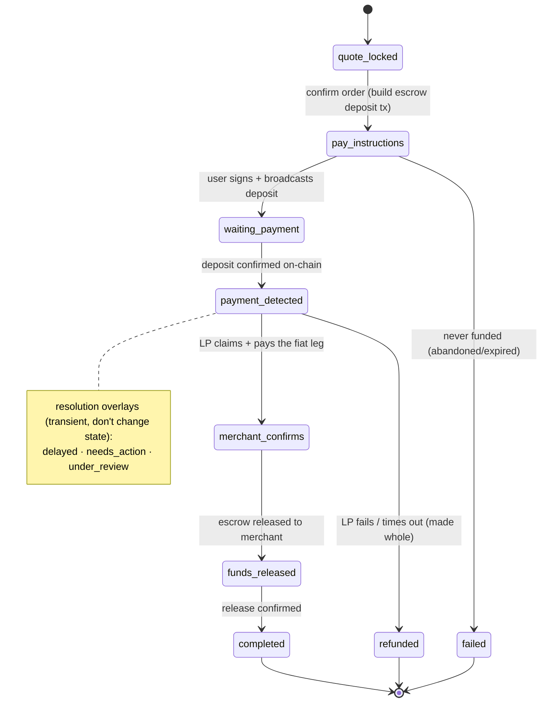
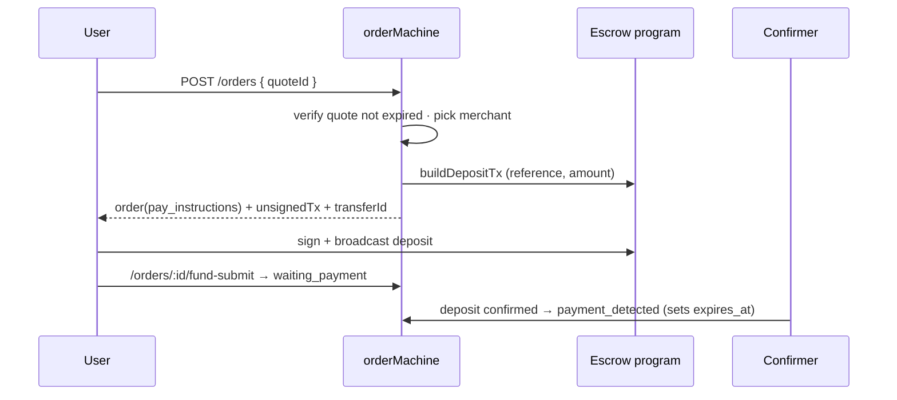
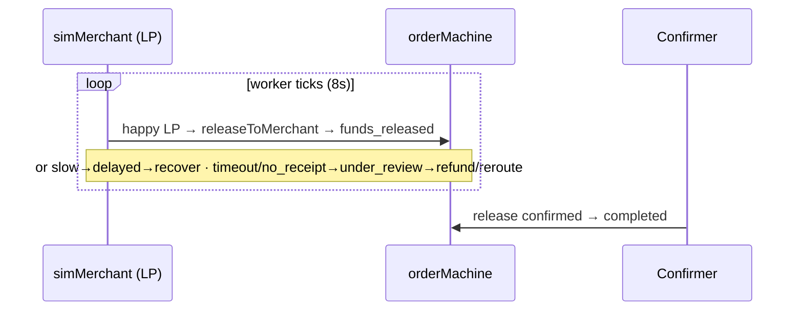

# 06 · Payout Order Lifecycle (Quote + State Machine)

## What it is

The **cash-out / merchant-pay** flow — the heart of the off-ramp. The user wants to pay ₹X (or cash
out to a payout rail like UPI). The app:
1. **Quotes** a locked rate + fee + ETA, valid **45 seconds** (the "certainty" the PDF demands).
2. On confirm, runs the payment through a **7-state order machine** designed **failure-first** — every
   step has a way to stall, escalate, and either recover or refund, so money is never lost or stuck.

This is the M1 milestone. Escrow (07) and routing (08) plug into it; this doc is the **spine**.

## The quote

`quoteEngine.createQuote` picks a merchant (via [routing](08-routing-and-failover.md)), then prices:

```
rate      = getMidRate() × (1 − merchant.spread_bps / 10_000)   // worse-than-mid for the user
amountUsdc = amountInr / rate
fees      = flat platform fee + network fee (illustrative for M1)
eta       = merchant.avg_completion_secs … ×2
expiresAt = now + 45s
```

The quote is persisted (so the order can verify it hasn't expired) and carries `routeQuality`. The FX
**mid rate is now live (M7)** — `getMidRate()` returns a cached, range-validated USD→INR rate refreshed
in the background (with a safe fallback); the merchant spread is applied on top. See
[14](14-notifications-and-infra.md) for the infra layer.

## Flow — the 7 states



**Happy path in words:** lock a quote → confirm (the backend builds an escrow **deposit** tx) → user
signs, USDC goes into the per-order **escrow** → the chain confirms → a merchant/LP picks it up and
sends the fiat → the escrow is **released** to the merchant → done.

**Failure-first design:**
- A **resolution** overlay (`delayed` / `needs_action` / `under_review`) describes *what's happening*
  without leaving the state — so the timeline can say "taking a little longer" honestly.
- `expires_at` is an **absolute escalation deadline** for the current state; the worker escalates on it
  (not on unrelated `updated_at` bumps).
- If a merchant never delivers, the order **refunds** the user from escrow (terminal, user made whole)
  — or, with M3, **silently re-routes** to another merchant first.

## Flow — confirm → fund → settle (sequence)

**Place & fund**



**Settle (LP worker)**



The order machine is the **only writer of order state**, and it uses **CAS (compare-and-set)
transitions** (`casOrderState`) so the confirmer, the simulated worker, and dev endpoints can't race
each other into an inconsistent state. Critically, **release/refund broadcast first, then transition**
— a failed broadcast leaves the order in its actionable state for the worker to retry (no stuck
orders).

## Why this way

- **45s locked quote = "certainty."** The PDF's core promise is the user knows *exactly* what they'll
  pay before committing. The lock + expiry enforces it.
- **Failure-first states.** Off-ramps fail constantly (LP offline, wrong amount, slow bank). Modelling
  delayed/needs_action/under_review + a refund terminal up front means failures are *handled*, not
  surprises.
- **CAS + broadcast-before-transition.** Idempotent, race-safe transitions are what make the
  multi-actor lifecycle (user, confirmer, LP worker) trustworthy.

## Legalities

- **Off-ramp / settlement.** Paying a merchant or cashing out to a bank rail is regulated **payout**
  activity — in production it needs a **licensed payout partner** (UPI PSP, etc.) and settles real
  fiat. Today the fiat leg is **simulated** (the "merchant" is a worker), so no real payout happens —
  the structure is real, the rail is not (M4/M7).
- **FX.** Quoting an INR↔USD rate and taking a spread has consumer-protection and (in some places)
  licensing implications. The rate is currently a **fixed constant** — a real launch needs a live FX
  source and clear disclosure of the rate + fees (the quote screen already itemizes them).
- **Escrow / funds-in-flight.** While an order is mid-flight, the USDC sits in the on-chain escrow —
  see [07](07-onchain-escrow.md) for who controls it and why that's the key legal question.

## Status

- ✅ Quote engine (rate/fee/ETA, 45s lock), full 7-state machine + resolution overlays, CAS
  transitions, escrow fund/release/refund wiring, the web Quote + OrderTracking UI, dev sim controls.
- ✅ **FX rate is live** (M7) — cached, range-validated USD→INR with a safe fallback; the spread applies
  on top. Fees are still illustrative; the **merchant/LP is simulated** (`simMerchant.ts`).
- ⬜ Real payout rails + mainnet (rest of M7).

## Key files

- `apps/backend/src/services/quoteEngine.ts`, `orderMachine.ts`, `simMerchant.ts`
- Routes `/orders/quote`, `/orders`, `/orders/:id/fund-submit`, `/orders/:id`, `/orders/:id/cancel`,
  `/sim/*` in `routes/index.ts`
- `db/queries.ts` (order/quote/event queries, `casOrderState`), schema `quotes`/`orders`/`order_events`
- Web: `src/components/sheets/{Quote,OrderTracking}.tsx`, `src/services/orders.ts`
