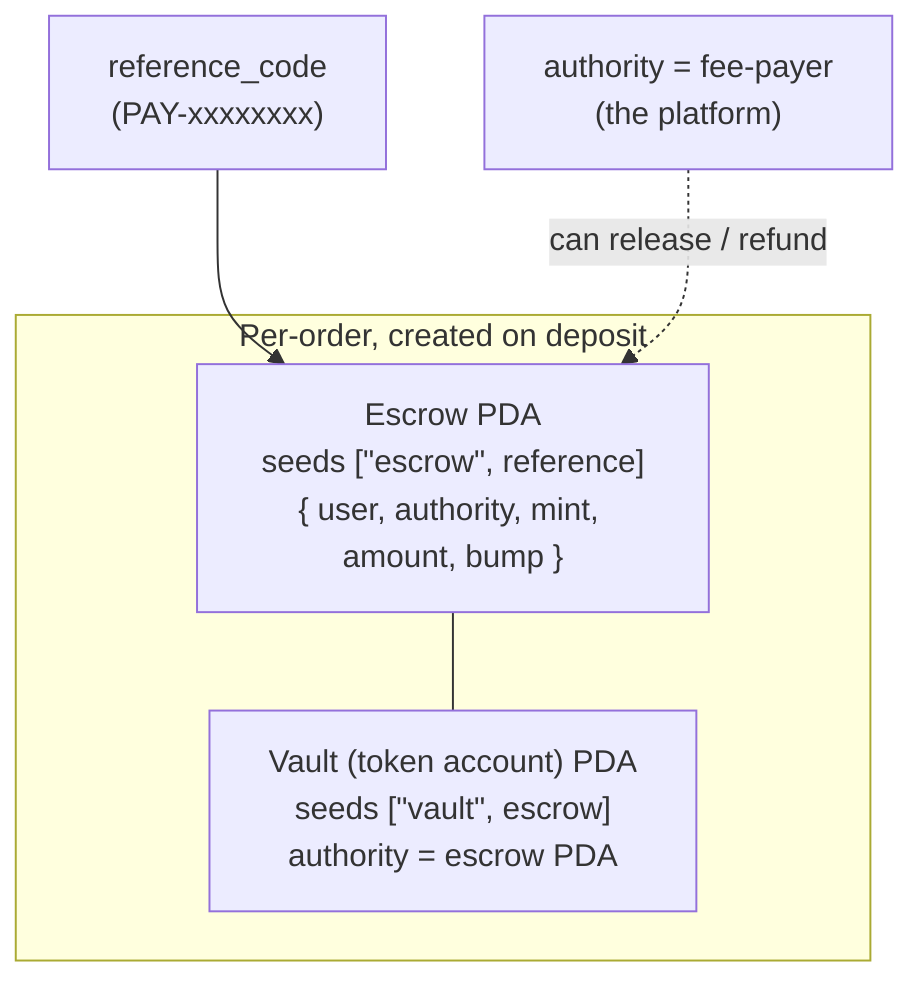
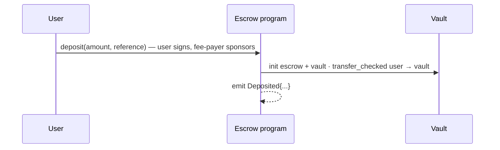
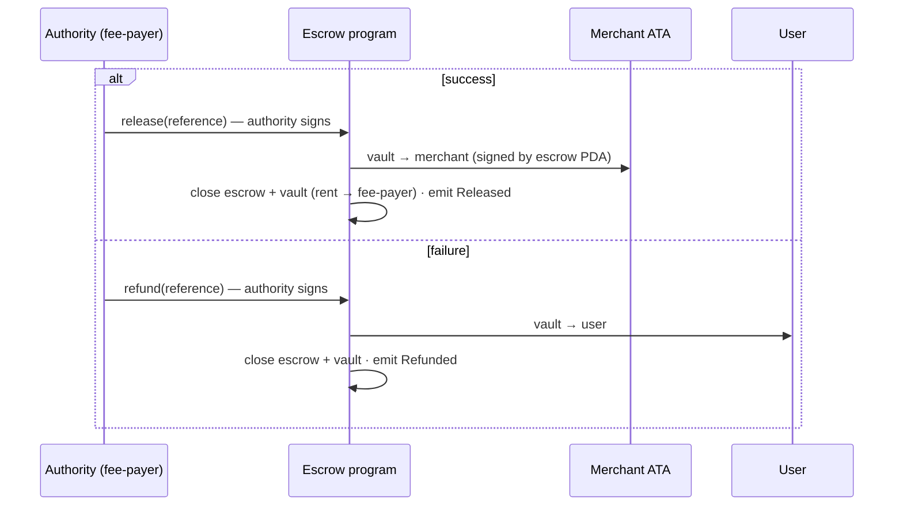

# 07 · On-chain Escrow (the Anchor program · M2)

## What it is

A **Solana program (smart contract)** that holds a user's USDC **while a merchant payout is in
flight**, and releases it **only** to the merchant on success or **back to the user** on failure. Each
order gets its **own escrow account** (a PDA) and a token **vault**, created when the user deposits and
**closed** when the order resolves. Because the account is destroyed on release/refund, a **second
release/refund is impossible** — the chain itself is the double-spend guard.

This replaced M1's "backend-custodied escrow" (funds held by a backend key). Now the rules live
on-chain, not in our server.

- **Program id (devnet):** `9UfJyNduUw6hJexd7zbwc6ivqPLs2ie2edQrqYAYVv3i`
- **Anchor 0.32**, Rust; tested on localnet, deployed to devnet.

## The accounts

- **Escrow PDA** — `seeds = ["escrow", reference_code]`. Holds the metadata: who deposited, the
  authority allowed to release/refund, the mint, the amount, the bump.
- **Vault PDA** — `seeds = ["vault", escrow]`, a token account owned by the escrow PDA. The actual USDC
  sits here.
- **Authority** — set to the **fee-payer** (the platform) at deposit time; only it can release/refund
  (`has_one = authority`).

## Flow — deposit → release / refund

**Deposit**

**Release or refund**

Three instructions:
- **`deposit(amount, reference)`** — user (token authority) + fee-payer (payer) sign. Inits escrow +
  vault, CPI `transfer_checked` user → vault, sets `authority = fee_payer`. Emits `Deposited`.
- **`release(reference)`** — authority signs; CPI vault → merchant ATA (signed by the escrow PDA's
  seeds), then **closes** escrow + vault (rent back to fee-payer). Emits `Released`.
- **`refund(reference)`** — authority signs; CPI vault → user, **closes** accounts. Emits `Refunded`.

The backend (`escrowProgram.ts`) builds these: `buildDepositTx` returns the same `{unsignedTx,
feePayer}` shape as a normal transfer (so the client signer is unchanged), while `releaseEscrow` /
`refundEscrow` are authority-signed and broadcast server-side. The IDL is **vendored** into
`apps/backend/src/idl/escrow.json` (since `anchor/target` is gitignored).

## Why this way

- **Per-order account, closed on terminal.** This is the elegant part: a closed account *cannot* be
  released again, so **double-release and release-vs-refund are impossible on-chain** — no backend lock
  needed, the strongest possible guard.
- **`has_one = authority`.** Only the platform can move escrowed funds to a merchant or back — but it
  can only ever do one of those two, and never redirect funds elsewhere (the destination is checked).
- **`emit!` events.** Deposited/Released/Refunded are an on-chain **audit log** (the PDF's "Layer E"
  proofs) — independently verifiable, not just our database.
- **Same client seam.** Deposit reuses prepare→sign→submit, so moving escrow on-chain cost ~zero
  frontend change.

## Legalities

- **Funds-in-flight custody.** This is the one place value is under program control. The design is
  **trust-minimized conditional settlement**: the user authorizes the deposit, and the program can
  only (a) pay the intended merchant or (b) return the funds to the user — it can't divert them. That's
  a meaningfully different posture from "the platform holds customer balances."
- **The key question = the release authority.** Today the **fee-payer (platform) holds the release
  authority**, which means *operationally* we decide when funds release. For a fully trust-minimized
  off-ramp, that authority should be constrained further (e.g. conditioned on a verifiable payout
  proof, time-locked auto-refund, or multisig). That hardening is future work and is the main legal
  gray for this flow — flagged in [11](11-compliance-and-legalities.md).
- **Auditability.** The on-chain events + closed-account guarantee make disputes and reconciliation
  provable, which is a compliance asset.

## Status

- ✅ Program built, **4/4 localnet tests pass** (deposit→release, deposit→refund, double-release
  rejected, non-authority release rejected), **deployed to devnet**, backend wired, IDL vendored,
  typecheck clean.
- 🟡 **Interactive web E2E pending a human** (sign a real `deposit` from a funded wallet, watch the
  escrow PDA close on completion). Authority model is platform-held (see Legalities).
- ⬜ Registry/staking, pause/circuit-breaker, constrained release authority — later milestones.

## Key files

- Program: `anchor/programs/escrow/src/lib.rs`, tests `anchor/tests/escrow.ts`, `Anchor.toml`
- Backend: `apps/backend/src/services/escrowProgram.ts`, `idl/escrow.json`, config `ESCROW_PROGRAM_ID`
- Build/deploy recipe (offline workaround): see the repo memory `anchor-build-offline`.
