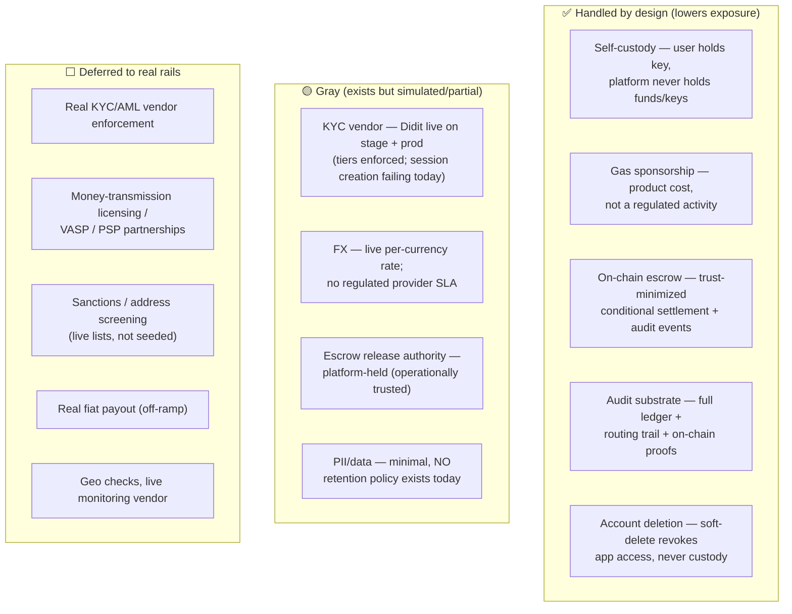

# 08 · Compliance & Legalities (the honest risk map)

> **Not legal advice.** This is an engineering-level map of *which regulatory questions each part of
> the product touches, how the current design handles or defers them, and where the gray zones are.*
> Every item marked for a real launch must be confirmed with qualified counsel in each target
> jurisdiction.

## The core thesis: simulated-rails-first keeps us out of scope

The product is built **structure-first with simulated rails**: real on-chain escrow and a real order
lifecycle, but an **LP network that is real in shape and simulated in substance** — real KYB
evidence, real bonds gating routing, real reputation and offers, and no real fiat — and, until a
licensed payout partner is picked,
**no real fiat payout**. Real on-chain USDC deposits and a real live-FX quote already work on
mainnet (both deployed envs — see [01-architecture](01-architecture.md)). Because **no real fiat
movement occurs on the payout side**, most of the heavy regulation is *triggered by that missing
leg, not yet by this one*. The design intent is that each regulated edge has a **clean seam** where a
licensed partner or vendor plugs in when the product needs it — so the whole machine is built now and
the regulated parts turn on last, corridor by corridor. See
[06-offramp-and-settlement](06-offramp-and-settlement.md) for the payout seam and
[10-ops-and-roadmap](10-ops-and-roadmap.md) for sequencing.

## The risk map

## Topic by topic

### 1. Custody & money transmission — ✅ *lightened by design*
Holding customer funds/keys is what triggers the heaviest rules (US state **MTL** / FinCEN **MSB**, EU
**VASP/EMI**). The app is **non-custodial**: the user signs every movement of their own funds; the
platform only sponsors gas. This is the **single biggest lever** keeping us in a lighter
classification. **Caveat:** the per-order escrow does put funds under *program* control briefly — see
#3. *(The custody/MTL line is fact-specific and jurisdiction-specific; confirm with counsel before
real funds move at scale.)* See [03-custody-money-in-and-confirmation](03-custody-money-in-and-confirmation.md).

### 2. KYC / customer identification — ✅ *enforced; real vendor is a config flip*
The tiered model is **enforced**: `users.kyc_tier` gates money movement (tier 1 ≈ $100/tx, $300/day
P2P; tier 2 unlocks merchant cash-out + external-address sends), checked server-side against
rolling-24h volume. The vendor seam is real (`services/kyc/` — `provider.ts` interface, `didit.ts`
vendor, `sim.ts` simulator) and **Didit — real document collection — is the active provider on both
stage and prod**. `sim` runs locally only: it promotes to tier 2 without seeing a document, and both
deployed tiers are mainnet. See [02-identity-and-onboarding](02-identity-and-onboarding.md).

### 3. Escrow release authority — 🟡 *platform-held*
The escrow is trust-minimized (funds can only go to the intended merchant or back to the user), but
the **release authority is the platform's fee-payer** — so *operationally* we decide when to release.
A fully trust-minimized off-ramp constrains this further (payout-proof-conditioned release,
time-locked auto-refund, or multisig). This is the main legal gray of the payout flow. See
[06-offramp-and-settlement](06-offramp-and-settlement.md).

### 4. FX & consumer disclosure — ✅ *live rate; one number, never a fee line*
Quoting a foreign currency against USD with a spread has consumer-protection (and sometimes
licensing) implications. The rate is a **live, cached, per-currency, plausibility-banded** feed. The
disclosure model is **the single all-in rate itself** — the user sees "$1 = ₹86.67" and nothing else;
there is no itemized fee line anywhere in the product, by deliberate design (a normal money app shows
you the rate, not its margin). The flat **$0.001-per-conversion** platform cut decided 2026-08-13 is
a *continuation* of that same posture, not a new disclosure mechanism — it folds into the same
all-in rate the user already sees, the same way the earlier percentage-based cut did. Full mechanics
and rate math: [05-fees-fx-and-display](05-fees-fx-and-display.md). Remaining for a real launch: a
regulated FX provider with an SLA and the formal disclosures that pair with real payout.

### 5. On-ramp / payout (real fiat) — ⬜ *deferred; seam built*
Converting fiat↔crypto and paying out to bank rails (UPI/QRIS/PromptPay/bank) is the **regulated
core** and needs **licensed partners** (PSP/MSB/VASP) who carry the fiat-leg licenses, plus KYC +
source-of-funds at entry. Deliberately last; nothing of legal consequence moves until then. The
*seam* for that partner exists and is no longer only simulated: a payout-provider registry
(`payout_providers`, key-gated test mode) drives the fiat leg per corridor, and **which settlement
model a corridor uses is a licensing decision, not a code detail**:

- **LP settlement has no affirmative live-phase legal support in any corridor researched so far.**
  India rules it out in writing — P2P INR settlement through personal accounts is the documented
  **account-freeze failure mode** (cyber-cell liens on accounts later traced to fraud;
  `india-legal-compliance-brief.md`), so India's live settler must be a licensed provider, never
  the pool.
- **Provider settlement lands AML/tax reporting once, on the licensed entity**, instead of
  distributing it across unlicensed LP counterparties while the platform still holds escrow release
  authority — the worst combination of both. The corridor registry now *encodes* that argument: a
  corridor's `settle` is an ordered preference with `'provider'` first everywhere, so automated
  licensed settlement wins whenever it is available.

> **⚠️ And the registry currently contradicts the first bullet.** Every corridor also lists `'lp'`,
> and on India — the corridor this research rules out — `lp` is the entry that actually *resolves*,
> because no INR provider is configured yet. Stated plainly rather than smoothed: this is the live
> position. It is survivable only because merchant-pay is **503-gated on every deployed
> environment** and the marketplace runs on devnet alone. Enabling an India-licensed partner flips
> the corridor to provider-first with no code change — that is the intended resolution, and it is
> ops work, not a build.

Full per-country comparison, the provider registry, and its safety invariants:
[06-offramp-and-settlement](06-offramp-and-settlement.md).

> **Indonesia — still owed.** The BI/OJK/PJP/PDP research for the QRIS/IDR corridor was done (rails,
> FX, and provider work landed) but this compliance doc never got an Indonesia jurisdiction section —
> flagged and not yet closed. The corridor research and its recorded posture ("rent a PJP-licensed
> partner"; BI bans crypto as a means of payment; OJK supervises crypto-assets since POJK 27/2024)
> live in [06-offramp-and-settlement](06-offramp-and-settlement.md); sequencing for closing this gap
> is in [10-ops-and-roadmap](10-ops-and-roadmap.md). Also still unaddressed here: TH PDPA, PH DPA,
> entity/incorporation questions, India 194S/115BBH tax withholding, and FIU reporting fields.

### 6. AML / sanctions / monitoring — 🟡 *structure built; real lists deferred*
Sanctions/address **screening** (against a seeded denylist), a per-tx **fraud score** (allow / review
/ block), and rolling-volume monitoring are **built and wired**, writing a **`risk_events`** audit
trail. **Simulated**: the denylist is seeded (not a live OFAC/sanctions feed) and geo checks are
deferred (need IP). Denylist administration (add/remove, and how a suspended/deleted person is kept
from re-onboarding under a fresh identity) is covered in
[07-admin-and-moderation](07-admin-and-moderation.md). Real lists + a monitoring vendor remain
deferred to a real launch.

### 7. Best-execution / fair routing — ✅ *evidenced*
A routing marketplace should prove it isn't self-dealing. The `order_routing_attempts` log + explicit
scoring weights ([06-offramp-and-settlement](06-offramp-and-settlement.md)) are the evidence trail.
(Not user-facing by choice.)

### 8. Data / privacy — 🟡 *minimal; NO retention policy exists today*
`users` holds email/phone/handle. **No retention policy exists** — this has never been researched or
written, and that should be stated plainly rather than implied. What does exist is an **audit
substrate that outlives an account regardless**: `transfers`, `risk_events`, and `admin_actions`
survive an account's lifecycle by the schema's own foreign-key topology (see
[09-data-model](09-data-model.md)), and the soft-delete design in
[07-admin-and-moderation](07-admin-and-moderation.md) leans on exactly that — nothing FK'd to `users`
ever gets touched by a delete. **That's a design consequence, not a legal one**: the ledger survives
deletion because the AML/dispute/audit trail needs it to, not because any specific retention law is
on file for any target jurisdiction. A real launch still needs a written privacy policy, actual
retention limits, encryption at rest, and regional handling (India **DPDP**, **GDPR**, and whatever
Indonesia's **PDP** law requires — see the Indonesia note under #5).

### 9. Account deletion — ✅ *posture resolved; 🟡 not yet built*
**Decided 2026-08-13:** a user may soft-delete their account at any time, even with a balance. This
is **consistent with the non-custodial thesis, not an exception to it**: the funds were never the
platform's to begin with (see #1), so a balance is not a legitimate reason to block deletion.
"Delete" means **app access revoked** — the same shape as suspension — never fund seizure or key
custody change. The funds stay exactly where they always were: in the user's own embedded wallet,
reachable directly via Privy outside the app. **Posture is closed; implementation is not** — no
`deleted` status value, no route, and no in-app recovery copy exist yet. Full FK-topology reasoning
(why hard-delete was rejected, why soft-delete is the only shape the schema survives) is in
[07-admin-and-moderation](07-admin-and-moderation.md).

### 10. Merchant/LP network (KYB) — 🟡 *evidence collected; no vendor, no contracts*
The structure is built and is no longer a sketch ([06](06-offramp-and-settlement.md),
[11](11-lp-console.md)). KYB now **collects evidence**: a per-country field spec (India: legal name,
entity type, PAN, optional GSTIN, registered address, contact, and the account payouts leave from;
Indonesia: NIB/NPWP in place of PAN/GSTIN), a six-state lifecycle with a `more_info` step so a
reviewer can ask rather than only refuse, mandatory reviewer notes the merchant reads verbatim, and
an append-only timeline. The spec is defined once and mirrored into the backend, drift-checked.

**The load-bearing field is "which account will you pay from".** That is a direct answer to the
account-freeze finding in §3 above: the failure mode is third-party money moving through a personal
account, and asking *which* account before anyone is onboarded makes that reviewable rather than
discoverable afterwards.

**No document upload, deliberately** — there is no file storage in this system, and the identity
documents already sit with the KYC vendor. Typed fields plus a human reading them is the honest
first rung; the alternative would have been a document vault nobody had designed.

Bonds gate routing **in the query that picks LPs** rather than in a background job, and cap an LP's
in-flight exposure at a multiple of their stake. Still no real KYB vendor, no contracts, no
arbitration, and no real fiat — so no live counterparty risk yet, but the shape is now specific
enough to be argued about with counsel rather than described in the abstract.

### 11. LP payment metadata leaves the system — ⬜ *unaddressed*
Out-of-band alerting sends an LP the amount and timing of work available, through **Telegram**. That
is a third-party processor seeing payment metadata about our LPs, and it is not covered by anything
in §7 (Data & privacy). Alerts deliberately never carry the **payee** — that is revealed only after
an LP commits — so the exposure is "this LP was offered ₹X at this time", not who was paid. Needs a
processor entry and a decision about whether a self-hosted channel (web/mobile push) should replace
it before real volume.

### 12. Reveal-on-commitment — ✅ *a data-minimisation win, claimed*
Worth recording on the positive side of this ledger. The payee's payment address is disclosed only
to the single LP who has committed to paying it, and only while they hold the lock — enforced in
SQL, in both LP-facing queries, rather than by remembering to strip a field. Before this, the LP
routing happened to pick saw every payee assigned to them whether or not they ever acted on it.

## Summary table

| Topic | Posture | Status | Closes at |
|---|---|---|---|
| Custody / money transmission | non-custodial (lighter class) | ✅ by design | revisit with counsel before real scale |
| Gas sponsorship | product cost | ✅ | rate-limited by design |
| Escrow conditional settlement | trust-minimized | ✅ structure / 🟡 authority | hardening later (multisig / proof-conditioned release) |
| KYC tiers | enforced per-tier caps (Didit vendor, live on both deployed tiers) | ✅ tiers / 🟡 vendor | session creation failing today — see runbook |
| AML / sanctions / monitoring | screening + fraud score built (seeded lists) | 🟡 | real lists + monitoring vendor |
| FX & disclosure | live per-currency rate, single all-in number, no fee line | ✅ | regulated provider SLA later |
| On-ramp / payout (fiat) | seam built (`payout_providers`), simulated fiat leg | ⬜ | licensed partner per corridor |
| Merchant KYB / bonds / disputes | evidence collected per country, 6-state review with merchant-visible reasons, bonds gate routing in SQL and cap exposure | 🟡 | no vendor, no contracts, no arbitration |
| LP payment metadata to a third party | Telegram alerts carry amount + timing (never the payee) | ⬜ | processor entry; self-hosted push |
| Payee disclosed only on commitment | enforced in SQL in both LP queries | ✅ | — |
| Data / privacy | minimal, **no retention policy** | 🟡 | pre-launch |
| Account deletion | soft-delete posture resolved | ✅ posture / ⬜ built | schema + route + web copy |

## Bottom line

The app is intentionally on the **light side of regulation** today because it holds no customer funds
and moves no real fiat on the payout side. **KYC enforcement and sanctions screening are built (against
simulated/seeded data);** the remaining **gray** items (FX provider SLA, escrow authority, PII
retention) are known and seamed, and the **deferred** items (licensing, real payout rails, real
KYC/AML + sanctions feeds) are sequenced behind a licensed partner per corridor
([06-offramp-and-settlement](06-offramp-and-settlement.md),
[10-ops-and-roadmap](10-ops-and-roadmap.md)). Two things resolved since the last pass: **account
deletion with a balance is now a settled, non-custodial-consistent posture** (not yet built), and the
**flat per-conversion fee is a continuation of the existing never-show-a-fee disclosure, not a new
question**. One thing still genuinely owed: **this doc has no Indonesia jurisdiction section**,
despite the corridor being live in the product. The thing to *not* do: turn on a real payout rail
before the real KYC/AML vendor, sanctions lists, and counsel sign-off for that specific corridor.
