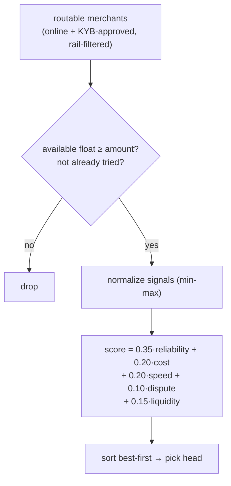
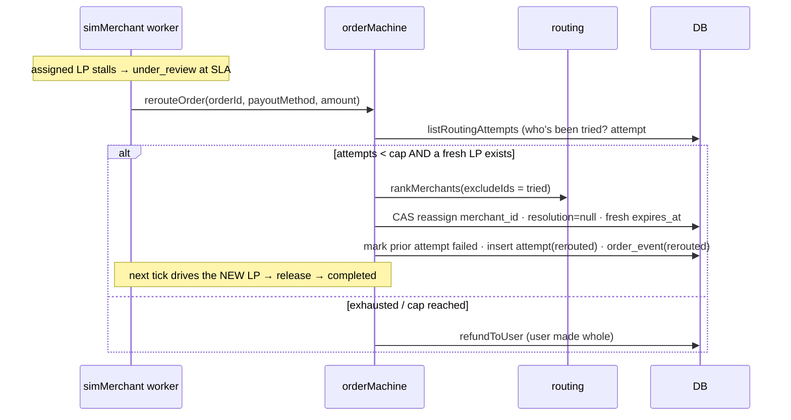
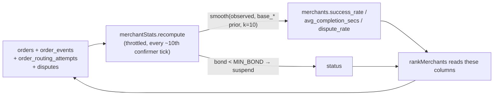

# 08 · Routing, Scoring & the LP Marketplace (M3 + M4)

> The PDF calls this the **moat**: *"a marketplace, not a DEX."* It's **100% invisible to the user** —
> per the product decision *"users don't care about routes, just pay like UPI."* No route picker, no
> labels; the engine makes better choices, learns from outcomes, and silently recovers.

## What it is

Three backend-only capabilities over the merchant/LP network:

1. **Multi-signal ranking (M3)** — score every eligible liquidity provider on reliability, cost,
   speed, dispute rate, and liquidity, and pick the best one.
2. **Silent auto-failover (M3)** — if the chosen LP stalls past its SLA, **re-route** the order to the
   next-best LP and retry the payout, instead of refunding. Refund only when no candidate is left.
3. **The merchant/liquidity layer (M4)** — the LP network behaves like a real marketplace: signals are
   **computed from real order outcomes** (not static seed numbers), **float is tracked live**, LPs are
   gated by **KYB + lifecycle**, and **bonds + disputes** give accountability. A flaky LP's score
   drops and it gets out-ranked/suspended automatically.

The unlock that makes failover cheap & safe: the **escrow holds USDC independent of merchant**
([07](07-onchain-escrow.md)) — the on-chain deposit names no merchant; only *release* picks a
treasury. So a reroute is a pure **DB + worker** change (swap `orders.merchant_id`, retry release to a
new treasury) — **no second deposit, no Anchor change, escrow stays funded.**

## Flow — rank a merchant (at quote time)

Reliability-weighted (matching "expose certainty"). **Available float** = `float_usdc − committed`
(sum of in-flight orders), so a saturated LP drops out until it clears (this folded in the old M3
queue-depth signal). `quoteEngine` uses the top-ranked LP; `routeQuality` derives from the composite
score (internal — not shown).

## Flow — silent failover

`MAX_ROUTING_ATTEMPTS = 3` (initial + 2 reroutes). Every assignment/reroute/release/failure is recorded
in **`order_routing_attempts`** — the "already tried" set, the observability log, **and** the substrate
M4 scores on. The user's timeline just keeps advancing; the reroute is logged, not shown.

## Flow — the M4 learning loop (signals stay live)

**`merchantStats.recomputeMerchantStats()`** derives each LP's live signals from history —
`success_rate` from released-vs-failed attempts, `avg_completion_secs` from `fund_confirmed →
funds_released` event timestamps, `dispute_rate` from upheld disputes — each **smoothed toward the
seed `base_*` prior** (Bayesian, k≈10) so a low-volume LP isn't volatile. Runs on a throttled confirmer
tick. Because ranking already reads those columns, routing self-corrects with **zero ranking-code
change**.

## The merchant lifecycle (M4)

- **Onboarding / KYB** — `kyb_status` (`pending → approved/rejected`). A prospective LP applies via
  `POST /merchants/apply` (created `pending`/offline); a dev `POST /sim/merchants/:id/kyb` approves it
  (flips online). Only **online + approved** LPs are routable (`listRoutableMerchants`).
- **Float / inventory** — `float_usdc` is the LP's capacity; **committed** float (in-flight orders)
  is subtracted live, so the marketplace never over-allocates an LP.
- **Bonds** — `bond_usdc` is skin-in-the-game; the recompute pass **auto-suspends** any LP below
  `MIN_BOND` (2000).
- **Disputes** — a user opens one on a completed order (`POST /orders/:id/dispute`); a dev resolution
  (`/sim/disputes/:id/resolve?for=user|merchant`) **upheld** for the user **draws down the LP's bond**
  (1500 fine) and feeds `dispute_rate` — so bad behaviour costs the LP money *and* routing share.

## Why this way

- **Invisible by design.** A stalled merchant becomes the platform's problem, not the user's: an order
  that would have **refunded** now silently **completes**.
- **Signals that learn.** M3 ranked on static seed numbers; M4 makes them reflect reality, so the
  marketplace gets better (or drops bad LPs) on its own — the whole point of "a marketplace."
- **Accountability without new custody.** Bonds + disputes punish bad LPs economically; failover and
  reroute never create a second deposit, so the custody posture from [07](07-onchain-escrow.md) is
  unchanged.

## Legalities

- **Best-execution / fair routing.** The `order_routing_attempts` log + explicit scoring weights are the
  evidence trail that routing isn't self-dealing — exactly what an auditor would want.
- **Merchant KYB + bonds + disputes** are modelled (simulated) here; a real network needs real KYB,
  contracts, and a real dispute/arbitration process with a licensed operator (see
  [11-compliance](11-compliance-and-legalities.md)). The **structure** is in place; the **vendors** are
  deferred to M7.
- **No new custody surface** — reroute/release just target a different vetted treasury.

## Status

- ✅ **M3 shipped** — weighted `rankMerchants`, `dispute_rate` + `order_routing_attempts`, `rerouteOrder`,
  worker reroute-before-refund, 5 seeded LP profiles, dev `merchant-fail` trigger. Frontend untouched.
- ✅ **M4 shipped** — live available-float gating, `merchantStats` computed+smoothed scoring on the
  confirmer tick, KYB lifecycle + onboarding, bonds + auto-suspend, disputes flow. `yarn typecheck`
  clean; a self-fixturing `check-merchant.ts` harness asserts the learning/float/suspend behaviour.
- 🟡 The LP network is still **simulated** (no real KYB vendor / payout / arbitration) — flips at M7.

## Key files

- `apps/backend/src/services/routing.ts` (`rankMerchants`, available float), `quoteEngine.ts`,
  `orderMachine.ts` (`rerouteOrder`), `simMerchant.ts` (reroute-before-refund),
  **`merchantStats.ts`** (`recomputeMerchantStats`, `MIN_BOND`, bond/suspend).
- `db/schema.sql` (`merchants` +`kyb_status`/`bond_usdc`/`base_*`, `order_routing_attempts`, `disputes`),
  `db/seed.ts` (5 LP profiles + priors), `db/queries.ts` (ranking, float, stats, lifecycle, disputes).
- Routes in `routes/index.ts`: `/merchants/apply`, `/orders/:id/dispute`, dev `/sim/orders/:id/merchant-fail`,
  `/sim/merchants/:id/kyb`, `/sim/merchants/recompute`, `/sim/disputes/:id/resolve`.
- Harnesses: `scripts/check-routing.ts`, `scripts/check-merchant.ts`.
