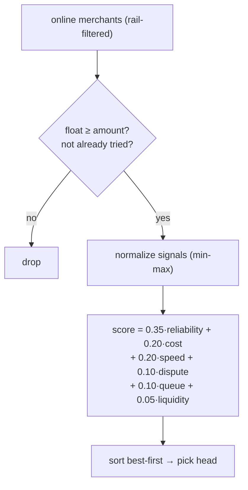
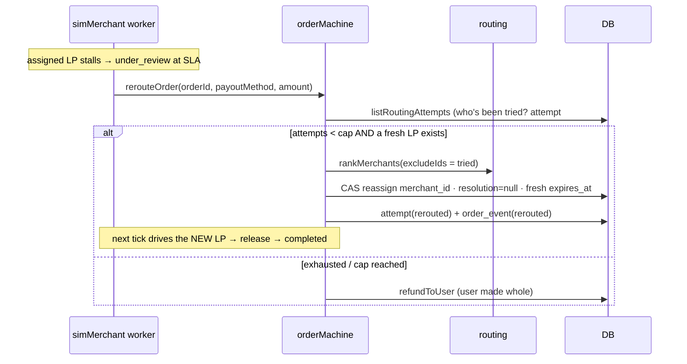

# 08 · Routing & Auto-failover (M3)

> The PDF calls this the **moat**: *"a marketplace, not a DEX."* It's also **100% invisible to the
> user** — per the product decision *"users don't care about routes, just pay like UPI."* There is no
> route picker and no route labels; the engine simply makes better choices and silently recovers.

## What it is

Two backend-only capabilities over the merchant/LP network:
1. **Multi-signal ranking** — given an order, score every eligible liquidity provider on
   reliability, cost, speed, dispute rate, queue depth, and liquidity, and pick the best one.
2. **Silent auto-failover** — if the chosen LP stalls past its SLA, **re-route** the order to the
   next-best LP and retry the payout, instead of refunding. Only refund when no candidate is left.

The unlock that makes failover cheap & safe: the **escrow holds USDC independent of merchant**
([07](07-onchain-escrow.md)) — the on-chain deposit names no merchant; only *release* picks a
treasury. So a reroute is a pure **DB + worker** change (swap `orders.merchant_id`, retry release to a
new treasury) — **no second deposit, no Anchor change, escrow stays funded.**

## Flow — rank a merchant (at quote time)

Reliability-weighted (matching "expose certainty"). `quoteEngine` uses the top-ranked LP; `routeQuality`
derives from the composite score. Ranking signals already live on the `merchants` table
(`success_rate`, `spread_bps`, `avg_completion_secs`, `float_usdc`, + new `dispute_rate`); **queue
depth** is computed live (count of in-flight orders per merchant).

## Flow — silent failover

`MAX_ROUTING_ATTEMPTS = 3` (initial + 2 reroutes). Every assignment/reroute/release is recorded in a
new **`order_routing_attempts`** audit table — which doubles as the "already tried" set and the
observability log. The user's timeline just keeps advancing; the reroute is logged, not shown.

## Why this way

- **Invisible by design.** The whole value is that a stalled merchant becomes the platform's problem,
  not the user's. An order that would have **refunded** now silently **completes** — resilience the
  user feels without understanding.
- **Weighted score, not a lexical sort.** The M1 stub sorted by `success → float → spread`. A
  normalized weighted score lets speed, cost, dispute history, and live load all matter, tuned toward
  reliability.
- **Audit table as the spine.** Recording attempts gives the tried-set, the failover history, and the
  Layer-E observability the PDF wants — for free.

## Legalities

- **Best-execution / fair routing.** A marketplace that routes customer orders across providers should
  be able to **show why** a route was chosen and that routing isn't self-dealing or
  consumer-detrimental. The `order_routing_attempts` log + the explicit scoring weights are exactly the
  evidence trail a regulator or auditor would want. (Surfacing it to the *user* is optional and
  currently deliberately hidden.)
- **Merchant/LP network = the M4 compliance edge.** Real LPs need **KYB** (know-your-business),
  contracts, performance bonds, and dispute handling — see [13](13-future-milestones.md). Today the LPs
  are **simulated**, so there's no real counterparty risk yet.
- **No new custody surface.** Failover never creates a second deposit; the same escrowed funds simply
  release to a different vetted treasury — so it doesn't change the custody posture from [07](07-onchain-escrow.md).

## Status

- 🟡 **In progress** (build-ready, partially implemented). Planned this milestone:
  weighted `rankMerchants`, `dispute_rate` column + `order_routing_attempts` table, `rerouteOrder`,
  worker reroute-before-refund, 5 seeded LP profiles, a dev `merchant-fail` trigger for a deterministic
  demo. **No frontend change.**
- ⬜ Real LP onboarding/scoring/bonds (M4).

## Key files

- `apps/backend/src/services/routing.ts` (`rankMerchants`), `quoteEngine.ts`, `orderMachine.ts`
  (`rerouteOrder`), `simMerchant.ts` (reroute-before-refund)
- `db/schema.sql` (`merchants.dispute_rate`, `order_routing_attempts`), `db/seed.ts` (LP profiles),
  `db/queries.ts` (ranking + attempts queries)
- Dev trigger: `/sim/orders/:id/merchant-fail` in `routes/index.ts`
