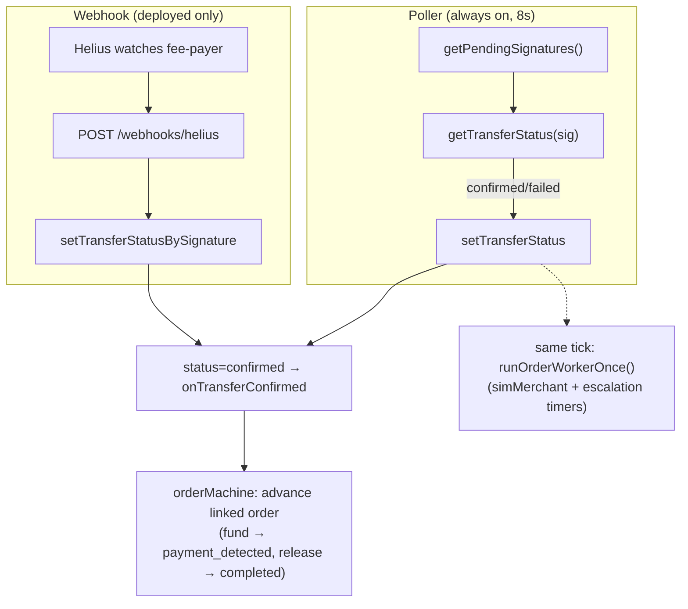

# 09 · Confirmation Pipeline

## What it is

How the backend learns that an on-chain action actually landed. Solana confirmation is **asynchronous**
— after a transaction is broadcast, something has to watch the chain and flip the database row from
`pending` to `confirmed`/`failed`, then advance any order that was waiting on it. Two mechanisms do
this, by design:

1. **Confirmer poller** (`confirmer.ts`) — every **8 seconds**, resolves every pending+broadcast
   transfer and persists a terminal status. Always on. The reliable fallback.
2. **Helius webhook** (`helius.ts` + `/webhooks/helius`) — Helius *pushes* a confirmation the moment a
   watched transaction lands. Faster, but only active on a deployed backend (needs `HELIUS_API_KEY` +
   `PUBLIC_BASE_URL`).

Both write through the **same** function, so they're interchangeable and idempotent.

## Flow

**Why watching the fee-payer catches everything:** the fee-payer **signs every sponsored
transaction** (sends, escrow deposits/releases, faucet mints), so a single Helius subscription on the
fee-payer address sees all of them — no per-user subscriptions needed.

**The poller does double duty.** Each 8s tick also calls `runOrderWorkerOnce()` (the
[simulated merchant](06-payout-order-lifecycle.md) + order-escalation clock) and retires stale unsigned
transfers. So the confirmer is both the chain-watcher *and* the heartbeat for the order lifecycle.

**Order advancement.** When a transfer flips to `confirmed`, `onTransferConfirmed(transferId)` looks up
the linked order and advances it: an `escrow_fund` confirmation → `payment_detected` (and sets the SLA
`expires_at`); an `escrow_release` confirmation → `completed`. A confirmed P2P **send** also fires an
in-app notification to the recipient ("Neha sent you $5" — M6, see [14](14-notifications-and-infra.md)).

## Why this way

- **Webhook + poll, not one or the other.** The webhook is fast but depends on external infra and a
  public URL; the poller is slower but unconditional. Running both means **push speed in prod,
  guaranteed convergence everywhere** — and because both are idempotent, a double-delivery is harmless.
- **Keyed off the signature row.** Confirmation logic only needs `transfers.signature` + status, so it's
  fully decoupled from *what* the transaction did (send vs. escrow vs. faucet). New transaction types
  plug in with zero confirmer change.
- **One process, one clock.** Folding the order-escalation worker into the same tick avoids a separate
  queue/cron — and the tick now also recomputes merchant stats + sweeps the rate-limit windows
  ([14](14-notifications-and-infra.md)). A Redis-backed queue (multi-instance) is the remaining **M7**
  scale step.

## Legalities

- **Settlement finality & reconciliation.** A payments system must know, provably, whether money
  moved. The pipeline ties every DB row to an on-chain signature with a terminal status — the
  foundation for **audit, dispute resolution, and reconciliation**. Combined with the escrow's on-chain
  `emit!` events ([07](07-onchain-escrow.md)), there's an independently verifiable record of settlement.
- **Operational resilience.** "We lost track of a payment" is both a UX and a compliance failure. The
  redundant confirm-and-retry design (plus stale-transfer expiry) is what prevents stuck/lost states.

## Status

- ✅ Confirmer poller (8s) with order advancement + worker tick + stale-transfer expiry; Helius webhook
  registration (idempotent) and handler with optional shared-secret auth.
- 🟡 Webhook is **only active when deployed** (needs `HELIUS_API_KEY` + `PUBLIC_BASE_URL`); locally the
  poller carries confirmation. No Redis-backed retry/backoff queue yet (multi-instance → **M7**).

## Key files

- `apps/backend/src/services/confirmer.ts` (`confirmPendingOnce`, `startConfirmer`)
- `apps/backend/src/services/helius.ts` (webhook registration), route `/webhooks/helius` in `routes/index.ts`
- `apps/backend/src/services/solana.ts` (`getTransferStatus`), `orderMachine.ts` (`onTransferConfirmed`)
- `db/queries.ts` (`getPendingSignatures`, `setTransferStatus[BySignature]`, `expireStaleUnsignedTransfers`)
