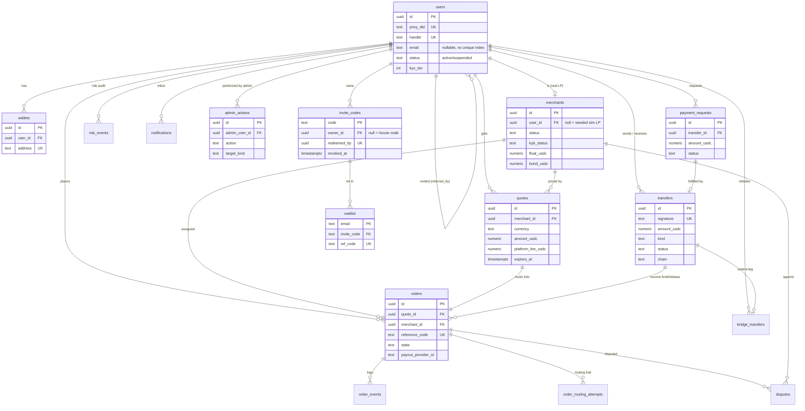

# 09 · Data Model

## What it is

The Postgres schema — the system's source of truth for everything *except* token balances (those
live on-chain and are read live). There's **no ORM**; every table is defined across the numbered
files in `apps/backend/src/db/migrations/`, and one module (`db/queries.ts`) holds every query.
**Access control is enforced in the API layer** (no row-level security) — every query is
owner-scoped by `userId`.

## Migrations, conventions

An in-house runner (`db/migrations.ts`, no deps), not a framework:

- **Forward-only.** Files live in `migrations/` as `NNNN_name.sql`, applied in filename order,
  each inside its own transaction. To undo something you write another migration — there is no
  `down`. `yarn db:new <name>` scaffolds the next number; `yarn db:migrate` / `db:status` /
  `db:deploy` / `db:reset` drive it (`db:deploy` is `db:migrate` under a name Railway's start
  sequence calls explicitly).
- **Checksummed.** Every applied file's md5 is recorded in `schema_migrations`. `db:status` warns
  if an applied file's checksum no longer matches disk (edited after the fact — the fix is a new
  migration, not touching the old one) or if an applied version's file is missing. **This doc must
  never describe a column as if a committed migration still defines it once a later migration
  drops or changes it** — 0001 is a big bang of the pre-migration schema plus everything added to
  it since, and the rest are true deltas.
- **Idempotent by habit.** Every `alter table` in these files is `add column if not exists` /
  `drop constraint if exists` / `create index if not exists`, so a fresh DB and an old one
  converge on the same shape. `0001_baseline.sql` in particular is one giant idempotent file — the
  pre-migration `schema.sql` frozen in place, safe to run against a DB that already has the
  schema.
- **Known drift, called out in the migrations themselves.** `0003_money_checks.sql` is numbered
  0003, not 0002, because stage has a `0002_waitlist_first_name` recorded in `schema_migrations`
  (applied 2026-08-06) whose `.sql` was never committed — it added `waitlist.first_name`, which no
  migration on disk creates and no code reads. A fresh environment comes up **without** that
  column while stage still has it. Nothing depends on it today; closing it is a future
  `add column if not exists` migration, never a re-use of `0002`. `waitlist.first_name` is **not**
  documented below because it isn't in any committed migration.

## Entity relationships

## Table by table

| Table | Purpose | Notes |
|---|---|---|
| **users** | one row per person | keyed to Privy DID; unique canonical **immutable** `handle`; `email` is **nullable with no unique index** — two rows can share an email today (⬜ flagged below); opt-in E.164 `phone` (partial unique `uq_users_phone`, present iff the user enrolled — enrollment *is* the consent, mirroring NPCI's numeric mapper); best-effort `country` (dialing default, never a compliance attribute); `kyc_tier` (0 restricted · 1 basic · 2 verified · 3 enhanced) drives send/cash-out limits; `kyc_status`/`kyc_provider`/`kyc_session_id` (unique)/`kyc_verified_at` track the real vendor's verification lifecycle separately from the tier that actually gates money; `role ∈ user/merchant/admin`, but the role that *governs* is `effectiveRole()` — `ADMIN_EMAILS` outranks the column so a root admin is undemotable even if their row still says `user`; `status ∈ active/suspended` (0009, moderation); `referred_by` self-FK = the redeemed invite code's `owner_id` (null for a house code), write-once; `invites_revealed_at` gates the one-look reveal of a user's own three codes |
| **wallets** | a user's chain address(es) | `chain='solana'` default; unique `address`; unique `(user_id, chain)` so a re-sync upserts in place instead of accumulating rows |
| **transfers** | the money ledger | `amount_usdc numeric(20,6)`, `> 0`; `kind ∈ send/add/pay/escrow_fund/escrow_release`; `status ∈ pending/confirmed/failed`; unique `signature`; `chain` (confirmer polls `'solana'` only — a foreign signature here is a permanent-pending zombie); unique `idempotency_key` per sender (prepare replay/dedupe). **The `kind='send'` daily-cap invariant:** `recentSendVolumeUsd` sums `amount_usdc` where `kind = 'send' and status <> 'failed'` over a rolling 24h window, and `checkSendLimit` (`services/compliance.ts`) gates that sum against the KYC tier's `sendDaily` cap — so P2P sends count toward the daily limit and merchant `pay`/`escrow_fund` legs deliberately do not; they have their own cash-out cap keyed the same way off `orders` |
| **payment_requests** | "you owe me $X" | `amount_usdc numeric(20,6)`, `> 0`; `status ∈ open/paid/cancelled`; links the fulfilling `transfer_id` |
| **merchants** | the LP network — seeded simulations *and* real onboarded LPs | ranking signals (`success_rate`/`dispute_rate`/`avg_completion_secs`/`spread_bps`/`float_usdc`) kept live + `base_*` seed priors; `status ∈ online/offline/suspended`, `kyb_status ∈ pending/approved/rejected`, `bond_usdc` (drawn down on an upheld dispute), `positive_rate` (payer 👍/👎 signal); `payout_rail ∈ UPI/QRIS/Pix/bank`; `sim_behavior ∈ happy/slow/no_receipt/timeout/psp` **or NULL** — NULL means a real human LP the sim worker must not auto-drive (nullable + no default, added once `merchants.user_id` could be a real logged-in person); unique `user_id` (partial, sim LPs stay NULL) |
| **quotes** | a 45s-locked price | fiat leg `amount_inr` is a legacy name but now generic 2dp money (`numeric(20,2)`) qualified by `currency` (default `'INR'`, added for the Indonesia corridor — every pre-existing row is INR by construction); crypto leg is 6dp (`numeric(20,6)`) — different scales, code must say which it means; `rate`, `fee_inr`/`network_fee_inr` (both `>= 0`), `platform_fee_usdc` (0006, default 0 — the platform's cut, folded into the quoted rate, never a separate line item, collected at deposit into the fee-payer ATA and returned on refund); `payout_method ∈ UPI/QRIS/Pix/bank`; `payout_destination`/`payout_name` (who actually receives the fiat — lives here, not on `orders`, because the merchant order view already joins quotes); `route_quality`, `expires_at` |
| **orders** | the 7-state machine | `amount_usdc numeric(20,6)`, `> 0`; `state ∈ quote_locked→pay_instructions→waiting_payment→payment_detected→merchant_confirms→funds_released→completed` plus terminal `refunded`/`failed`; transient `resolution ∈ delayed/needs_action/under_review`; links escrow fund/release `transfers`; `expires_at` = the worker's escalation deadline for the current state; `payout_utr`/`payout_claimed_at` (a real LP's hand-entered proof of the fiat leg — deliberately not a new `state`, so the order stays `payment_detected` while this is just data about it); `feedback_up` (nullable boolean, one payer 👍/👎 per order, mirrors `uq_disputes_order`); `payout_provider_id`/`payout_providers_tried` (`text[]`, the exclusion set for failover)/`payout_provider_ref` (0005 — claimed *before* the first initiate, since vendor idempotency doesn't span accounts; **no DB-level FK** to `payout_providers.id`, matched by app code only) |
| **order_events** | append-only timeline | powers the live tracker; `(from_state, to_state, event, detail jsonb)` |
| **order_routing_attempts** | routing audit + tried-set + scoring substrate | `(sequence, outcome ∈ assigned/released/failed/rerouted, reason)`; unique `(order_id, sequence)`; `released`/`failed` outcomes feed `merchants.success_rate` |
| **payout_providers** | the payout-vendor registry | `id` (env-key-shaped text PK, e.g. `xendit_id`) — one vendor is *not* one provider, each live country is its own credentialed account; `adapter` (code module: `xendit`/`sim`), `payout_method ∈ */UPI/QRIS/Pix/bank`, `priority` (lower wins, ties by id), `enabled` (default **false** — a migrated row is inert until switched on). Rows are routing metadata only; credentials live in env, resolved by provider id |
| **disputes** | user disputes on a completed order | `status ∈ open/resolved`, `resolution ∈ upheld/rejected`; unique `order_id` (one dispute per order — prevents bond over-draw and `dispute_rate` corruption from repeats); upheld draws down the merchant's `bond_usdc` and feeds `dispute_rate` |
| **denylist** | simulated sanctions list | `kind ∈ address/handle`, `value`, unique `(kind, value)`; screened on every money movement |
| **risk_events** | per-action fraud/screening audit | `kind` (send/cash_out/onboarding, free text), `decision ∈ allow/review/block`, `score`, `reason`, `counterparty` (handle or raw address — the whole point of the audit row for external sends) |
| **notifications** | in-app inbox | `kind` (free text: payment_sent/received/refunded/request_paid/kyc_upgraded/…), `title`, `body`, `meta jsonb`, `read` |
| **bridge_transfers** | cross-chain leg (CCTP) | rail-agnostic: `rail` names the protocol impl (`cctp_standard`/`cctp_fast`/future), `rail_data jsonb` holds rail-specific artifacts so a new rail needs no schema change; unique `transfer_id` — companion to exactly ONE `transfers` row, always the Solana leg (`kind='send'` outbound burn / `kind='add'` inbound mint), so the existing chain confirmer and the `kind='send'` daily-cap logic need no bridge-aware branch; `direction ∈ out/in`; `state` machine `created→source_submitted→source_confirmed→ready→settling→settled/failed`, and **post-`source_confirmed` states never expire** — once burned, the attestation is permissionless and replayable, so funds can be delayed but never stranded; unique `source_tx` (partial, dedupes re-reported inbound burns) |
| **bridge_events** | append-only bridge timeline | mirrors `order_events`: `(from_state, to_state, event, detail)` per `bridge_transfer_id` |
| **invite_codes** | the invite-only gate, for **both** doors | `code` PK (`FP-XXXX-XXXX`, plain text — an operator must be able to read one back, so it is not hashed); owner is `owner_id` (an account) or `owner_email` (an f-list member) or neither = a **house code** minted from the console, belonging to nobody; redeemer is `redeemed_by` (**unique** — an account burns at most one code, ever) or `redeemed_email` — at most one of the two redeemer columns is ever set; `revoked_at` (revoke sets this rather than deleting the row, so a revoked code can't be re-minted by chance and the audit trail still points at something real); **status is derived, never stored**: unused = `redeemed_at is null and revoked_at is null`. Redemption locks the row with `select … for update` inside the `/auth/sync` or f-list-join transaction. Replaces the old `users.referral_limit` counter — the count of a user's `invite_codes` rows *is* their allowance now |
| **waitlist** | the f list — invite-only landing-page signups | `email` PK (also the concurrency control — `insert … on conflict do nothing` claims it before spending anything); `city` (demo corridor selected); `ref_code` (this member's own share code, unique, HMAC-derived, write-once); `referred_by` (an app user's `@handle` **or** another member's `ref_code`, `@` disambiguates the one column — **last-touch**, each submit carrying a ref overwrites it, the opposite write rule from `users.referred_by`); `invite_code` **real FK** to `invite_codes.code` (unlike `referred_by`, this names a row that must exist), write-once — a code and an email are both required to join, and joining mints the member three codes of their own; `verified_at` (double opt-in confirm click). No FK to `users` — these people have no account yet |
| **admin_actions** | audit trail for the admin console | one row per admin **write**; `action` and `target_kind` are **free text by design, no CHECK** — `kyb_approve`/`kyb_reject`/`merchant_suspend`/`merchant_reinstate`/`dispute_resolve`/`denylist_add`/`denylist_remove`/`invite_mint`/`invite_revoke`/`role_grant`/`role_revoke`/… — new admin actions need no migration, just a new string; `target_id` is text (uuid or `kind:value`) so one table covers every target kind; `admin_user_id` is a plain (non-cascading) FK to `users` — admin rows are **never hard-deleted**, so the FK's meaning is "this admin existed," not "this admin still does" |

## Why this way

- **Ledger + state machine, not balances.** Token balances are authoritative on-chain; the DB
  records *intent and lifecycle*. This avoids a DB balance drifting from the chain — the chain is
  read for truth and reconciled.
- **Append-only `order_events`/`bridge_events`.** The timeline is derived from an immutable log, so
  the UI and any audit see the same history; state is never rewritten in place.
- **`numeric`, never `float8`.** Every money column is `numeric`, so storage is exact and a value
  too big for the column is *rejected* by the cast rather than mangled. `numeric(20,6)` does
  **not** protect against precision it can simply absorb — a 10-decimal amount is silently rounded
  to 6 by the cast, before any CHECK runs — which is why `0003_money_checks.sql` only claims what
  a constraint can actually enforce: sign. The app layer is the real validator. See
  [01 · Architecture — Money & decimals](01-architecture.md#money--decimals).
- **CHECK constraints, backfilled idempotently.** States/kinds are constrained at the DB level;
  `0003_money_checks.sql` adds the money-sign checks (`> 0` on every ledger leg, `>= 0` on
  balances/fees) as the last guard that survives a *new* route forgetting to validate. Corridor
  growth (`0004`) drops and re-adds `merchants_rail_chk`/`quotes_payout_chk`/`merchants_sim_chk` to
  widen the allowed value sets rather than leaving old rows on a constraint that no longer matches
  reality.
- **Indexes** cover the hot reads: transfers by user, orders by user and by `(state, expires_at)`
  (the worker's scan), events by order, `waitlist.ref_code` (unique) and `.referred_by`,
  `invite_codes` by `owner_id`/`owner_email`.
- **One polymorphic column instead of two FKs — `waitlist.referred_by`.** Holds either an app
  user's `@handle` or another f-list member's `ref_code`, both opaque strings, `@` disambiguates.
  One code path for two referral sources, no join, no second FK — but no referential integrity
  either, so renaming a handle orphans old attribution. Fine for a marketing queue, wrong the day
  referral credit pays out money (flagged with a `ponytail:` comment at the source).
- **The f-list update's coalesce order differs by column, deliberately.** `city`, `ref_code`, and
  `invite_code` are write-once (a ref code is derived from the email and must never move, and who
  vouched for you is lineage). `referred_by` is last-touch (the newest invite link wins, because
  the landing page caches the ref so attribution survives a stripped URL). This is the **opposite**
  of `users.referred_by`, which stays write-once always — a different mechanism, and rewriting an
  account's lineage would be a real integrity problem.
- **One `redeemed_at`, two redeemer columns.** An invite code is spent at signup or at the f-list
  door, and the redeemer on either side is a different kind of thing: a user id (`redeemed_by`,
  UNIQUE) or a bare email (`redeemed_email`). Loosening `redeemed_by` to cover both would cost the
  UNIQUE constraint that structurally guarantees one account never burns two codes. Status stays
  derived from the single `redeemed_at`, so "spent" means spent at *both* doors.

## Planned — migration 0010 (⬜, decided 2026-08-13, not yet written)

- **Partial unique index on `users.email`.** Today `email` is nullable with **no** uniqueness —
  two accounts can share one address, which is a real gap for anything email-based (account
  recovery, dedupe, notifications-by-email). Planned: `create unique index … on users (email)
  where email is not null`, mirroring the `uq_users_phone` pattern already in `0001`.
- **`users.local_currency` / `users.preferred_currency`.** No such columns exist yet — display
  currency is currently a client-side/browser concern. Planned to move the "what currency does
  this person see" decision server-side and persist it per user.
- **`users.status` extended with `'deleted'`.** Today's CHECK is `status in ('active',
  'suspended')` (`0009`). Planned to add `'deleted'` for soft-delete (account closure that keeps
  the row — and the audit trail pointing at it — rather than a hard `delete`).

None of the three exist in any committed migration as of this doc; they are intent, not schema.

## Legalities

- **The audit substrate.** `transfers`, `orders`, `order_events`, `order_routing_attempts`, and
  `bridge_events` together are the record-keeping a payments/AML regime requires: who moved what,
  when, through which provider, with what outcome. Combined with on-chain signatures and escrow
  events, it's a complete, cross-verifiable trail. See
  [08 · Compliance & legalities](08-compliance-and-legalities.md).
- **PII & retention.** `users` holds email/phone; a real launch needs retention limits, encryption
  at rest, and regional data rules. Minimal today.
- **No RLS.** Authorization is entirely in the API layer — acceptable now, a production hardening
  item (defense in depth).
- **Admin rows are never hard-deleted.** `admin_actions.admin_user_id` is a plain FK with no
  cascade rule exercised in practice — the audit trail must survive the admin account it names.

## Status

- ✅ Full schema through `0009`: Phase-1 ledger/state-machine core (`0001`), money-sign CHECKs
  (`0003`), multi-corridor currency + QRIS rail (`0004`), payout-provider registry + per-order
  binding (`0005`), platform fee folded into quotes (`0006`), real invite codes replacing the
  `referral_limit` counter (`0007`), invite-only f list with its own minted codes (`0008`), user
  account moderation (`0009`).
- ✅ `users.referral_limit` — **dropped** in `0007`, confirmed absent from every migration after;
  do not resurrect it in code or docs, the count of `invite_codes` rows is the allowance.
- 🟡 `waitlist.ref_code` is null on rows written before the referral loop existed; backfilled the
  next time that address re-submits.
- 🟡 Known drift: `schema_migrations` on stage records an applied `0002_waitlist_first_name` with
  no matching committed file (see Migrations, conventions above) — `waitlist.first_name` exists on
  stage only and is undocumented here on purpose.
- ⬜ Migration `0010` (unique partial index on `users.email`, `local_currency`/
  `preferred_currency`, `status='deleted'`) — planned, not written.
- ⬜ RLS, encryption-at-rest, retention policy (production hardening).

## Key files

- `apps/backend/src/db/migrations/*.sql` — the schema, in numbered forward-only files (no
  `schema.sql` anymore).
- `apps/backend/src/db/migrations.ts` — the runner (checksum tracking, drift warnings, advisory
  lock).
- `apps/backend/src/db/migrate.ts` — CLI: `yarn db:migrate` / `db:status` / `db:deploy` /
  `db:new <name>` / `db:reset`.
- `apps/backend/src/db/queries.ts` — every query. `apps/backend/src/db/seed.ts` — merchants + test
  data. `apps/backend/src/db/pool.ts` — connection.
