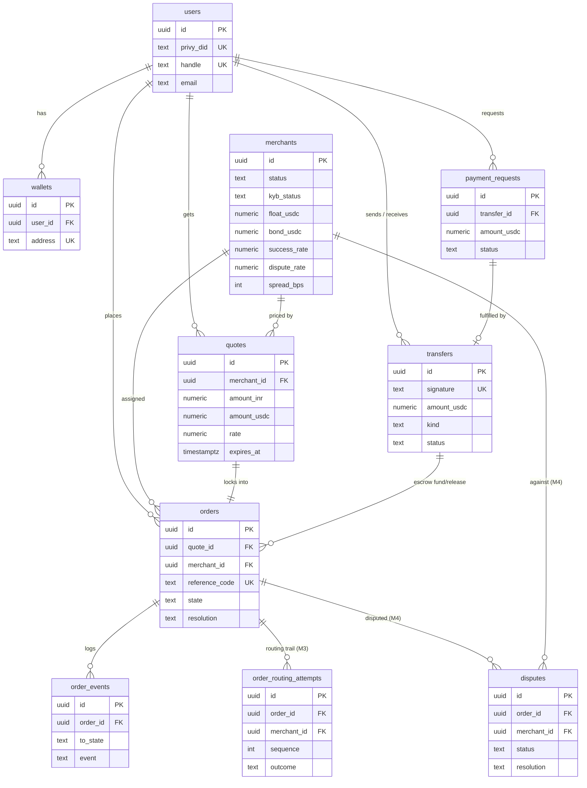

# 10 · Data Model

## What it is

The Postgres schema — the system's source of truth for everything *except* token balances (those live
on-chain and are read live via `getUsdcBalance`). There's **no ORM**; one SQL file defines the schema
and one module (`queries.ts`) holds every query. **Access control is enforced in the API layer** (no
row-level security) — every query is owner-scoped by `userId`.

## Entity relationships

## Table by table

| Table | Purpose | Notes |
|---|---|---|
| **users** | one row per person | keyed to Privy DID; unique `handle` |
| **wallets** | a user's chain address(es) | `chain='solana'`; unique `address` |
| **transfers** | the money ledger | `kind ∈ send/add/pay/escrow_fund/escrow_release`; `status ∈ pending/confirmed/failed`; unique `signature` |
| **payment_requests** | "you owe me $X" | `status ∈ open/paid/cancelled`; links the fulfilling `transfer_id` |
| **merchants** | the LP network (simulated) | ranking signals (`success_rate`/`dispute_rate`/`avg_completion_secs`/`spread_bps`/`float_usdc`) kept **live by M4** + `base_*` seed priors; lifecycle (`status` incl. `suspended`, `kyb_status`), `bond_usdc`, `sim_behavior` |
| **quotes** | a 45s-locked price | INR + USDC legs, `rate`, fees, ETA, `route_quality`, `expires_at` |
| **orders** | the 7-state machine | `state` + transient `resolution`; links escrow fund/release transfers; `expires_at` = escalation deadline |
| **order_events** | append-only timeline | powers the live tracker; `(from_state, to_state, event, detail)` |
| **order_routing_attempts** *(M3)* | routing audit + tried-set + **M4 scoring substrate** | `(sequence, outcome, reason)`; `released`/`failed` outcomes feed `success_rate` |
| **disputes** *(M4)* | user disputes on completed orders | `(status open/resolved, resolution upheld/rejected)`; upheld draws down the LP's bond + feeds `dispute_rate` |

## Why this way

- **Ledger + state machine, not balances.** Token balances are authoritative on-chain; the DB records
  *intent and lifecycle* (who tried to pay whom, what state an order is in). This avoids the classic
  bug of a DB balance drifting from the chain — we read the chain for truth and reconcile.
- **Append-only `order_events`.** The timeline is derived from an immutable log, so the UI and any
  audit see the same history; state is never "rewritten."
- **CHECK constraints + idempotent migrations.** States/kinds are constrained at the DB level; a
  bottom-of-file `do $$ … $$` block backfills constraints on older databases (e.g. widening
  `transfers.kind` for escrow). No migration framework yet — `schema.sql` is re-runnable.
- **Indexes** cover the hot reads: transfers by user, orders by user and by `(state, expires_at)` (the
  worker's scan), events by order.

## Legalities

- **The audit substrate.** `transfers`, `orders`, `order_events`, and `order_routing_attempts` together
  are the **record-keeping** any payments/AML regime requires: who moved what, when, through which
  provider, with what outcome. Combined with on-chain signatures + escrow events, it's a complete,
  cross-verifiable trail.
- **PII & retention.** `users` holds email/phone — a real launch needs retention limits, encryption at
  rest, and regional data rules (DPDP/GDPR). Minimal today.
- **No RLS.** Authorization is entirely in the API layer. That's acceptable now but a production
  hardening item (defense in depth).

## Status

- ✅ Full schema through M4: Phase-1 + orders/quotes/merchants (M1), escrow transfers (M2),
  `order_routing_attempts` (M3), `disputes` + merchant lifecycle/`bond_usdc`/`base_*` columns (M4);
  idempotent constraint + column backfills; owner-scoped queries; hot-path indexes.
- ⬜ RLS, encryption-at-rest, retention policy (production hardening).

## Key files

- `apps/backend/src/db/schema.sql` (the whole schema), `db/queries.ts` (every query), `db/seed.ts`
  (merchants + test data), `db/pool.ts` (connection).
- Init/seed: `yarn workspace @pay/backend db:init` / `db:seed`.
