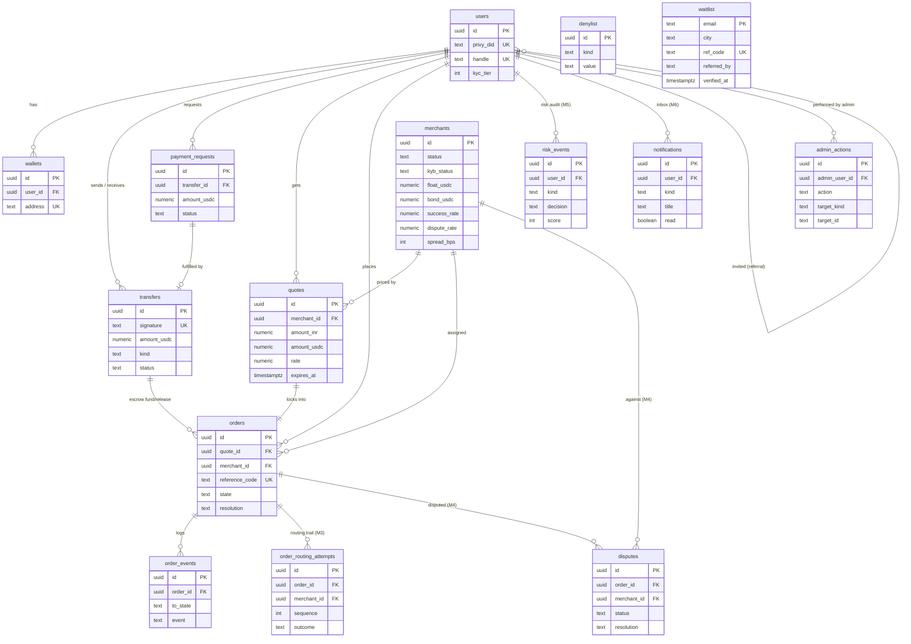

# 10 · Data Model

## What it is

The Postgres schema — the system's source of truth for everything *except* token balances (those live
on-chain and are read live via `getUsdcBalance`). There's **no ORM**; one SQL file defines the schema
and one module (`queries.ts`) holds every query. **Access control is enforced in the API layer** (no
row-level security) — every query is owner-scoped by `userId`.

## Entity relationships

`waitlist` is deliberately unattached — no FK to `users`, because the people on it don't have
accounts yet. `users.referred_by` is the self-reference that carries the invite tree.

## Table by table

| Table | Purpose | Notes |
|---|---|---|
| **users** | one row per person | keyed to Privy DID; unique canonical **immutable** `handle`; opt-in E.164 `phone` (partial unique index `uq_users_phone` = the pay-by-phone mapper); best-effort `country` (dialing default); `kyc_tier` drives M5 limits; `role ∈ user/merchant/admin`; `referred_by` self-FK + `referral_limit` (default 3) = the invite-only gate, enforced at row creation in `/auth/sync` |
| **wallets** | a user's chain address(es) | `chain='solana'`; unique `address` |
| **transfers** | the money ledger | `amount_usdc numeric(20,6)`, `> 0`; `kind ∈ send/add/pay/escrow_fund/escrow_release`; `status ∈ pending/confirmed/failed`; unique `signature`; `chain` (confirmer polls `'solana'` only); `idempotency_key` (unique per sender — prepare replay/dedupe) |
| **payment_requests** | "you owe me $X" | `amount_usdc numeric(20,6)`, `> 0`; `status ∈ open/paid/cancelled`; links the fulfilling `transfer_id` |
| **merchants** | the LP network (simulated) | ranking signals (`success_rate`/`dispute_rate`/`avg_completion_secs`/`spread_bps`/`float_usdc`) kept **live by M4** + `base_*` seed priors; lifecycle (`status` incl. `suspended`, `kyb_status`), `bond_usdc`, `sim_behavior` |
| **quotes** | a 45s-locked price | the fiat leg is **2dp** (`amount_inr numeric(20,2)`) and the crypto leg **6dp** (`amount_usdc numeric(20,6)`) — they are different scales and the code must say which it means; `rate` 6dp (the engine emits 4), fees, ETA, `route_quality`, `expires_at` |
| **orders** | the 7-state machine | `amount_usdc numeric(20,6)`, `> 0`; `state` + transient `resolution`; links escrow fund/release transfers; `expires_at` = escalation deadline |
| **order_events** | append-only timeline | powers the live tracker; `(from_state, to_state, event, detail)` |
| **order_routing_attempts** *(M3)* | routing audit + tried-set + **M4 scoring substrate** | `(sequence, outcome, reason)`; `released`/`failed` outcomes feed `success_rate` |
| **disputes** *(M4)* | user disputes on completed orders | `(status open/resolved, resolution upheld/rejected)`; upheld draws down the LP's bond + feeds `dispute_rate` |
| **denylist** *(M5)* | simulated sanctions list | `(kind address/handle, value)`; screened on every money movement |
| **risk_events** *(M5)* | per-action fraud/screening audit | `(kind, decision allow/review/block, score, reason)` |
| **notifications** *(M6)* | in-app inbox | `(kind, title, body, read, meta)`; written by `notify()` at lifecycle events |
| **admin_actions** | audit trail for the admin console | one row per admin **write**; `target_id` is text (uuid or `kind:value`) so one table covers every target kind |
| **waitlist** | the f list — landing-page signups | `email` is the PK (a re-submit is idempotent, never a duplicate); `city` = the demo corridor selected; `ref_code` = this member's own share code (unique, **HMAC-derived not stored-random**); `referred_by` holds `'@handle'` *or* another member's code and is **last-touch** (each submit carrying a ref overwrites it — the landing page caches the ref so attribution survives a stripped URL); `verified_at` = the confirm click. No user FK — these people have no account yet |

## Why this way

- **Ledger + state machine, not balances.** Token balances are authoritative on-chain; the DB records
  *intent and lifecycle* (who tried to pay whom, what state an order is in). This avoids the classic
  bug of a DB balance drifting from the chain — we read the chain for truth and reconcile.
- **Append-only `order_events`.** The timeline is derived from an immutable log, so the UI and any
  audit see the same history; state is never "rewritten."
- **`numeric`, never `float8` — and the string it returns is the point.** Every money column is
  `numeric`, so storage is exact, `sum()` is exact, and a value too big for the column is *rejected*
  rather than silently mangled. `pg` hands `numeric` back as a **string**, and the app keeps it that
  way all the way to the client — see [01 · Money & decimals](01-architecture.md#money--decimals).
  What `numeric(20,6)` does **not** protect against is precision it can simply absorb: a 10-decimal
  amount is silently rounded to 6 by the *cast*, before any CHECK runs. That's why the app layer
  rejects excess precision instead of trusting the column, and why `0002_money_checks.sql` only
  claims what a constraint can actually enforce — sign.
- **CHECK constraints + idempotent migrations.** States/kinds are constrained at the DB level, and
  `0002_money_checks.sql` adds the money ones (`amount_usdc > 0` on every ledger leg, `>= 0` on
  balances and fees) — the last guard that survives a *new* route forgetting to validate. A
  bottom-of-file `do $$ … $$` block backfills constraints on older databases (e.g. widening
  `transfers.kind` for escrow). No migration framework yet — `schema.sql` is re-runnable.
- **Indexes** cover the hot reads: transfers by user, orders by user and by `(state, expires_at)` (the
  worker's scan), events by order, `waitlist.ref_code` (unique) and `waitlist.referred_by`.
- **One polymorphic column instead of two FKs.** `waitlist.referred_by` holds either an app user's
  `@handle` or another f-list member's `ref_code` — both opaque strings, `@` disambiguates. It buys a
  single code path for two referral sources with no join; it costs referential integrity, so renaming
  a handle would orphan old attribution. Fine for a marketing queue, wrong if referral credit ever
  pays out money (flagged with a `ponytail:` comment in `schema.sql`).
- **The upsert's coalesce order differs by column, deliberately.** `city` and `ref_code` read
  `waitlist.*` first — write-once, because a code is derived from the email and must never move.
  `referred_by` reads `excluded` first — last-touch, so the newest invite link wins. See
  [20 · Waitlist & referral loop](20-waitlist-referral-loop.md) for why, and for what that costs.

## Legalities

- **The audit substrate.** `transfers`, `orders`, `order_events`, and `order_routing_attempts` together
  are the **record-keeping** any payments/AML regime requires: who moved what, when, through which
  provider, with what outcome. Combined with on-chain signatures + escrow events, it's a complete,
  cross-verifiable trail.
- **PII & retention.** `users` holds email/phone — a real launch needs retention limits, encryption at
  rest, and regional data rules (DPDP/GDPR). Minimal today.
- **No RLS.** Authorization is entirely in the API layer. That's acceptable now but a production
  hardening item (defense in depth).

## Status

- ✅ Full schema through M6: Phase-1 + orders/quotes/merchants (M1), escrow transfers (M2),
  `order_routing_attempts` (M3), `disputes` + merchant lifecycle columns (M4), `users.kyc_tier` +
  `denylist` + `risk_events` (M5), `notifications` (M6); idempotent constraint + column backfills;
  owner-scoped queries.
- ✅ Post-M6 growth + ops tables: `admin_actions` (console audit trail), `users.role`,
  `users.referred_by`/`referral_limit` (invite-only gate), and `waitlist` + its referral columns.
- 🟡 `waitlist.ref_code` is null on rows written before the referral loop; the `coalesce` in
  `addWaitlistEmail` backfills one the next time that address is submitted, so legacy rows stay
  code-less until they re-submit.
- ⬜ RLS, encryption-at-rest, retention policy (production hardening).

## Key files

- `apps/backend/src/db/schema.sql` (the whole schema), `db/queries.ts` (every query), `db/seed.ts`
  (merchants + test data), `db/pool.ts` (connection).
- Init/seed: `yarn db:init` / `yarn db:seed`.
