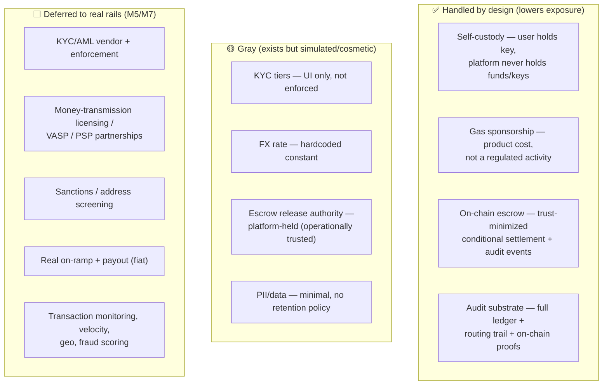

# 11 · Compliance & Legalities (the honest risk map)

> **Not legal advice.** This is an engineering-level map of *which regulatory questions each part of
> the product touches, how the current design handles or defers them, and where the gray zones are.*
> Every item marked for a real launch must be confirmed with qualified counsel in each target
> jurisdiction.

## The core thesis: simulated-rails-first keeps us out of scope

The product is built **structure-first with simulated rails**: real on-chain escrow and a real order
lifecycle, but a **simulated merchant/LP network**, a **quoted (not live) FX rate**, a **devnet
faucet instead of a real on-ramp**, and **no real fiat payout**. Because **no real customer money and
no real fiat movement occur**, almost none of the heavy regulation is *triggered yet*. The design
intent is that each regulated edge has a **clean seam** where a licensed partner or vendor plugs in at
the milestone that needs it — so we build the whole machine now and turn on the regulated parts last
(M5 compliance, M7 real rails).

## The risk map

## Topic by topic

### 1. Custody & money transmission — ✅ *lightened by design*
Holding customer funds/keys is what triggers the heaviest rules (US state **MTL** / FinCEN **MSB**, EU
**VASP/EMI**). The app is **non-custodial**: the user signs every movement of their own funds; the
platform only sponsors gas. This is the **single biggest lever** keeping us in a lighter
classification during the build. **Caveat:** the per-order escrow does put funds under *program*
control briefly — see #3. *(The custody/MTL line is fact-specific and jurisdiction-specific; confirm
with counsel before real funds move.)*

### 2. KYC / customer identification — 🟡 *cosmetic → M5*
The tiered model (caps scale with verification, "progressive/JIT KYC") is the right shape and the seam
for a vendor (Persona/Onfido/Sumsub). **Today nothing is enforced** — no documents collected, no
limits applied. Fine on devnet; **must close before real funds**. Lives at **M5**.

### 3. Escrow release authority — 🟡 *platform-held*
The escrow is trust-minimized (funds can only go to the intended merchant or back to the user), but the
**release authority is the platform's fee-payer** — so *operationally* we decide when to release. A
fully trust-minimized off-ramp constrains this further (payout-proof-conditioned release, time-locked
auto-refund, or multisig). This is the main legal gray of the payout flow. See [07](07-onchain-escrow.md).

### 4. FX & consumer disclosure — 🟡 *quoted, not live*
Quoting INR↔USD with a spread has consumer-protection (and sometimes licensing) implications. The
quote screen **does** itemize rate + fees (good), but the **rate is a hardcoded constant**. A real
launch needs a live FX source and clear, accurate disclosure. **M7.**

### 5. On-ramp / payout (real fiat) — ⬜ *deferred to M7*
Converting fiat↔crypto and paying out to bank rails (UPI/Pix/bank) is the **regulated core** and needs
**licensed partners** (PSP/MSB/VASP) who carry the fiat-leg licenses, plus KYC + source-of-funds at
entry. Deliberately last; the faucet/simulated payout move nothing of legal consequence until then.

### 6. AML / sanctions / monitoring — ⬜ *deferred to M5*
Transaction monitoring, velocity/geo checks, fraud scoring, and **sanctions/address screening** (OFAC
etc.) are required once real value flows. The **data foundation exists** (the `transfers` ledger +
`order_events` + routing trail), so these are additive analytics over existing data, not a re-architecture.

### 7. Best-execution / fair routing — ✅ *evidenced*
A routing marketplace should prove it isn't self-dealing. The `order_routing_attempts` log + explicit
scoring weights ([08](08-routing-and-failover.md)) are the evidence trail. (Not user-facing by choice.)

### 8. Data / privacy — 🟡 *minimal*
`users` holds email/phone/handle. A real launch needs a privacy policy, retention limits, encryption at
rest, and regional handling (India **DPDP**, **GDPR**). Minimal today.

### 9. Merchant/LP network (KYB) — 🟡 *modelled (M4 ✅), real vendor deferred to M7*
The **structure** is now built ([08](08-routing-and-failover.md)): KYB lifecycle (`kyb_status`,
onboarding/approval gating), performance scoring from real outcomes, **bonds** (skin-in-the-game,
auto-suspend below a floor), and a **dispute** open/resolve flow that draws the bond down. Still
**simulated** — no real KYB vendor, contracts, payout, or arbitration — so no real counterparty risk
yet; those flip at **M7**.

## Summary table

| Topic | Posture | Status | Closes at |
|---|---|---|---|
| Custody / money transmission | non-custodial (lighter class) | ✅ by design | (revisit M7 w/ counsel) |
| Gas sponsorship | product cost | ✅ | rate-limit M6 |
| Escrow conditional settlement | trust-minimized | ✅ structure / 🟡 authority | hardening later |
| KYC tiers | progressive model | 🟡 cosmetic | **M5** |
| AML / sanctions / monitoring | data foundation only | ⬜ | **M5** |
| FX & disclosure | itemized but fixed rate | 🟡 | **M7** |
| On-ramp / payout (fiat) | simulated | ⬜ | **M7** |
| Merchant KYB / bonds / disputes | structure built (M4 ✅), simulated network | 🟡 | real vendor **M7** |
| Data / privacy | minimal | 🟡 | pre-launch |

## Bottom line

The app is intentionally on the **light side of regulation** today because it holds no customer funds
and moves no real fiat. The **gray** items (KYC, FX, escrow authority, PII) are known and seamed; the
**deferred** items (licensing, real rails, AML/sanctions) are sequenced into M5/M7 where a licensed
partner carries the regulated leg. The thing to *not* do: flip on a real on-ramp or real payout before
M5's KYC/AML and counsel sign-off.

## Related

[03 Custody & gas](03-custody-and-gas.md) · [07 Escrow](07-onchain-escrow.md) ·
[12 Status & roadmap](12-status-and-roadmap.md) · [13 Future milestones](13-future-milestones.md)
