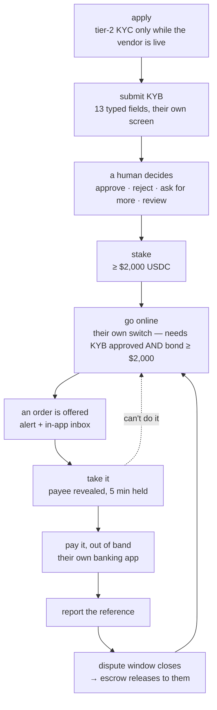

# 11 · The LP Console

## What it is

The app the people who settle our payouts actually use. An LP (liquidity provider) is a real person
with a real bank account who pays a payee in local currency on a payer's behalf, and gets USDC out
of escrow for it.

**No money moves through this app.** That is the defining fact and it is worth being blunt about,
because the name invites the opposite assumption. The console does three things:

1. **Tells them work exists** — an order is funded and they can take it.
2. **Shows them their score, and what it earns them** — the reason they'd keep doing this.
3. **Shows them their stake** — what they've put up, what it backs, how to get it back.

The payment itself happens in the LP's own banking or UPI app. We hand them a destination and an
amount; they pay it; they come back and report the reference. We are a notice board and a scoreboard,
not a payment rail. The machine behind all of it — quoting, escrow, routing, the offer/lock, release
— is [06](06-offramp-and-settlement.md).

**It is a separate app, on its own domain.** It has to be: a payer must never perceive that a person
settles their payment ([06](06-offramp-and-settlement.md) § Why this way), and while the console
lived inside the wallet app that promise held only as far as the URL bar. Anyone signed in could
reach it, and the code shipped in every payer's JavaScript bundle whether they visited or not.

**Who can use it:** existing fpay users only. Account creation needs an invite
([02](02-identity-and-onboarding.md)) — with three carve-outs in `inviteRequired`: an existing user
(matched on Privy DID *or* verified email), an empty directory, and any address in `ADMIN_EMAILS`.
The console itself never signs anyone up.

Applying needs a `users` row and **tier-2 identity verification only while the identity vendor is
live** (`routes/merchant.ts` — `if (config.personaLive && …)`). While it is off, that gate is dropped
and the human reviewing the business form is the identity check
([14](14-manual-onboarding-fallback.md)). Approval does **not** grant a KYC tier: nothing a partner
does reads one. Someone arriving without an account gets told to open the wallet app
first — the same dead end the admin console gives a non-admin.

## The lifecycle

Every step is refusable and every step is reversible except the last. An LP can hand an order back
free of penalty, go offline, or ask for their stake back.

The KYB submission asks more than business identity. Alongside the PAN and the payout account go
screening questions — experience, profession, intended stake, commitment, and whether the payout
account is dedicated or shared — the same signal peer platforms collect before letting anyone in.
Nothing in them is verifiable and nothing gates on them; they exist so the human deciding is reading
a person with a stated intent, and the dedicated-account question aims straight at the frozen-account
pattern ([08](08-compliance-and-legalities.md)). One spec drives all of it
(`packages/shared/src/kyb.ts`): the form renders it, both sides validate it, and the admin review
shows the answers under the same labels the applicant saw.

## The score, and what it buys

This is the centre of the product. An LP's pitch is not "settle payouts"; it is **keep your score up
and you can earn more**, and the console has to make that legible or the incentive doesn't exist.

Four signals, recomputed from real order outcomes over the **last 90 days** (payer 👍/👎 is
lifetime until it carries its own timestamp) and smoothed toward a prior so a low-volume LP
isn't volatile: **success rate**, **average completion time**, **dispute rate**, and **payer 👍/👎**.
The settled *count* behind the tier's volume gate stays lifetime — a rung earned by volume doesn't
dissolve in a quiet quarter.
They feed the routing score directly ([06](06-offramp-and-settlement.md) § Routing), so what the
screen shows and what the router does cannot drift — they read the same columns.

Those signals roll into a **tier**, and the tier is what pays:

| | buys | costs the platform |
|---|---|---|
| **More capacity per dollar staked** | effective float is `bond × leverage`, and leverage rises with tier | more exposure per bond |
| **First refusal on every order** | the routed LP holds it exclusively for 5s before the pool sees it — pushed a deep link the moment the clock starts, while rivals can't even see the order | nothing |
| **The spread surplus** | an order is offered only to LPs at or below the quoted spread, so a cheaper LP who is faster keeps the difference | nothing |
| **A wider price envelope** | the platform sets a per-tier ceiling on the margin (`TIER_MAX_SPREAD_BPS`); a higher tier may charge more, and a downgrade clamps a stored margin to the new cap in the same stats write | nothing — the payer-facing quote is still struck competitively |

The screen leads with the number and with **what closes the gap to the next tier** — derived by
running the same step function against current signals and naming the term that is binding ("12 more
clean orders at 98%+"). A tier badge with no path to the next one is decoration.

Deliberately **not** a reward: a shortened dispute window for trusted LPs. It cycles their capital
faster at no cost to us, and it is the payer's only recourse period. Wrong side of that trade.

Live work outranks all of it while it exists — a five-minute lock is time-critical and a score is
not — so orders take the top of the screen when there are any, and the scoreboard is what an LP sees
the rest of the time.

## The stake

An LP stakes USDC before they can be routed anything. It is **skin in the game, and nothing else**:

- **Held idle.** It sits in the stake treasury and is not deployed, lent, or used as working capital.
- **It gates routing**, in the query that picks LPs — not in a background job. Below the floor, an
  LP is suspended out of routing; above it again, they are reinstated to *offline* (solvent means
  eligible to work, not back at the desk — they say when).
- **It bounds exposure.** Effective float is `min(what they declared, bond × leverage)`. Their claim
  about their own capacity was previously unchecked against their stake.
### The numbers, in one place

Every constant this doc names by symbol. Enforced values, read from source — if you change one, change
it here too.

| what | value | where |
|---|---|---|
| `MIN_BOND` — stake floor to go online, and to stay routable | **$100** (= the tier-1 payer's per-transaction cap) | `services/merchantStats.ts` |
| dispute penalty — drawn per upheld dispute | **min(bond, the order's amount)** — no flat fine | `db/queries.ts` `drawDownBond` |
| `DISPUTE_CLAW_WINDOW_H` — bond stays claimable, and a completed order disputable, for | **72 h** | `services/merchantStats.ts` |
| `MAX_STAKE_DEPOSIT_USD` — cap on one stake deposit | **$50,000** | `routes/merchant.ts` |
| `LEVERAGE` — effective float multiplier, by partner tier | **1 → 1× · 2 → 3× · 3 → 5×** | `services/merchantStats.ts` |
| `MIN_SPREAD_BPS` — price floor | **10 bps** | `services/merchantOps.ts` |
| `TIER_MAX_SPREAD_BPS` — price ceiling, by tier | **1 → 100 · 2 → 200 · 3 → 300 bps** | `services/merchantStats.ts` |
| tier 2 needs | **10 settled · ≥95% success · ≤3% disputes** | `TIER_RULES` |
| tier 3 needs | **50 settled · ≥98% success · ≤1% disputes · ≤120s median** | `TIER_RULES` |
| `PAYEE_COOLDOWN_DAYS` — a partner may not pay the same payee again inside | **180 days** | `services/routing.ts` |
| `HEAD_START_MS` — the preferred partner's exclusive window | **5s** | `services/orderMachine.ts` |
| `LOCK_TTL_MS` — how long a taken order is held | **5 min** | `services/orderMachine.ts` |
| `DISPUTE_WINDOW_MS` — the payer's window to dispute | **2 min** | `services/orderMachine.ts` |
| lock ban | **3 abandonments in 24h → 1 hour blocked** | `services/orderMachine.ts` |

`settled` (the tier's volume gate) is **lifetime**; the three rates are 90-day, except `positive_rate`
which is lifetime because 👍 has no timestamp of its own.

- **It is slashed only on an upheld dispute** — `min(bond, the order's amount)`, once per order, and
  the ledger records what was actually drawn. With tier-1 leverage at 1× (in flight ≤ bond) every
  draw is fully covered; nothing is ever left uncollected. A draw that lands under the floor
  auto-suspends the partner on the next stats tick, exactly as before.
- **Every movement is ledgered.** `merchant_bond_events` is written in the same statement as every
  change to `bond_usdc` — deposit, request, cancel, penalty — so for every partner the balance IS the
  sum of its ledger (`check-bond` asserts it). A partner is never deleted: leaving is a flag
  (`suspend_reason = 'exited'`, frozen by trigger) and the ledger, the KYB record and the history stay.
- **It comes back.** Withdrawal is a *request*: the bond is debited immediately (money on its way out
  must stop backing new orders). **Five** preconditions, all predicates in one statement: enough bond,
  **no withdrawal already requested**, no in-flight orders, no open disputes, and **nothing completed
  inside the 72-hour claw window** (`recent_payout`) — while a payout can still be disputed, the bond
  that would answer for it stays. Then a root admin sends the
  USDC. The stake vault has no signer by design, so automating the release means a
  second hot key in env — a security decision deliberately not made as a side effect.

> **Open decision: staked returns.** The stake earns the LP nothing today. Whether it should — and
> what that would mean for withdrawal timing, for what we owe them, and for the regulatory posture of
> holding other people's money to deploy it — is undecided and deliberately unbuilt.

## Being told about work

An LP who has to keep a tab open is an LP who misses orders, so the console is a **notifier first**.

- The **in-app inbox always fires** — it is the durable record and it costs one row.
- An **out-of-band channel** reaches a pocket: `services/alert` is a config-selected adapter
  registry, the same shape as the payout and KYC seams. Telegram is the adapter that exists, chosen
  because it reaches a locked phone in about a second, needs no service worker, no app install and
  no approval, and costs nothing. Web push and mobile push are the obvious next adapters and are not
  built; `merchants.alert_address` is already shaped to hold a device token.
- The **first alert fires while the payer is still signing**, not after funding — a few seconds of
  head start that costs the payer nothing and adds nothing to what they see.
- **Alerts never carry the payee.** They say the amount and that work exists. Who to pay is revealed
  only by taking the order, and an alert that leaked it would walk straight around the lock.

> A third-party messenger now sees LP payment metadata (amounts, timing). That is a new processor
> and is recorded in [08](08-compliance-and-legalities.md), not glossed here.

## What an LP is asked to pay

We hand over a destination; they pay it however they normally would. Two things about the work
they are handed, both decided 2026-08-21 ([06](06-offramp-and-settlement.md) § Routing, § Legs):

- **They will not be handed the same receiver twice in 180 days** (`PAYEE_COOLDOWN_DAYS` — doubled
  from 90 on 2026-08-24), nor two live orders to one receiver. This is routing's pair rule, not a score — a personal account paying the same handle
  repeatedly is the account-freeze pattern — so it never shows in the queue as a refusal; the
  order simply isn't offered to them and the lock would refuse it if it were.
- **An order may be one part of a larger payment.** When no single LP can carry a payment it is
  split across LPs, and each gets an ordinary order for their part: the amount on the screen and in
  the UPI deep link is *their* part, the reference is theirs, the lock, the claim and the release
  are theirs. The other parts are other people's orders; the console never shows them.

Today there is exactly one destination shape per live corridor, and the corridor registry is what
decides:

- **UPI ID** (`name@bank`) — India. Gets a deep link into their UPI app and a "processed by" label
  derived from the handle's suffix.
- **QRIS merchant ID** — Indonesia. Copied by hand; there is no equivalent public URI scheme.

**Bank account + IFSC, and phone numbers, are deferred** (2026-08-14). Two things have to be
answered first, and neither is a formatting problem:

1. **A destination is one text column.** An account number, an IFSC and a beneficiary name are three
   fields the LP copies separately — a single string they have to split by hand, at 3am, for money
   that does not come back, is not a design.
2. **A typed account has no independent name check.** With UPI the payee's name comes from the QR or
   the PSP and the payer confirms it against something they didn't write. With an account number the
   payer supplies the account, the code *and* the name, so a mistyped digit reaches a stranger and
   nothing on our side catches it. The likely answer is that the LP's own bank is the check — IMPS
   and NEFT name-match at their end, a mismatch fails, the LP never claims, and the ladder refunds —
   but that costs the payer time and an LP a wasted lock, and it should be a decision rather than a
   discovery.

Until then `bank` and `Pix` are declared `NOT_QUOTABLE` in `lib/corridors.ts`: they remain valid
enum values, and any attempt to quote or register on them is refused at the door rather than
accepted into a dead end.

## Status

- ✅ Apply, KYB submission with a merchant-visible timeline, staking, self-serve availability and
  pricing (inside the tier's price cap — the platform sets the envelope, the LP prices within it),
  capacity, the order queue with offer/lock/reveal, reporting a payout, the earnings and
  disputes ledger, and the alert seam with a Telegram adapter.
- ✅ Its own app (`apps/lp`), with the score leading and distance-to-next-tier computed from the
  same rules routing scores on.
- ✅ Its own Vercel project and domain (`provider.frenspay.xyz`, `DEPLOY.stage.md`), behind the same
  deploy access gate as the wallet app — its own key, its own cookie.
- ⬜ Web/mobile push. **Bank and phone destinations** (above). Staked returns. An admin surface for
  releasing a stake withdrawal ([07](07-admin-and-moderation.md)).

## Key files

- `apps/backend/src/routes/merchant.ts` — every LP-facing endpoint
- `apps/backend/src/services/{routing,merchantStats}.ts` — the score, the tier, the leverage table
- `apps/backend/src/services/alert/{index,provider,telegram}.ts` — the notifier seam
- `packages/shared/src/kyb.ts` (+ `apps/backend/src/lib/kyb.ts`, its enforcing mirror)
- `packages/ui` — the design system the console shares with the wallet app
- `apps/lp/src/{middleware.ts,lib/gate.ts,lib/gateHtml.ts,app/gate/route.ts}` — the deploy access gate, byte-for-byte `apps/web`'s
