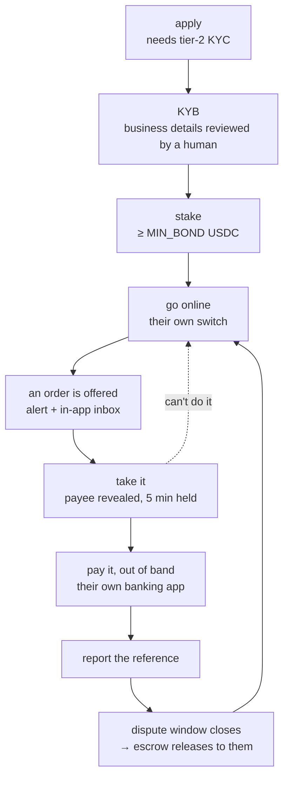

# 11 · The LP Console

## What it is

The app the people who settle our payouts actually use. An LP (liquidity provider) is a real person
with a real bank account who pays a payee in local currency on a payer's behalf, and gets USDC out
of escrow for it.

**No money moves through this app.** That is the defining fact and it is worth being blunt about,
because the name invites the opposite assumption. The console does three things:

1. **Tells them work exists** — an order is funded and they can take it.
2. **Shows them their score, and what it earns them** — the reason they'd keep doing this.
3. **Shows them their stake** — what they've put up, what it backs, how to get it back.

The payment itself happens in the LP's own banking or UPI app. We hand them a destination and an
amount; they pay it; they come back and report the reference. We are a notice board and a scoreboard,
not a payment rail. The machine behind all of it — quoting, escrow, routing, the offer/lock, release
— is [06](06-offramp-and-settlement.md).

**It is a separate app, on its own domain.** It has to be: a payer must never perceive that a person
settles their payment ([06](06-offramp-and-settlement.md) § Why this way), and while the console
lived inside the wallet app that promise held only as far as the URL bar. Anyone signed in could
reach it, and the code shipped in every payer's JavaScript bundle whether they visited or not.

**Who can use it:** existing fpay users only. Applying needs a `users` row and tier-2 identity
verification, and account creation needs an invite ([02](02-identity-and-onboarding.md)), so the
console never signs anyone up. Someone arriving without an account gets told to open the wallet app
first — the same dead end the admin console gives a non-admin.

## The lifecycle

Every step is refusable and every step is reversible except the last. An LP can hand an order back
free of penalty, go offline, or ask for their stake back.

## The score, and what it buys

This is the centre of the product. An LP's pitch is not "settle payouts"; it is **keep your score up
and you can earn more**, and the console has to make that legible or the incentive doesn't exist.

Four signals, recomputed from real order outcomes and smoothed toward a prior so a low-volume LP
isn't volatile: **success rate**, **average completion time**, **dispute rate**, and **payer 👍/👎**.
They feed the routing score directly ([06](06-offramp-and-settlement.md) § Routing), so what the
screen shows and what the router does cannot drift — they read the same columns.

Those signals roll into a **tier**, and the tier is what pays:

| | buys | costs the platform |
|---|---|---|
| **More capacity per dollar staked** | effective float is `bond × leverage`, and leverage rises with tier | more exposure per bond |
| **First refusal on every order** | the routed LP holds it exclusively for 20s before the pool sees it | nothing |
| **The spread surplus** | an order is offered only to LPs at or below the quoted spread, so a cheaper LP who is faster keeps the difference | nothing |

The screen leads with the number and with **what closes the gap to the next tier** — derived by
running the same step function against current signals and naming the term that is binding ("12 more
clean orders at 98%+"). A tier badge with no path to the next one is decoration.

Deliberately **not** a reward: a shortened dispute window for trusted LPs. It cycles their capital
faster at no cost to us, and it is the payer's only recourse period. Wrong side of that trade.

Live work outranks all of it while it exists — a five-minute lock is time-critical and a score is
not — so orders take the top of the screen when there are any, and the scoreboard is what an LP sees
the rest of the time.

## The stake

An LP stakes USDC before they can be routed anything. It is **skin in the game, and nothing else**:

- **Held idle.** It sits in the stake treasury and is not deployed, lent, or used as working capital.
- **It gates routing**, in the query that picks LPs — not in a background job. Below the floor, an
  LP is suspended out of routing; above it again, they are reinstated to *offline* (solvent means
  eligible to work, not back at the desk — they say when).
- **It bounds exposure.** Effective float is `min(what they declared, bond × leverage)`. Their claim
  about their own capacity was previously unchecked against their stake.
- **It is slashed only on an upheld dispute**, a flat penalty, once per order.
- **It comes back.** Withdrawal is a *request*: the bond is debited immediately (money on its way out
  must stop backing new orders), preconditions are no in-flight orders and no open disputes, and a
  human sends the USDC. The stake vault has no signer by design, so automating the release means a
  second hot key in env — a security decision deliberately not made as a side effect.

> **Open decision: staked returns.** The stake earns the LP nothing today. Whether it should — and
> what that would mean for withdrawal timing, for what we owe them, and for the regulatory posture of
> holding other people's money to deploy it — is undecided and deliberately unbuilt.

## Being told about work

An LP who has to keep a tab open is an LP who misses orders, so the console is a **notifier first**.

- The **in-app inbox always fires** — it is the durable record and it costs one row.
- An **out-of-band channel** reaches a pocket: `services/alert` is a config-selected adapter
  registry, the same shape as the payout and KYC seams. Telegram is the adapter that exists, chosen
  because it reaches a locked phone in about a second, needs no service worker, no app install and
  no approval, and costs nothing. Web push and mobile push are the obvious next adapters and are not
  built; `merchants.alert_address` is already shaped to hold a device token.
- The **first alert fires while the payer is still signing**, not after funding — a few seconds of
  head start that costs the payer nothing and adds nothing to what they see.
- **Alerts never carry the payee.** They say the amount and that work exists. Who to pay is revealed
  only by taking the order, and an alert that leaked it would walk straight around the lock.

> A third-party messenger now sees LP payment metadata (amounts, timing). That is a new processor
> and is recorded in [08](08-compliance-and-legalities.md), not glossed here.

## What an LP is asked to pay

We hand over a destination; they pay it however they normally would. The shapes depend on the
country, which is what the corridor registry is for:

- **UPI ID** (`name@bank`) — India. Gets a deep link into their UPI app and a "processed by" label.
- **Bank account + IFSC** — India, when the payee has no UPI. Two fields the LP copies separately,
  and no deep link.
- **Phone number** — where the rail resolves one.

The beneficiary **name** stops being decorative for bank transfers: name matching is how a
misdirected transfer is caught, and it is what the LP checks before sending money that does not come
back.

## Status

- ✅ Apply, KYB submission with a merchant-visible timeline, staking, self-serve availability and
  pricing, capacity, the order queue with offer/lock/reveal, reporting a payout, the earnings and
  disputes ledger, and the alert seam with a Telegram adapter.
- 🟡 The console still lives inside the wallet app while it is being moved to its own; the score is
  shown but does not yet lead, and distance-to-next-tier is not surfaced.
- ⬜ Its own app and domain. Web/mobile push. Bank and phone destinations. Staked returns. An admin
  surface for releasing a stake withdrawal ([07](07-admin-and-moderation.md)).

## Key files

- `apps/backend/src/routes/merchant.ts` — every LP-facing endpoint
- `apps/backend/src/services/{routing,merchantStats}.ts` — the score, the tier, the leverage table
- `apps/backend/src/services/alert/{index,provider,telegram}.ts` — the notifier seam
- `packages/shared/src/kyb.ts` (+ `apps/backend/src/lib/kyb.ts`, its enforcing mirror)
- `packages/ui` — the design system the console shares with the wallet app
