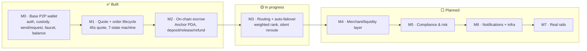

# 12 · Status & Roadmap (M0 → M7)

## The heat-map

How done is each layer of the north-star architecture. ✅ complete · 🟡 gray (partial/simulated) ·
⬜ planned.

## Layer-by-layer

| Architecture layer | Today | Status | Milestone |
|---|---|---|---|
| Auth & embedded wallet | Privy email-OTP, self-custody | ✅ | M0 |
| Custody & gas sponsorship | fee-payer model, no SOL for users | ✅ | M0 |
| P2P send / request | real gas-sponsored USDC + requests | ✅ | M0 |
| Money in (funding) | **devnet faucet** | 🟡 | M0 → M7 |
| Quote engine | rate+fee+ETA, 45s lock; **FX = constant** | ✅ / 🟡 FX | M1 |
| Order state machine | 7 states + resolutions, CAS, failure-first | ✅ | M1 |
| Escrow / conditional release | **on-chain Anchor PDA** (devnet) | ✅ | M2 |
| Routing / matching engine | weighted rank + **silent failover** | 🟡 in progress | M3 |
| Merchant / liquidity layer | **simulated** LPs (sim_behavior) | 🟡 sim → ⬜ | M1 seed → M4 |
| Compliance & risk (KYC/AML) | **cosmetic** tiers, no enforcement | 🟡 | M5 |
| Notifications, queues, rate-limit, observability | none (one in-process poller) | ⬜ | M6 |
| Real rails (live FX, payout, KYC vendor, mainnet) | simulated | ⬜ | M7 |

## What "done" means per shipped milestone

- **M0 — Base P2P wallet** ✅ — Privy auth + embedded wallets, self-custody + gas sponsorship, send /
  request by handle, balance + history, devnet faucet, confirmation pipeline (poller + Helius webhook).
  *Mobile has this; web has this.*
- **M1 — Quote + order lifecycle** ✅ — quote engine (45s lock), the full 7-state order machine + 4
  resolution states, the web Quote + OrderTracking UI, simulated merchant worker. *Gray: FX is a
  hardcoded constant; merchant is simulated.*
- **M2 — On-chain escrow** ✅ — per-order Anchor PDA (deposit/release/refund, close-on-terminal
  double-spend guard, `emit!` audit events), deployed to devnet, 4/4 localnet tests, backend wired,
  typecheck clean. *Gray: interactive web E2E pending a human; release authority platform-held.*
- **M3 — Routing + auto-failover** 🟡 — weighted multi-signal ranking + invisible reroute-before-refund
  + routing audit table. Backend-only; frontend untouched. *In progress (build-ready).*

## The honest gray list (what's not real yet)

1. **FX rate** is a constant (`87.55`), not a live feed. *(M7)*
2. **Merchants/LPs are simulated** — `sim_behavior` drives happy/slow/no_receipt/timeout. *(M4)*
3. **Funding is a faucet**, not a real on-ramp. *(M7)*
4. **KYC tiers are cosmetic** — no enforcement, no documents. *(M5)*
5. **Escrow release authority is platform-held** — operationally trusted. *(hardening)*
6. **One in-process poller**, no queue/Redis/rate-limit/observability. *(M6)*
7. **Mobile lacks the cash-out order flow** (P2P only). *(parity work)*
8. **Nothing is committed to git yet** — all M1/M2/M3 work is in the working tree.

## Next decisions on the table

- **De-crypto UX polish** — strip the remaining crypto "tells" (USDC/escrow/on-chain wording, dollars-
  only quote, human payment tracker) so it reads like an everyday app. *(scoped, not yet started)*
- **Finish M3** routing/failover backend.
- **Mobile order-flow parity.**
- **Commit** the shipped work.

See [13-future-milestones](13-future-milestones.md) for M4–M7 detail.
