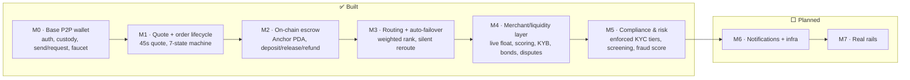

# 12 · Status & Roadmap (M0 → M7)

## The heat-map

How done is each layer of the north-star architecture. ✅ complete · 🟡 gray (partial/simulated) ·
⬜ planned.

## Layer-by-layer

| Architecture layer | Today | Status | Milestone |
|---|---|---|---|
| Auth & embedded wallet | Privy email-OTP, self-custody | ✅ | M0 |
| Custody & gas sponsorship | fee-payer model, no SOL for users | ✅ | M0 |
| P2P send / request | real gas-sponsored USDC + requests | ✅ | M0 |
| Money in (funding) | **devnet faucet** | 🟡 | M0 → M7 |
| Quote engine | rate+fee+ETA, 45s lock; **FX = constant** | ✅ / 🟡 FX | M1 |
| Order state machine | 7 states + resolutions, CAS, failure-first | ✅ | M1 |
| Escrow / conditional release | **on-chain Anchor PDA** (devnet) | ✅ | M2 |
| Routing / matching engine | weighted rank + **silent failover** | ✅ | M3 |
| Merchant / liquidity layer | live float, **computed scoring**, KYB, bonds, disputes (simulated network) | ✅ / 🟡 sim | M4 |
| Compliance & risk (KYC/AML) | **enforced KYC tiers** + screening + fraud score (sim vendor) | ✅ / 🟡 vendor | M5 |
| Notifications, queues, rate-limit, observability | none (one in-process poller) | ⬜ | M6 |
| Real rails (live FX, payout, KYC vendor, mainnet) | simulated | ⬜ | M7 |

## What "done" means per shipped milestone

- **M0 — Base P2P wallet** ✅ — Privy auth + embedded wallets, self-custody + gas sponsorship, send /
  request by handle, balance + history, devnet faucet, confirmation pipeline (poller + Helius webhook).
- **M1 — Quote + order lifecycle** ✅ — quote engine (45s lock), the full 7-state order machine + 4
  resolution states, web Quote + OrderTracking UI, simulated merchant worker.
- **M2 — On-chain escrow** ✅ — per-order Anchor PDA (deposit/release/refund, close-on-terminal
  double-spend guard, `emit!` events), deployed to devnet, 4/4 localnet tests. *Gray: interactive web
  E2E pending a human; release authority platform-held.*
- **M3 — Routing + auto-failover** ✅ — weighted multi-signal ranking + invisible reroute-before-refund
  + `order_routing_attempts` audit log + dev `merchant-fail` trigger. Backend-only.
- **M4 — Merchant/liquidity layer** ✅ — live available-float gating, computed+smoothed performance
  scoring on the confirmer tick, KYB lifecycle + onboarding sim, bond reserve + auto-suspend, disputes
  open/resolve flow. `check-merchant.ts` harness. *Gray: the LP network itself is still simulated.*
- **M5 — Compliance & Risk** ✅ — `users.kyc_tier` enforced per-tier caps at the money-movement
  endpoints (rolling-24h volume, structured `limit_exceeded`), simulated verification upgrade,
  sanctions/denylist screening + a per-tx fraud score → `risk_events`. The web uses the real tier.
  `check-compliance.ts` harness. *Gray: KYC vendor + real sanctions lists still simulated (M7).*
- **De-crypto UX** ✅ — dollars-only Quote, human payment tracker, Processing/Completed chips, copy
  swaps; the app reads like an everyday money app, no crypto "tells" user-facing.

## The honest gray list (what's not real yet)

1. **FX rate** is a constant (`87.55`), not a live feed. *(M7)*
2. **The LP network is simulated** — `sim_behavior` drives outcomes; KYB/bonds/disputes are modelled,
   not backed by a real vendor or arbitration. *(M7)* But the signals they feed are now **real/computed**.
3. **Funding is a faucet**, not a real on-ramp. *(M7)*
4. **KYC vendor + sanctions lists are simulated** — tiers are now **enforced** (M5), but real document
   capture and a live OFAC/sanctions feed are sim. *(M7)*
5. **Escrow release authority is platform-held** — operationally trusted. *(hardening)*
6. **One in-process poller**, no queue/Redis/rate-limit/observability. *(M6 — next)*
7. **Mobile lacks the cash-out order flow** (P2P only). *(parity work)*

## Where we are

Committed on branch `sacred`: anchor program, backend (M1–M5), web+mobile + de-crypto, docs. Next
milestone: **M6 — Notifications + infra hardening** (Redis queues/locks, rate-limiting, observability,
notifications). See [13-future-milestones](13-future-milestones.md) for M6–M7 detail and
[11-compliance](11-compliance-and-legalities.md) for the risk map.
