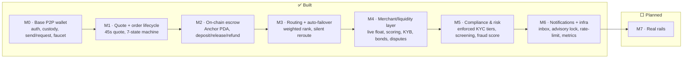

# 12 · Status & Roadmap (M0 → M7)

## The heat-map

How done is each layer of the north-star architecture. ✅ complete · 🟡 gray (partial/simulated) ·
⬜ planned.

## Layer-by-layer

| Architecture layer | Today | Status | Milestone |
|---|---|---|---|
| Auth & embedded wallet | Privy email-OTP, self-custody | ✅ | M0 |
| Custody & gas sponsorship | fee-payer model, no SOL for users | ✅ | M0 |
| P2P send / request | real gas-sponsored USDC + requests | ✅ | M0 |
| Money in (funding) | **devnet faucet** | 🟡 | M0 → M7 |
| Quote engine | rate+fee+ETA, 45s lock; **live FX** (M7) | ✅ | M1 / M7 FX |
| Order state machine | 7 states + resolutions, CAS, failure-first | ✅ | M1 |
| Escrow / conditional release | **on-chain Anchor PDA** (devnet) | ✅ | M2 |
| Routing / matching engine | weighted rank + **silent failover** | ✅ | M3 |
| Merchant / liquidity layer | live float, **computed scoring**, KYB, bonds, disputes (simulated network) | ✅ / 🟡 sim | M4 |
| Compliance & risk (KYC/AML) | **enforced KYC tiers** + screening + fraud score (sim vendor) | ✅ / 🟡 vendor | M5 |
| Notifications, rate-limit, observability | **in-app inbox + advisory lock + in-house rate-limit + /metrics** (single-instance) | ✅ / 🟡 scale | M6 |
| Real rails (live FX, payout, KYC vendor, mainnet) | simulated | ⬜ | M7 |

## What "done" means per shipped milestone

- **M0 — Base P2P wallet** ✅ — Privy auth + embedded wallets, self-custody + gas sponsorship, send /
  request by handle, balance + history, devnet faucet, confirmation pipeline (poller + Helius webhook).
- **M1 — Quote + order lifecycle** ✅ — quote engine (45s lock), the full 7-state order machine + 4
  resolution states, web Quote + OrderTracking UI, simulated merchant worker.
- **M2 — On-chain escrow** ✅ — per-order Anchor PDA (deposit/release/refund, close-on-terminal
  double-spend guard, `emit!` events), deployed to devnet, 4/4 localnet tests. *Gray: interactive web
  E2E pending a human; release authority platform-held.*
- **M3 — Routing + auto-failover** ✅ — weighted multi-signal ranking + invisible reroute-before-refund
  + `order_routing_attempts` audit log + dev `merchant-fail` trigger. Backend-only.
- **M4 — Merchant/liquidity layer** ✅ — live available-float gating, computed+smoothed performance
  scoring on the confirmer tick, KYB lifecycle + onboarding sim, bond reserve + auto-suspend, disputes
  open/resolve flow. `check-merchant.ts` harness. *Gray: the LP network itself is still simulated.*
- **M5 — Compliance & Risk** ✅ — `users.kyc_tier` enforced per-tier caps at the money-movement
  endpoints (rolling-24h volume, structured `limit_exceeded`), simulated verification upgrade,
  sanctions/denylist screening + a per-tx fraud score → `risk_events`. The web uses the real tier.
  `check-compliance.ts` harness. *Gray: KYC vendor + real sanctions lists still simulated (M7).*
- **M6 — Notifications + infra** ✅ — in-app notifications (table + emits at order completed/refunded,
  send→recipient, request paid, KYC upgrade + web bell/badge/inbox), a per-user **advisory lock** closing
  the M5 daily-cap TOCTOU, an in-house **rate limiter** (money-movement + faucet + auth), and **metrics**
  at `/metrics` + a pino latency log. `check-infra.ts` 7/7. *Gray: single-instance — Redis + real push are
  M7. See [14](14-notifications-and-infra.md).*
- **De-crypto UX** ✅ — dollars-only Quote, human payment tracker, Processing/Completed chips, copy
  swaps; the app reads like an everyday money app, no crypto "tells" user-facing.

## The honest gray list (what's not real yet)

1. **FX is live** now (cached, range-validated, with an offline fallback); the remaining gray is a
   *regulated* FX provider with an SLA + formal disclosures, bundled with real payout. *(M7 vendor)*
2. **The LP network is simulated** — `sim_behavior` drives outcomes; KYB/bonds/disputes are modelled,
   not backed by a real vendor or arbitration. *(M7)* But the signals they feed are now **real/computed**.
3. **Funding is a faucet**, not a real on-ramp. *(M7)*
4. **KYC vendor + sanctions lists are simulated** — tiers are now **enforced** (M5), but real document
   capture and a live OFAC/sanctions feed are sim. *(M7)*
5. **Escrow release authority is platform-held** — operationally trusted. *(hardening)*
6. **Single-instance infra** — rate-limit + metrics + notifications are built (M6), but the lock/limiter/
   counters are in-process; **Redis (multi-instance) + real push** are *(M7)*.
7. **Mobile lacks the cash-out order flow** (P2P only). *(parity work)*

## Where we are

Committed on branch `sacred`: anchor program, backend (M1–M6), web+mobile + de-crypto, docs. Next and
**final** milestone: **M7 — Real rails** (live FX, real payout + KYC/AML vendors, mainnet) — the one that
flips every simulated component to production. See [13-future-milestones](13-future-milestones.md) for
the M7 detail and [11-compliance](11-compliance-and-legalities.md) for the risk map.

**2026-07-22 increment (docs 16–18):** direct external-address sends (tier-2 gated, idempotent
prepare); UPI-style directory — canonical immutable handles + opt-in pay-by-phone with country
dialing defaults; unified pay targets (QR / address / @handle / phone incl. `tel:` QRs); backend
routes split into domain modules with keyset pagination on the list endpoints; three-tier env config
(local/stage/prod, separate databases); chain list = Solana live + 12 CCTP-reachable EVM networks
"coming soon", with the chain-surface rule codified (network names only at external send /
on-ramp / off-ramp). Pending: the **parked OTP-channel decision** (Privy SMS = US/CA-only on all
plans vs WhatsApp = all regions; irreversible dashboard choice — see 02), Helius key, runtime
matrices in 17/18.

**2026-07-23 increment (docs/19): cross-chain USDC is BUILT.** CCTP V2 behind a rail abstraction
(`bridge_transfers` + rail registry; `cctp_standard` free outbound, `cctp_fast` seconds-fast
inbound; protocol mix is env config). Outbound: send to any Base/Ethereum/Arbitrum address —
user-signed Solana burn (self-custody), platform settles destination gas; free on L2s, visible $2
on Ethereum. Inbound: the user's Privy smart wallet is the deposit address; "Move to balance" runs
a paymaster-sponsored burn; the fee-payer mints on Solana. Devnet cutover to OFFICIAL Circle USDC
(faucet = treasury transfers). Preflight (`scripts/check-cctp.ts`) passes: IDL burn build, Iris
sandbox, all 3 Sepolia RPCs. Pending funding/ops: Circle-faucet the treasury, Sepolia-ETH the
minter wallet, Privy dashboard smart-wallets + Pimlico paymaster URLs; then the docs/19 runtime
matrix.

**2026-08-01 increment (docs/20): the f list can grow itself.** One `?ref=` parameter now carries
either an app user's `@handle` or an f-list member's own 8-char share code; `POST /waitlist` records
it and answers `{code, position, frens}`, and a new `GET /waitlist/verify` stamps the confirm click
and redirects back to the landing page. Codes and tokens are both HMAC-derived from the address, so
nothing is stored, nothing expires, and a re-submit is idempotent. First outbound email in the
system (Resend over `fetch`, no dependency) — deliberately inert until its env vars are set, so it
deploys ahead of DNS. The app-side loop closed too: "Share invite" points at the marketing site
instead of the app origin, and the invite gate offers an f-list exit instead of a dead end. Pending:
the **landing page half is deferred** while that redesign is in flight (no `?ref=` read, no share
link, no `?v=1` state), plus Resend domain verification and `db:init` on stage.

**2026-08-10 increment (docs/01): money stopped being a float.** Every amount is now a **decimal
string** at rest and on the wire, a BigNumber inside a calculation, a `bigint` of base units at the
chain edge, and a `number` only when printed — one invariant, one module (`units.ts`, mirrored into
the backend and byte-compared by `check:money`). The live bugs it closed were all *missing
validation*, not lost precision: a 10-decimal amount was silently truncated to 6, `1e-9` passed the
`> 0` guard and built a zero-value transaction, and `1e308` reached Postgres as a 500. Rounding now
has a direction with a name — what the user owes rounds up, what fpay delivers rounds down, and a
protocol fee ceiling rounds up because rounding *that* one down reverts a CCTP burn on-chain. Two
real defects fell out of it: the fast-lane rail fee was quantized to cents, so a $1 transfer owed
Circle $0.0001 and collected nothing, and the quote's half-up `.toFixed()` pair could hand back a
cent nobody funded. `0002_money_checks.sql` adds sign constraints as the backstop, and `check:money`
(now in `check:all`) guards the two traps TypeScript can't see — `<` between decimal strings compares
*lexically*, and `+` *concatenates*. Pending: nothing in this workstream; `apps/mobile` still carries
the old float shape but is parked outside the workspace.

**2026-08-12 increment (DEPLOY.stage.md/DEPLOY.md): stage hosting became real and gated.** The
backend cut over to a repo-root **Dockerfile** (`node:24-slim`, Supabase session-pooler Postgres,
migrations before start) on Railway, and the frontends adopted the OMS Vercel model — **one project
per app per environment** (`stage` branch → stage projects, `sacred` → prod twins). Two hard-won
invariants got documented at the root cause: web's Vercel project needs **"Include source files
outside of the Root Directory" OFF** (otherwise `@vercel/next` resolves the app dir against the git
root while `next build` recorded it against `outputFileTracingRoot`, the `noop.js` →
`server.runtime.prod.js` crash), and admin will hit the same crash until its `outputFileTracingRoot`
points at the git root. The deployed web app now sits behind a **shared access-key gate**
(`src/middleware.ts` + `/gate`: per-env `openssl rand -hex 32` key, year-long hashed device cookie,
unset = off) — web's first server-side code, which makes it permanently a Next server rather than a
static export. Both DEPLOY files are now step-by-step runbooks (settings, variables, domains,
tests). Pending: first admin deploy (the tracing-root fix), stage web/API custom domains.

**2026-08-12 increment (docs/02, docs/20): the invite code became a real thing.** The gate used to
be an existing user's `@handle` plus a counter on their row (`users.referral_limit`), which meant
**nobody — not even an admin — could generate an invite**: the only lever was a hand-written
`UPDATE`, exactly as the baseline migration's own comment instructed. Codes are now rows
(`invite_codes`), so they can be minted, listed, revoked and audited. Redemption moved **inside the
account-creation transaction**, where `select … for update` on the single code row replaced the
lock-the-referrer-then-count-in-a-separate-statement dance — a net deletion, and stronger: two
people racing one code, one wins, the other reads `redeemed_at` and gets a clean 403. Unknown, used
and revoked collapse to one `invalid_invite` so the endpoint can't be used as an oracle. The
**landing page is now the door** (`POST /invite/check`, public and check-only — it never burns and
never reserves, because reserving would mean holding a lock across a redirect and a whole signup),
with the f list demoted to the fallback. Each account gets **three codes shown exactly once**,
server-enforced via `users.invites_revealed_at`: lose one, lose a fren. Admin gained an invites
console (house codes, owned by nobody, are the standing answer to "we're out") and **team
management** — promoting an operator was the other SQL-only hole, with `ADMIN_EMAILS` naming root
admins who can't be demoted so one bad click can't lock everyone out. `users.email` is finally
written, from Privy, after existing unused since the baseline. Pending: the square logo cut sweeping
the rest of the apps, and automating queue → invite-send.
