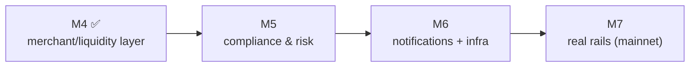

# 13 · Future Milestones (M5 → M7)

The unbuilt half of the roadmap, documented to the same standard so the full vision is on paper. Each
is **⬜ planned**. These flip the remaining **simulated** components ([11](11-compliance-and-legalities.md))
into **real** ones, in dependency order: make the (now-built) marketplace compliant (M5), harden the
infra (M6), then connect real money (M7). *(M4 — the merchant/liquidity layer — is **✅ built**; see
[08](08-routing-and-failover.md).)*

---

## M5 · Compliance & Risk

**What it will be.** Make the cosmetic KYC real and add risk controls: enforce **progressive KYC tiers
0–3** (actual caps/limits), integrate a **KYC/AML vendor**, **address/sanctions screening** (OFAC etc.),
**transaction monitoring**, **velocity/geo checks**, and **fraud scoring**.

**Why.** The moment real value flows (M7), identifying and screening customers is non-negotiable.
Building it at M5 means the gates exist *before* the on-ramp turns on.

**Legalities.** This **is** the compliance milestone — it closes the biggest grays from
[11](11-compliance-and-legalities.md): KYC enforcement, AML monitoring, sanctions screening. Pairs
directly with that doc.

**Status.** ⬜ Planned. The tiered UI shell ([02](02-auth-identity.md)) and the `transfers`/`orders`
ledger ([10](10-data-model.md)) are the seams; M5 adds enforcement + a vendor + screening over them.

---

## M6 · Notifications + Infra Hardening

**What it will be.** Production infrastructure: a **notification service** (push/webhooks/reminders —
"you paid ₹X to Y", "Z sent you $A"), **Redis** for queues/locks/quote-cache, **API-gateway
rate-limiting** (incl. protecting the fee-payer from abuse), and **observability** dashboards.

**Why.** Today there's one in-process 8s poller and no rate-limiting — fine for devnet, not for
production load, abuse resistance, or operability. This is the "make it survive real traffic" milestone.

**Legalities.** Operational resilience + abuse prevention are themselves compliance expectations for a
payments operator; rate-limiting the fee-payer prevents a spam-drain DoS.

**Status.** ⬜ Planned. The confirmer/worker move from an in-process tick to real queues; notifications
read the existing `transfers`/`order_events` data.

---

## M7 · Real Rails

**What it will be.** Flip every simulated component to production: a **live FX source**, **real payout
providers** (UPI/Pix/bank), **KYC/AML vendors** live, and **mainnet** USDC (Circle's real mint)
instead of a controlled devnet mint. The faucet becomes a **real on-ramp** (card/bank/Apple Pay via a
licensed partner).

**Why.** The endgame: real users moving real money. Everything before M7 exists so that this switch is
a *configuration + partnership* change, not a re-architecture.

**Legalities.** The **regulated core**: licensed on-ramp/payout partners (PSP/MSB/VASP) carrying the
fiat legs, live KYC/AML enforcement, FX disclosure, mainnet custody/key hardening (HSM/KMS/multisig for
the fee-payer + constrained escrow authority). **Counsel sign-off required before launch.**

**Status.** ⬜ Planned. Seams are everywhere by design: `USDC_MINT` → Circle's mint; `solana.ts` faucet
→ on-ramp partner; simulated LP payout → real PSP; `MID_RATE` constant → live FX; devnet → mainnet RPC.

---

## The throughline

Every future milestone replaces a **simulated edge** with a **real, licensed one** at a **seam that
already exists** in the code. That's the payoff of "build the structure with simulated rails first":
the hard architecture is done; what remains is partnerships, vendors, and turning regulated features on
in the right order. See [12-status-and-roadmap](12-status-and-roadmap.md) for the current heat-map.
