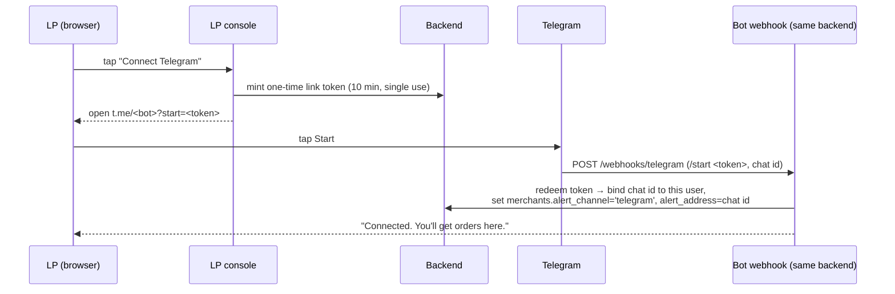
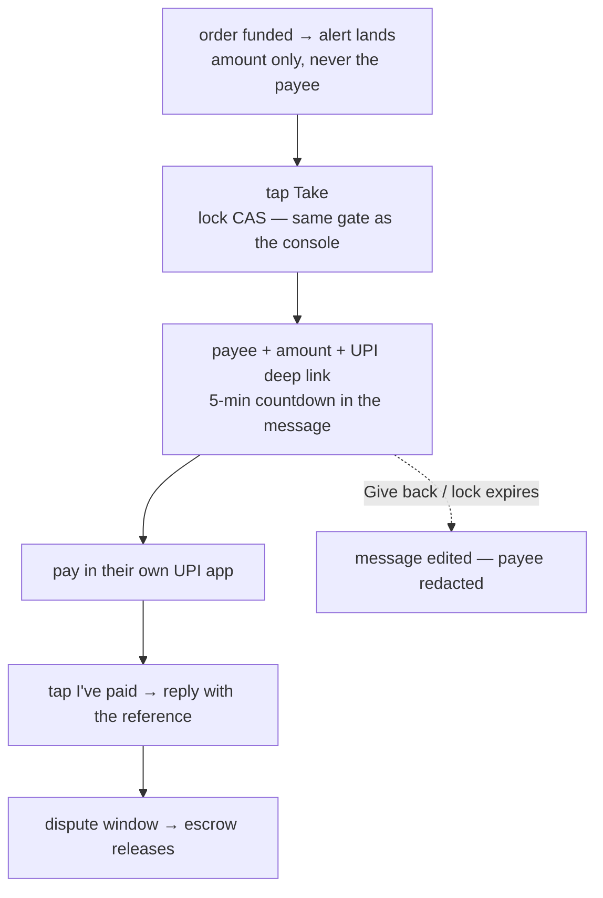

# 13 · The Telegram bot

> **Drafted 2026-08-24, ahead of implementation.** Decisions marked **(proposed)** are the
> plan's recommended defaults and are still awaiting sign-off — the open question list lives in
> the planning session, not here. Per the status legend in [README](README.md), nothing below
> claims unshipped behavior: almost everything in this doc is ⬜, and the Setup section is the
> part that can be done today, because only a human with the Telegram account can do it.

## What it is

A second renderer of the [LP console](11-lp-console.md), inside Telegram. Same account, same
backend, same gates — a partner who settles payouts can run their whole working day from the
chat: get told work exists, **take it, see who to pay, pay out of band, report the reference,
give it back**, flip themselves online/offline, and check earnings and score. The web console
remains the full surface; the bot covers the operational core.

Telegram was already chosen as the LP alert channel on the merits
([11](11-lp-console.md) § Being told about work): it reaches a locked phone in about a second,
needs no app install, no service worker, no store review, and costs nothing. Today that channel
is **one-way and orphaned** — the backend can send an alert to a chat id, but no screen ever
captures a chat id and nothing listens for replies. The bot closes both halves of that loop:
the alert becomes a message with buttons on it, and the buttons do the work.

Alongside the bot, the **apply step starts asking for two contact facts** it never asked for:

- **Telegram** — optional ("connect it if you're on it"), captured via the link flow below.
- **Phone number** — asked at apply, stored normalized (E.164), **verification stubbed**: the
  row records `verified_at = null` and a real verification layer lands later. The full OTP
  machine already exists for the wallet-side phone alias (`services/phoneOtp.ts`, [02](02-identity-and-onboarding.md));
  the LP contact phone deliberately does not reuse `users.phone`, because that column doubles as
  the pay-by-phone directory opt-in — storing an LP there would make them findable by every
  payer **(proposed)**.

## What exists today vs. what this adds

| | Exists | Missing |
|---|---|---|
| Outbound sends | ✅ `services/alert/telegram.ts` — bare `fetch` to `sendMessage`, HTML mode, inline **Open** button; adapters never throw | Message edits (redaction), callback buttons |
| Address storage | ✅ `merchants.alert_channel` / `alert_address` (migration 0015) | Anything that ever sets them — the console has no UI and `setMerchantAlerts` has zero callers |
| Backend route | ✅ `POST /merchants/alerts` (`routes/merchant.ts:372`) — its docstring already specifies the `/start <token>` handshake | The handshake itself: token mint, the bot webhook that redeems it |
| Env | ✅ `TELEGRAM_BOT_TOKEN` read by `envConfig.ts` (unset → adapter inert) | The var isn't in `.env.example`; no webhook secret var; no bot created |
| Inbound | — | Everything: `/webhooks/telegram` route, update handling, commands, buttons |
| Identity | ✅ Privy bearer → `authPreHandler` | A `chat_id → user/merchant` mapping — a chat id is not an identity the API accepts today |
| Phone at apply | ✅ `/apply` collects one field (business name); KYB later takes a free-text `contactPhone` into `kyb_fields` jsonb | A typed, normalized, apply-time contact phone + the verification stub |

## Flow **(proposed)**

Connecting Telegram — the deep-link handshake the `/merchants/alerts` docstring already sketches:



Working an order from the chat:



Everything the buttons do calls the **same code the console routes call** — lock, unlock, paid,
status — behind the same gates (suspension, KYB approved, lock bans, bond floor). The bot is a
client, not a second rulebook. What stays on the web: **stake** (needs the Privy embedded wallet
to sign), **identity** (Persona's hosted flow), **KYB** (a seven-field form) — the bot deep-links
out for those.

## Why this way **(proposed)**

- **Inside the backend, not a separate app.** There is no service-auth path a standalone bot
  could use (`auth.ts` accepts only Privy bearers), and inventing one just to talk to ourselves
  over HTTP is a second identity system for zero gain. In-process, the webhook resolves
  `chat_id → merchants` row and calls the same service functions the routes call.
- **Deep link, not a "login with Telegram" widget.** A bot cannot message a person who has never
  pressed Start, so a widget alone can't deliver alerts. `t.me/<bot>?start=<token>` yields both
  the identity proof and the open chat in one tap.
- **Webhook on stage/prod, long-polling locally.** The deployed backend has a public URL and an
  existing self-registering webhook pattern (Helius registers itself at boot against
  `PUBLIC_BASE_URL`); authenticity is Telegram's `X-Telegram-Bot-Api-Secret-Token` header,
  checked with the existing `secretEq`. Local has no public URL, so it polls — with its **own
  bot** (see the trap below).
- **One bot per tier.** `setWebhook` is a property of the token: if stage and prod shared a bot,
  every stage deploy would repoint prod's webhook at stage.
- **Bare `fetch`, no SDK.** The whole surface is five methods (`sendMessage`, `editMessageText`,
  `answerCallbackQuery`, `setWebhook`, `getUpdates`); the existing adapter and `email.ts` already
  set the house style.
- **Payee redaction.** Chat history is forever, so once an order is paid, handed back, or the
  lock expires, the bot edits the reveal message and removes the payee.
- **Alerts still never carry the payee.** The invariant holds ([11](11-lp-console.md)): who to
  pay appears only after the Take button — i.e. after the lock.

## Setup — the steps only Bridge can do

Nothing here requires the code to exist; do it once and the tokens wait in env.

### 1 · Create three bots in @BotFather

One per tier. In Telegram, open **@BotFather** (the verified one) and, three times:

1. `/newbot`
2. **Display name** — what LPs see in the chat header, e.g. `FrensPay Partners`
   (stage: `FrensPay Partners (stage)`, local: anything — it's yours alone).
3. **Username** — must end in `bot`, e.g. `frenspay_bot` · `frenspay_stage_bot` ·
   `frenspay_dev_bot`.
4. BotFather replies with the **token** (`1234567890:AA…`). Treat it like any secret — it can
   send messages as the bot. `/token` re-shows it; `/revoke` rotates it.

### 2 · Configure each bot (still in @BotFather)

- `/setjoingroups` → **Disable** — private chats only; an order taken in a group would reveal
  the payee to everyone in it.
- `/setcommands` → paste (final list lands with the code):

  ```
  start - connect your fpay account
  online - start taking orders
  offline - stop taking orders
  orders - what's open right now
  earnings - your ledger
  status - your score, tier and stake
  help - what this bot can do
  ```
- Optional polish: `/setdescription` (the empty-chat blurb), `/setabouttext`, `/setuserpic`
  (the mark from `yarn brand` output).
- `/setprivacy` can stay at its default — irrelevant in private chats.

### 3 · Generate webhook secrets

One per deployed tier (local polls, it needs none):

```bash
openssl rand -hex 32
```

This becomes Telegram's `X-Telegram-Bot-Api-Secret-Token` header on every webhook call — the
same shared-secret shape the Helius webhook uses.

### 4 · Set the env vars

Names follow the [prefix chain](10-ops-and-roadmap.md) (`envConfig.ts`): stage reads
`STAGE_<KEY>`, prod reads the bare key, local reads `LOCAL_<KEY>` and **falls back to
`STAGE_<KEY>`** — which is exactly why local must set its own token explicitly.

| Where | Var | Value |
|---|---|---|
| Railway · stage env | `STAGE_TELEGRAM_BOT_TOKEN` | @frenspay_stage_bot token |
| Railway · stage env | `STAGE_TELEGRAM_WEBHOOK_SECRET` | its hex secret |
| Railway · prod env | `TELEGRAM_BOT_TOKEN` | @frenspay_bot token |
| Railway · prod env | `TELEGRAM_WEBHOOK_SECRET` | its hex secret |
| `apps/backend/.env` (local) | `LOCAL_TELEGRAM_BOT_TOKEN` | @frenspay_dev_bot token — **never the stage token** |

> **The local trap.** A local backend that inherits `STAGE_TELEGRAM_BOT_TOKEN` through the
> fallback chain and starts polling would call `deleteWebhook`/`getUpdates` **on stage's bot**
> — detaching stage's webhook and eating its updates. The implementation will guard on an
> explicitly-`LOCAL_`-set token before starting the poller, but the operational rule stands:
> stage's token never goes in a local `.env`.

Stage's `TELEGRAM_BOT_TOKEN` also powers the **existing alert adapter** — same bot sends alerts
and answers commands; there is no second token.

### 5 · Verify

```bash
# token works (any time, no deploy needed)
curl -s "https://api.telegram.org/bot<TOKEN>/getMe"

# after the bot code deploys: webhook registered itself at boot (like Helius)
curl -s "https://api.telegram.org/bot<TOKEN>/getWebhookInfo"
# expect url = https://stage.api.frenspay.xyz/webhooks/telegram, last_error_message absent
```

Then DM the bot `/start` from your own Telegram: pre-code it will say nothing; post-code it
should answer with the "connect from the console" nudge, and the full loop is console →
**Connect Telegram** → Start → an order alert with buttons on it.

## Legalities

- **The processor gets wider.** [08](08-compliance-and-legalities.md) §11 already flags Telegram
  as an unentered processor seeing *amount + timing*. A bot that reveals the payee after Take
  puts **payee VPA/name into a third party's chat history** — redaction-on-completion narrows
  the window but does not undo delivery. This is a posture decision to make explicitly when the
  plan is approved, and §11's processor entry should be written at the same time.
- **New PII with no retention policy.** An LP contact phone joins email/phone/handle under
  [08](08-compliance-and-legalities.md) §8's honest caveat: no retention policy exists yet. This
  doc widens the surface knowingly; it does not solve retention.
- The chat id itself is low-sensitivity, but it is a stable external identifier bound to a
  financial actor — it lives in the DB, never in logs or client bundles.

## Status

- ✅ Outbound alert adapter, `alert_channel`/`alert_address` columns, `POST /merchants/alerts`,
  `TELEGRAM_BOT_TOKEN` plumbing — built earlier with the alert seam ([11](11-lp-console.md)).
- ⬜ Everything else: the webhook/poller, the link handshake, commands and buttons, the console
  "Connect Telegram" row, phone-at-apply + the verification stub, admin visibility of the new
  contact fields, the copy-gate extension (`scripts/check-copy.mjs` must scan the bot's strings —
  they are partner-facing copy), the docs/08 processor entry.
- ⬜ **The plan itself is unapproved** — the defaults above are proposals until the open
  questions (scope cut, payee-in-chat posture, phone storage location, pool broadcast) are
  answered.

## Key files

Existing:

- `apps/backend/src/services/alert/{index,provider,telegram}.ts` — the outbound seam
- `apps/backend/src/routes/merchant.ts` — `POST /merchants/alerts` + every gate the bot reuses
- `apps/backend/src/routes/webhooks.ts` — `secretEq` + the webhook shape to copy
- `apps/backend/src/services/helius.ts` — self-registering webhook at boot, the template
- `apps/backend/src/services/phoneOtp.ts` — the real OTP machine the stub is defined against
- `apps/backend/src/envConfig.ts` — where the new vars slot in

Planned (names indicative until the plan is approved):

- `apps/backend/src/services/telegram/` — update handling, commands, the link handshake
- a `/webhooks/telegram` route + a migration (next free number) for the chat-id binding and
  `merchants.contact_phone`
