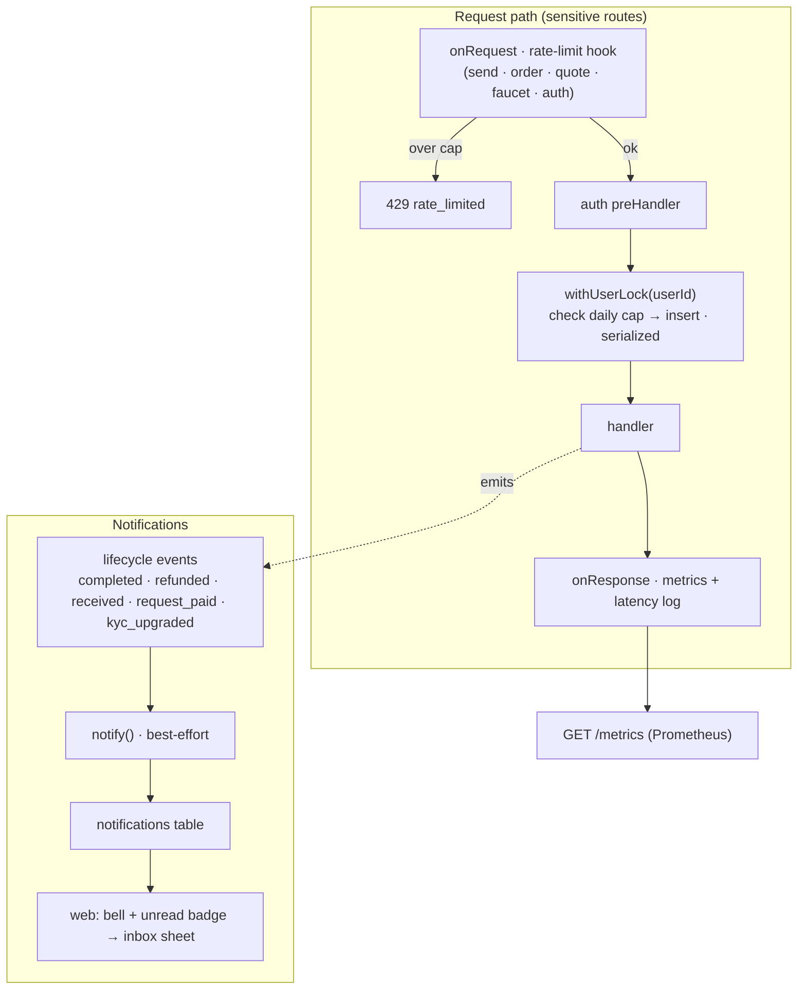

# 14 · Notifications & Infra Hardening (M6)

## What it is

The "make it production-shaped" layer: tell users what happened to their money, serialize the
money-movement checks so they can't be raced, throttle abuse of the expensive endpoints, and expose
operational metrics. **M6 builds all four with zero new infrastructure** — no Redis, no queue service,
no new npm dependency — using Postgres advisory locks, an in-house rate limiter, and in-memory counters.
The pieces that genuinely *need* external infra (real push delivery, multi-instance Redis) are deferred
to [M7](13-future-milestones.md).

1. **In-app notifications** — a `notifications` table + a best-effort `notify()` helper, surfaced as a
   header **bell + unread badge + inbox sheet** in the web app.
2. **Per-user advisory lock** — `withUserLock(userId, fn)` over `pg_advisory_lock(hashtext(userId))`,
   closing the M5 daily-cap **TOCTOU**.
3. **Rate limiting** — an in-house fixed-window limiter on money-movement + faucet + auth (→ `429`).
4. **Observability** — in-memory counters at `GET /metrics` (Prometheus text) + a pino latency log.

## Flow

**The lock closes the TOCTOU.** M5 enforced KYC daily caps by reading rolling volume then inserting the
transfer/order — two statements. Two concurrent requests could both read "under cap" and both insert,
beating the limit. `withUserLock` takes a **session advisory lock keyed on the user** for the whole
check→insert, so per user those critical sections run one at a time. Different users never contend
(distinct keys). Verified by `check-infra.ts`: two concurrent over-cap $200 sends → exactly **one**
passes.

**Rate limiting protects the fee-payer.** The platform sponsors gas on every transaction and the faucet
mints test USDC, so an unthrottled `/devnet/faucet` or `/transfer/prepare` is a drain vector. A fixed
window per identity (`x-dev-user-id` / bearer token / IP) caps each — faucet tightest (5/min), sends
20/min — returning `429` with `retry-after`.

**Notifications are best-effort.** `notify()` swallows its own errors: a notification must never fail a
payment. They populate the in-app inbox today; **real push** (FCM/APNs/web-push) and webhooks are M7.

## Why this way

- **Advisory locks over Redis.** The correctness need (serialize a per-user critical section) is met by
  Postgres itself — no new service, no new failure mode. Redis (distributed locks, queues, quote-cache)
  only becomes necessary at **multi-instance scale**, which is an M7 concern.
- **In-house limiter over a plugin.** A `Map` fixed-window is ~40 lines, no dependency, and sufficient
  for a single instance (the budget-conscious call). Multi-instance production swaps in
  `@fastify/rate-limit` + a Redis store — a drop-in at M7.
- **In-memory metrics + pino.** Counters + the structured logger Fastify already ships answer "is it
  healthy / how much traffic / how many limit blocks" without a TSDB. A real scrape target is M7.
- **Best-effort notifications.** Decoupling the notification write from the money path (try/catch, no
  await-or-fail) means the feature can never cause a failed payment — the cardinal rule.

## Legalities

- **Transaction notifications** are a consumer-protection expectation (and in some regimes a
  requirement): the user must be told when money leaves or arrives. The inbox is the first cut; auditable
  delivery (push receipts) is part of the real-rails work.
- **Abuse / fraud controls.** Rate limiting is a baseline AML/operational control — it bounds automated
  abuse and complements the M5 screening/velocity checks.
- **Observability = operational compliance.** "We can prove what the system did" (metrics + structured
  logs + the on-chain audit trail) is foundational for incident response and regulator questions.

## Status

- ✅ In-app notifications (table + emits at 5 lifecycle points + endpoints + web bell/badge/inbox).
- ✅ Per-user advisory lock closing the M5 daily-cap TOCTOU (verified).
- ✅ In-house rate limiter (`429`) on money-movement + faucet + auth.
- ✅ Metrics at `GET /metrics` (Prometheus) + pino route/status/latency log.
- 🟡 **Single-instance** — the lock uses a **dedicated lock pool** (separate from the query pool, so a
  held lock can't starve the queries inside its own section); the limiter + metrics are per-process.
  Multi-instance (Redis locks/queues/cache, shared rate-limit store, a scrape target) and **real
  push/webhook delivery** are **M7**.

## Key files

- `apps/backend/src/services/notify.ts` (emit helpers), `metrics.ts` (counters), `rateLimit.ts`
  (`rateLimitHook`, `RATE_LIMIT_RULES`, `sweepRateLimitWindows`).
- `apps/backend/src/db/queries.ts` (`withUserLock`, notification CRUD, `getSendNotifyInfo` /
  `getOrderUserAmount` / `getRequestNotifyInfo`), `db/schema.sql` (`notifications`).
- Emits in `services/{orderMachine,confirmer}.ts`; `routes/index.ts` (rate-limit hook, `/metrics`,
  `/notifications*`, the two `withUserLock` wraps); `server.ts` (onResponse/onError hooks).
- Web: `components/sheets/notifications.tsx`, `components/SheetHost.tsx`, `app/(tabs)/home/page.tsx`
  (bell + badge), `store/usePayStore.ts`, `services/api.ts`.
- Harness: `apps/backend/scripts/check-infra.ts`.

## Related

[09 Confirmation pipeline](09-confirmation-pipeline.md) · [10 Data model](10-data-model.md) ·
[12 Status & roadmap](12-status-and-roadmap.md) · [13 Future milestones](13-future-milestones.md)
