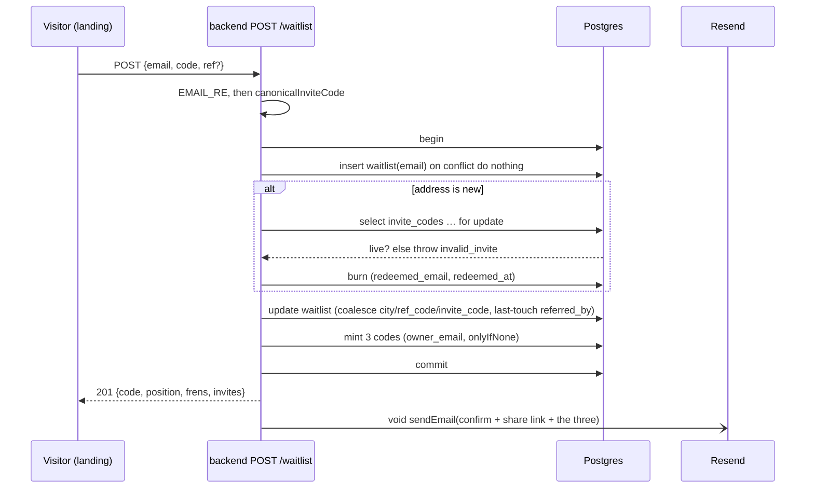
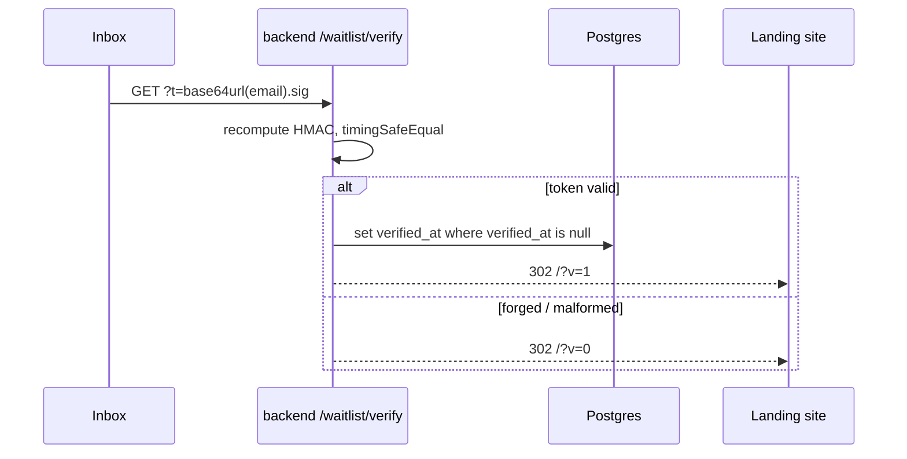

# 20 · The f list & referral loop

## What it is

The **f list** — the pre-launch queue the landing page collects — plus the two things that make it
grow and make it real: an invite code that gates entry and gives every member three of their own to
pass on, and a confirmation email that proves an address exists.

**The f list is invite-only.** A code *and* an email are both required to join, in one form, and
joining spends the code. It is not the queue you fall back to when you have no code — it *is* what a
code opens. Everyone on the list was let in by somebody, and everyone on the list can let in three.

> **Read this before changing the landing page.** This file previously described the opposite model
> — a code sent you to the app, an email put you on the queue, and the two were separate doors. It
> was wrong, and the wrongness survived long enough to be re-implemented from the doc. The strip has
> **one form, two required fields, and no mode to switch between.**

The one thing that is *not* invite-gated is an existing account: a code is spent at whichever door
it walks through first, so a code burned here is dead at `/auth/sync` too, and vice versa. There is
one "spent", `invite_codes.redeemed_at`, and both doors read it.

Two code-shaped strings still live on this page and are easy to confuse:

| String | What it is | Redeemed? |
|---|---|---|
| `FP-XXXX-XXXX` | a real invite code — random, stored, one use | yes: joining the f list, **or** signup |
| `?ref=k3n8q2wp` | f-list attribution only, HMAC-derived from the email | never |

`?ref=` used to carry an app user's `@handle` too, and `isHandle()` existed to decide which values
were safe to forward to the app's gate. Nothing forwards a ref any more: **`?ref=` is purely
attribution.** A referral link on its own gets nobody in — the person still needs a code.

## Flow

**1 · Joining**

**Two races, two different locks** — this is the part worth understanding before editing
`joinWaitlistWithCode`:

- *Two people, one code.* `select … for update` on the `invite_codes` row. Both block; whoever loses
  re-reads a row with `redeemed_at` set and falls out. Identical to the signup gate.
- *One address, two submits.* The `waitlist` primary key, claimed by `insert … on conflict do
  nothing` **before** anything is spent. A `select … for update` cannot serve here — with no row yet
  there is nothing to lock, so both callers would decide they were first and burn a code each.

Re-joining is free by construction: an address already on the list skips the burn entirely and gets
back the same three codes (`onlyIfNone`). That is what makes the route idempotent for people who
re-submit when the confirm mail is slow, and it closes the obvious grief — collect three codes, feed
them all to one address, watch them evaporate.

**2 · Confirming**

Always a redirect, never JSON: a human clicked this from a mail client, so the only useful response
is a page. Clicking twice still lands on `?v=1` — the write is guarded by `verified_at is null`, the
response is not. `?v=1` shows the success line **without** codes: they already have their three in
the mail they just came from, and re-printing them would suggest a second set.

## Why this way

- **There is no `POST /invite/check` any more.** It was the landing gate's pre-flight — check the
  code, then hand off to the app, which burned it later. A check that answers "good" and a write that
  spends it are two moments, and two people fit between them. Now the same request that validates a
  code spends it, under one lock, and the endpoint is deleted rather than left as a second way to
  probe which codes are live.
- **`redeemed_email`, not a loosened `redeemed_by`.** An f-list member has no user row.
  `redeemed_by uuid unique references users(id)` is the structural "one account burns at most one
  code" guarantee and is worth keeping exactly as strict as it is, so the other kind of redeemer sits
  beside it. At most one of the two is ever set.
- **The joiner's three are real rows, not derived.** `ref_code` is HMAC-derived precisely because it
  must be reproducible from an email and never stored. Invite codes are the opposite requirement:
  they must be unguessable, revocable, and able to record who burned them. So they are minted by
  `mintCode()` and stored with `owner_email` — which also puts f-list members' codes in the admin
  console beside everyone else's.
- **Enumeration, narrowed but not lost.** A duplicate *email* is still `201`, so the form cannot be
  used to ask "is this address on the list?". A bad code is `404` and a spent one `409` — that leaks
  nothing the caller was not already holding, and swallowing it would leave someone staring at a
  success screen for a join that never happened. Revoked stays folded into `invalid_code`: an
  operator killing a code should not advertise that it ever existed.
- **`POST /waitlist` is now the only brute-force surface on the gate**, at 5/min per IP — tighter
  than the 10/min the retired pre-flight had, which is the right direction now that a wrong guess and
  a real join are the same request. The 40-bit keyspace already makes guessing hopeless; this caps
  the rate anyway.
- **The mail is the durable copy.** The success screen is one page view and people close tabs, so the
  confirm email carries the three codes as well as the confirm button. That is why no "resend my
  codes" endpoint exists and why nothing is persisted client-side.
- **The link is the delivery vehicle; the cache is the attribution.** The landing page stores `?ref=`
  in `localStorage['fpay:ref']` on arrival and reads from there at submit even when the URL is bare.
  Otherwise attribution is shed by deleting nine characters from the address bar, and a referral
  reward dodged that easily is not a reward.
- **Last touch wins, and it's mutable.** `referred_by = coalesce(new, existing)` lets a submit
  carrying a ref overwrite the previous referrer; one carrying none leaves it alone, so re-joining
  cold can't erase credit. The accepted cost (Bridge, 2026-08-01): an already-credited signup **can**
  be re-attributed, so a referrer's `frens` count can go down. `invite_code` is the opposite —
  write-once, like `ref_code`. Who vouched for you is lineage, not marketing.
- **A typo'd ref is dropped, never rejected.** An invite is marketing. Losing a signup because someone
  mistyped a friend's handle is worse than losing the attribution. The server also never checks
  whether a ref *exists* — that would answer "is `@x` a real user?" for an unauthenticated caller.
  Note the contrast with the invite code, which is checked hard: one is a credit, the other is a door.
- **Unset configuration is a supported state.** With `RESEND_API_KEY` and `WAITLIST_SECRET` empty, no
  ref codes are minted and no mail is sent; joining still works and still spends the invite code. That
  is what lets the code deploy *before* the DNS records are published. A key **without** a secret logs
  a boot warning and stays disabled — a token minted under an empty HMAC key could be forged.
- **`WAITLIST_SECRET` is write-once in practice.** Rotating it invalidates every outstanding confirm
  link and re-mints everyone's share code, so any link already shared silently stops attributing.

## Legalities

- **Double opt-in is the point.** An unconfirmed address on a marketing list is a liability under
  GDPR/DPDP-style consent rules and a deliverability problem besides. `verified_at` is the record that
  a human with access to that inbox asked to be there.
- **PII, minimally.** The table holds an email and a city string. No name, no phone, no account link.
  Retention and deletion policy are unbuilt — an operator request today means a manual `delete`, and
  note that `waitlist.invite_code` FKs `invite_codes`, so the list row goes first.
- **Sender identity.** Mail goes out from a verified domain (SPF + DKIM); an unverified domain fails
  closed at Resend rather than sending as somebody else.
- **Enumeration.** The always-`201`-on-duplicate-email response is a privacy control, not a
  convenience.

## Status

- ✅ Schema: `waitlist.{ref_code, referred_by, verified_at, invite_code}`,
  `invite_codes.{redeemed_email, owner_email}` (`0008_flist_invite_gate`), indexes on all three
  lookup columns.
- ✅ `POST /waitlist` validates + burns + mints in one transaction; `GET /waitlist/verify`; Resend
  mailer carrying the three codes; IP-keyed rate limits on both routes.
- ✅ Landing: one form, code + email both required, three codes and a copy-all on success, `?ref=`
  captured to `localStorage` on arrival and sent at submit, `?v=1` / `?v=0` confirm states.
- ✅ `POST /invite/check` and the `?invite=` handoff to the app are **deleted**, along with
  `NEXT_PUBLIC_*_APP_URL` in the landing app.
- ✅ App side: the onboarding gate no longer offers "no invite? join the f list" — that was an escape
  hatch onto a door demanding the same code. It now says plainly that there isn't one.
- ✅ Admin: the F list shows *Referred by* and *Confirmed*, with both in the CSV export.
- ✅ `scripts/check-waitlist.ts` (pure logic: token round-trip, payload swap under a valid signature,
  code stability, ref sanitiser) and `scripts/check-flist-gate.ts` (DB: one code one member,
  re-joining spends nothing, the chain extends, an f-list burn is dead at signup).
- ⬜ Not built: queue position and the `frens` count are computed and returned by the server and
  rendered nowhere. The landing success state shows the three codes only.
- ⬜ Sending is inert until the Resend domain verifies and the four backend vars are set
  ([stage deploy — waitlist / Resend](../DEPLOY.stage.md)).
- ⬜ Queue → account is still manual: an operator mints a house code in the console and mails it.
  What's missing is the *automation*, not the ability.

## Key files

- `apps/backend/src/routes/waitlist.ts` (both routes, ref code + confirm token helpers),
  `db/queries.ts` (`joinWaitlistWithCode` — the whole door; `mintCodesFor`, `waitlistPosition`,
  `countWaitlistFrens`, `verifyWaitlistEmail`, `listWaitlist`), `services/invites.ts`
  (`mintCode`, `canonicalInviteCode`), `services/email.ts`, `services/rateLimit.ts`.
- `apps/backend/db/migrations/0008_flist_invite_gate.sql`,
  `scripts/{check-waitlist,check-flist-gate}.ts`.
- `packages/shared/src/contracts.ts` (`WaitlistJoinRequest/Response`, `AdminWaitlistEntry`).
- Landing: `components/frenspay/inline-f-list-form.tsx` (the form), `components/ref.ts` (capture /
  read / overwrite), `lib/{waitlist,invite,email,frenspay-copy}.ts`, `app/globals.css` (`.tearoff-*`).
- Web: `app/onboarding/handle/page.tsx` (the gate). Admin: `app/waitlist/page.tsx`,
  `app/invites/page.tsx`.

## Related

- [02 · Auth & identity](02-auth-identity.md) — the other door the same codes open
- [10 · Data model](10-data-model.md) — `waitlist` and `invite_codes`
- [14 · Notifications & infra](14-notifications-and-infra.md) — rate limiting, best-effort delivery
- [Stage deploy — waitlist / Resend](../DEPLOY.stage.md) — env vars, Resend DNS records
