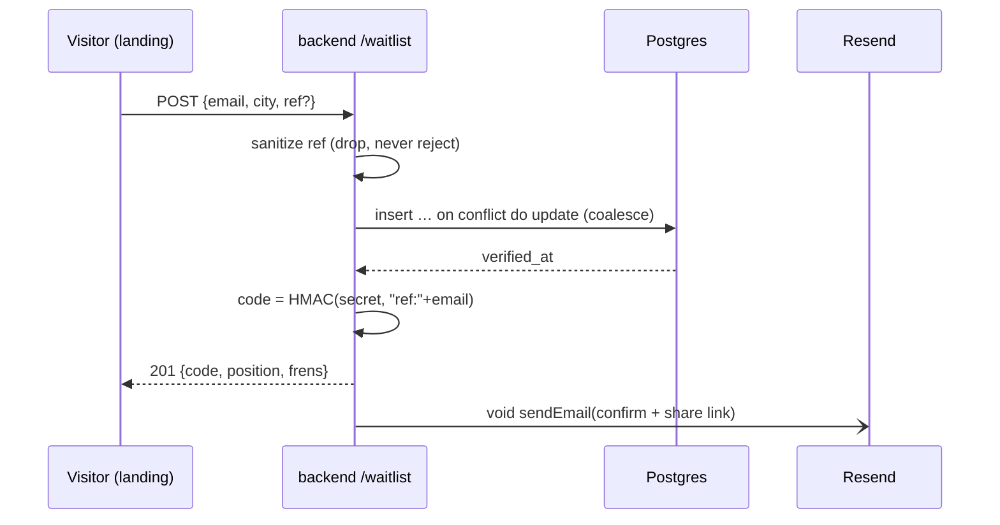
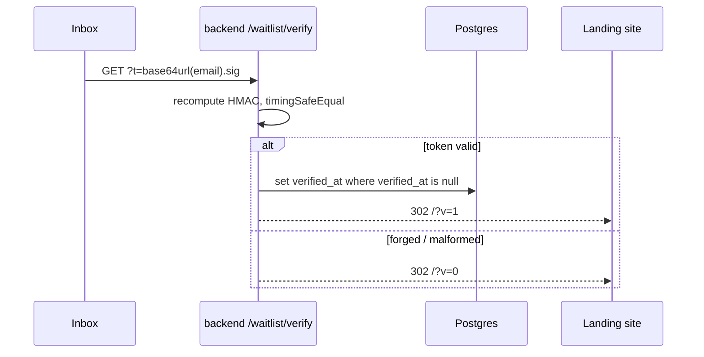

# 20 · Waitlist & referral loop

## What it is

The **f list** — the pre-launch queue the landing page collects — plus the two things that make it
grow and make it real: a referral link that attributes who brought whom, and a confirmation email
that proves an address exists.

fpay is invite-only, and the invite code **is** the referrer's `@handle` (see
[02 · Auth & identity](02-auth-identity.md)). That covers people who already have an account. It does
nothing for the much larger group who don't — so the f list gets its own share code, and one `?ref=`
parameter carries both kinds of referrer:

| `?ref=` value | Who sent it | Where it came from |
|---|---|---|
| `@asha` | an app user | Settings → "Share invite" |
| `k3n8q2wp` | an f-list member | their own confirm email / success card |

Both land on the marketing site. Only the `@handle` form is forwarded onward to the app, because an
8-character member code is not a handle and would fail the invite gate with `invalid_referral`.

## Flow

**1 · Joining**

The `201` is unconditional — duplicates included — so the form cannot be used to ask *"is this
address already on the list?"*. Mail is fired with `void` after the row is committed, so a Resend
outage or a slow round trip can never turn a successful signup into an error.

**2 · Confirming**

Always a redirect, never JSON: a human clicked this from a mail client, so the only useful response is
a page. Clicking twice still lands on `?v=1` — the write is guarded by `verified_at is null`, the
response is not.

## Why this way

- **Codes and tokens are derived, not stored.** Both are `HMAC-SHA256(WAITLIST_SECRET,
  "<purpose>:<email>")`. Nothing is persisted to look up, nothing expires, no sweep job exists, and a
  re-submit of the same address yields the *same* code — which is what makes the `on conflict do
  update` idempotent instead of minting a second identity for one person.
- **One polymorphic `referred_by` column, no FK.** Covered in
  [10 · Data model](10-data-model.md) — one code path for two referral sources, at the cost of
  referential integrity. Deliberate for a marketing queue; wrong the day referral credit pays money.
- **The link is the delivery vehicle; the cache is the attribution.** The landing page stores the ref
  in `localStorage['fpay:ref']` the moment it arrives, and reads from there at submit even when the
  URL is bare. Otherwise attribution is shed by deleting nine characters from the address bar, and a
  referral reward that can be dodged that easily is not a reward. Mirrors the app's own capture
  (`apps/web/src/app/page.tsx`) down to the key name and the no-expiry behaviour. Because the two are
  separate origins with separate storage, `AppLink` re-appending `?ref=` to the app URL is the only
  way a cached referral reaches signup.
- **Last touch wins, and it's mutable.** Each new link overwrites the cache, and
  `referred_by = coalesce(excluded, waitlist)` lets a submit carrying a ref overwrite the previous
  referrer (a submit carrying none leaves it alone, so re-joining cold can't erase credit). The
  accepted cost, chosen deliberately: an already-credited signup **can** be re-attributed by getting
  that person to click another link and re-submit, so a referrer's `frens` count can go down. If
  rewards ever pay cash, an audit trail of attribution changes is the natural next ask. Self-referral
  is blocked in `sanitizeRef` — everyone is shown their own code, and under last-touch pasting it
  back would otherwise be a free fren.
- **A typo'd ref is dropped, never rejected.** An invite is marketing. Losing someone's signup because
  they mistyped a friend's handle is a worse outcome than losing the attribution. The server also
  never checks whether the ref *exists* — that would answer "is `@x` a real user?" for an
  unauthenticated caller.
- **Resend over `fetch`, no SDK.** The whole integration is one HTTP POST and the backend runs Node
  20+. A dependency would buy types we write by hand anyway.
- **Unset configuration is a supported state, not a broken one.** With `RESEND_API_KEY` and
  `WAITLIST_SECRET` empty, no codes are minted and no mail is sent, and `POST /waitlist` behaves
  exactly as it did before this feature existed. That is what lets the code deploy *before* the DNS
  records are published. A key **without** a secret logs a boot warning and stays disabled, because a
  token minted under an empty HMAC key could be forged by anyone.
- **`WAITLIST_SECRET` is write-once in practice.** Rotating it invalidates every outstanding confirm
  link and re-mints everyone's share code, so any link already shared silently stops attributing.

## Legalities

- **Double opt-in is the point.** An unconfirmed address on a marketing list is a liability under
  GDPR/DPDP-style consent rules and a deliverability problem besides. `verified_at` is the record that
  a human with access to that inbox asked to be there.
- **PII, minimally.** The table holds an email and a city string. No name, no phone, no account link.
  Retention and deletion policy are unbuilt — an operator request today means a manual `delete`.
- **Sender identity.** Mail goes out from a verified domain (SPF + DKIM); an unverified domain fails
  closed at Resend rather than sending as somebody else.
- **Enumeration.** The always-`201` response is a privacy control, not a convenience.

## Status

- ✅ Schema (`ref_code` / `referred_by` / `verified_at` + two indexes), `POST /waitlist` with `ref`,
  `GET /waitlist/verify`, Resend mailer, IP-keyed rate limits on both routes.
- ✅ App side: Settings "Share invite" now points at the marketing site, and the invite gate offers an
  f-list exit to visitors with no code.
- ✅ Admin: the F list shows *Referred by* and *Confirmed*, with both in the CSV export.
- ✅ `scripts/check-waitlist.ts` — asserts token round-trip, that a payload swapped under a valid
  signature is rejected, code stability, and the ref sanitiser.
- ✅ Landing site: `?ref=` captured to `localStorage` on arrival and sent at submit, "@asha invited
  you" above the form, queue position + copyable share link on success, `?v=1` / `?v=0` confirm
  states, and demo links that relay a cached `@handle` on to the app.
- ⬜ Sending is inert until the Resend domain verifies and the four backend vars are set
  ([stage deploy — waitlist / Resend](../DEPLOY.stage.md)).
- ⬜ `NEXT_PUBLIC_APP_URL` is unset, so the landing "try the demo" links still fall back to `#`. The
  referral relay works the moment a real web-app URL is filled in.
- ⬜ No invite-send: moving someone from the queue into an actual account is still a manual step.

## Key files

- `apps/backend/src/routes/waitlist.ts` (both routes, code + token helpers),
  `services/email.ts` (Resend + the template), `scripts/check-waitlist.ts`.
- `apps/backend/src/db/{schema.sql,queries.ts}` (`addWaitlistEmail`, `waitlistPosition`,
  `countWaitlistFrens`, `verifyWaitlistEmail`, `listWaitlist`), `services/rateLimit.ts`.
- `packages/shared/src/contracts.ts` (`WaitlistJoinRequest/Response`, `AdminWaitlistEntry`).
- Web: `app/settings/page.tsx` (`ReferralCard`), `app/onboarding/handle/page.tsx` (the gate exit),
  `services/env.ts` (`LANDING_URL`). Admin: `app/waitlist/page.tsx`.
- Landing: `apps/landing/src/components/{ref.ts,Waitlist.tsx,AppLink.tsx}` — `ref.ts` is the capture /
  read / overwrite rule and the `isHandle` test that decides what may cross to the app.

## Related

- [02 · Auth & identity](02-auth-identity.md) — the invite-only gate the f list feeds
- [10 · Data model](10-data-model.md) — the `waitlist` table
- [14 · Notifications & infra](14-notifications-and-infra.md) — rate limiting, best-effort delivery
- [Stage deploy — waitlist / Resend](../DEPLOY.stage.md) — env vars, Resend DNS records
