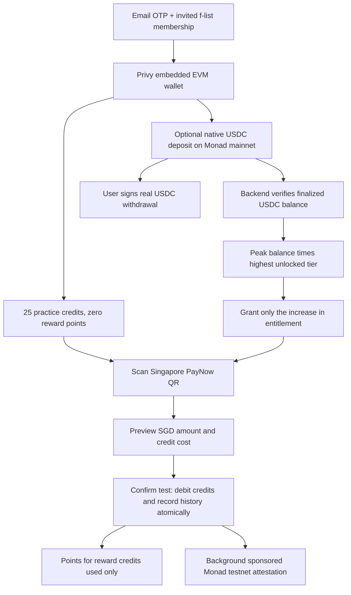

# Historical: Monad prelaunch (retired)

The customer practice-payment experience is retired. Its signup, quote and spend endpoints return 410.
The active app uses the Solana USDC merchant-payment pilot described in `DEPLOY.md`.
`/prelaunch` redirects to `/legacy-wallet`, which retains existing funds, withdrawals and receipt history.
No practice credits are converted into money. The description below records the previous implementation.

## What it is

An optional invite-only web campaign for the Singapore/TOKEN2049 audience. People verify their email and invited f-list membership,
get 25 practice credits, and scan Singapore PayNow QRs to record simulated payments. **The
recipient receives no money.** This is not a functioning PayNow payment method or a promise
that someone can buy goods at TOKEN2049. Pay separately for real purchases.

Three values have separate meanings:

| Value | Location | Meaning |
|---|---|---|
| Real USDC | User's Privy embedded EVM wallet, Monad mainnet (143) | User-controlled funds; withdrawable by signing a transfer |
| Test credits | PostgreSQL campaign ledger | Consumable simulation budget, not a token or redeemable money |
| Points | PostgreSQL campaign ledger | Campaign participation record; possible future eligibility, no guaranteed allocation or value |

No bridge, mainnet PayNow settlement, StraitsX personal API connection, token issuance or faucet
is included. Existing Solana balances, escrow, P2P and pending orders remain in their existing
system. This is an additive web entry mode, not a migration of existing funds or the native app.

## Flow



### Credit rules

The server verifies the email and embedded Ethereum wallet through Privy, never a client-supplied
wallet address. It reads **Circle native USDC**, `0x754704Bc059F8C67012fEd69BC8A327a5aafb603`,
on chain 143 at a finalized block. Wrong networks, unavailable RPCs and invalid observations do
not become zero balances. The UI retains the timestamp of its last verified balance.

Let `H` be the highest **observed and verified wallet balance**, `M` the highest unlocked tier,
and `G` all reward credits previously granted. A refresh grants `max(0, H × M − G)`.
This is a balance high-water mark, not cumulative deposits. Funds arriving and leaving between
observations may never qualify. The UI checks at initial account load and every 20 seconds while
the wallet view is open; users can explicitly refresh after depositing.

| Steps completed cumulatively | Multiplier |
|---|---|
| Verified email | 1× |
| Email + name + two-letter country code | 2× |
| Above + verified phone | 5× |
| Above + linked X identity verified by Privy | 10× |

Example: a verified peak of 100 USDC grants 100 credits at 1×. Reaching 2× grants another 100.
Withdrawing and redepositing 100 earns nothing more. A new peak of 150 at 2× grants another 100.
Credits already spent still count in `G`. Credits and the highest attained tier survive withdrawal
or unlinking for this campaign. Phone/X identities cannot qualify multiple campaign accounts.
Name/country are self-reported profile data, not identity verification or proof of residency.

Reward credits are consumed before practice credits. Every reward credit consumed earns one
point, including six-decimal fractional amounts. Practice credits earn none. There is no daily
point cap; the ledger uses bounded decimal database columns, not floating-point arithmetic.

### Test payment and receipt

The server independently validates Singapore PayNow TLV/CRC, proxy type, SGD currency, expiry and
fixed QR amounts. It quotes credit cost using the SGD/USD rate, rounding cost up to six decimals.
One credit is US$1 for the simulation; no real conversion fee or payout applies. Fallback FX is
explicitly labelled as an estimate. Quotes expire after 90 seconds or earlier QR expiry.

The account row is locked while checking and debiting. A spend is unique by both quote and
account/idempotency key. Retrying a successful spend returns its original result even after quote
expiry. The browser saves the request key before submission and offers result recovery after a
lost response or reload. Insufficient funds, foreign-account quotes and expired unused quotes
cannot debit the account. History returns the latest 100 records.

Receipts are asynchronous platform attestations on **Monad testnet (10143)**. A dedicated
platform-owned Privy wallet submits a sponsored, zero-value transaction to
`0x000000000000000000000000000000000000dEaD` with a salted SHA-256 commitment in calldata.
The canonical payload and random salt stay in the database; recipient/phone/email data do not
go on-chain. This is not a user-signed payment or proof of a physical purchase/location.

The worker leases pending jobs, uses the spend UUID as the provider idempotency key, verifies
chain and configured wallet, then checks successful finalized receipts. Direct and sponsored
UserOperation receipts are supported. Unresolved submissions without a hash go to review after
12 hours rather than being sent under a fresh key. Test completion and points do not depend on
RPC or sponsorship availability. A test can be recorded while its testnet receipt remains pending.

### Withdrawal

The backend prepares only an exact-amount native-USDC transfer on chain 143, checking the current
verified balance and rejecting zero/self/token-contract destinations. Privy requests the user's
signature; the platform does not sweep funds. The frontend requests app-paid gas. A submitted or
ambiguous withdrawal is saved locally and blocks another submission until the user checks the
result on the explorer. Export-wallet access remains available. Mainnet sponsorship must be
enabled and funded before opening deposits; a failed sponsor is not a successful withdrawal.

## Why this way

The first interaction needs no purchase, faucet or test MON. Optional funding and progressively
completed profile steps increase the amount people can try. An independent campaign ledger keeps
simulated spend out of real payment, escrow and payout tables. Backend credits give immediate
feedback while testnet infrastructure catches up.

The campaign entrance uses its own server-verified Privy identity and account table. It does not
call legacy `/auth/sync` or create Solana payout accounts; public campaign enrollment therefore
does not satisfy existing invite, KYC or real-money settlement checks.

## Legalities

This document defines software behavior, not a legal conclusion. Published copy must say that
these are test payments, recipients are unpaid, credits cannot be redeemed, and token allocation
is not guaranteed. Do not market this as paying real purchases throughout TOKEN2049.

Real deposits remain user-controlled USDC, with real network/asset risk. Profile multipliers are
not KYC tiers. Before any reward distribution, establish campaign terms, eligibility rules,
privacy/retention for QR and identity data, and jurisdiction-specific review. Existing settlement
controls still apply to the legacy money product.

Email OTP plus per-account peaks do **not** prevent one person from moving the same capital
through multiple accounts. Phone/X reuse protection reduces one avenue but does not make this
sybil-resistant. Do not equate points with a guaranteed redeemable liability. No personal-account
StraitsX API permissions or PayNow-on-Monad support are assumed; those require provider agreement.

## Status

Implemented behind a feature flag: web onboarding, practice/reward balances, PayNow simulation,
profile tiers, USDC reads/withdrawal preparation, durable spend idempotency and receipt worker.
Local checks cover the arithmetic, parser parity and transfer calldata. An isolated PGlite run
also exercises the migration and actual ledger functions: deposit/withdraw/redeposit observations,
profile upgrades, request replay, expired/foreign quotes, rollback, phone attempt limits and
phone/X reuse. Its connection adapter serializes transactions; it does not prove production
PostgreSQL multi-connection locking. Production credentials,
real deposit/withdrawal, SMS/X OAuth and sponsored receipts still require an end-to-end staging
run. Do not describe configured capabilities as live-verified integrations.

### Setup and rollout

1. Apply additive migration `0031_monad_prelaunch.sql` through normal deployment tooling. Never
   seed/reset an existing database. `0030` remains the separate StraitsX sandbox migration.
2. Set backend `PRELAUNCH_ENABLED=true`, `MONAD_RPC_URL`, `MONAD_TESTNET_RPC_URL`,
   `PRELAUNCH_RECEIPT_WALLET_ID`, and matching public `PRELAUNCH_RECEIPT_ADDRESS`. These use
   `LOCAL_`/`STAGE_`/bare production tiers like existing backend variables.
3. In Privy, enable email OTP, Ethereum embedded wallets, X linking and allowed callback origins.
   Use the existing single Privy application. Provision a separate platform-owned EVM receipt
   wallet. Enable TEE execution and funded **app-pays** gas sponsorship for Monad and Monad
   Testnet. No user-pays-token-gas support is assumed for Monad.
4. Configure the existing MessageCentral OTP integration for real phone verification. The console
   provider is local-only. SMS sends are limited per account (60-second interval, five/day), with
   five verification attempts per challenge. Restrict sponsorship policies/budgets in Privy.
5. Set web `NEXT_PUBLIC_STAGE_PRELAUNCH_ENABLED=true` for stage or
   `NEXT_PUBLIC_PRELAUNCH_ENABLED=true` for production and rebuild. Local defaults on unless
   `NEXT_PUBLIC_LOCAL_PRELAUNCH_ENABLED=false`. Both customer modes use the shared email/f-list
   gate; the feature flag selects the existing UI only. Backend and frontend flags must agree.
6. Verify email login, refresh/reload, wrong-network deposits, finalized deposit crediting, tier
   upgrades, withdrawal and redeposit, duplicate/concurrent confirmations, failed SMS codes,
   QR fixed amounts, receipt recovery and rejected/ambiguous withdrawals before public promotion.

`GET /admin/prelaunch` requires existing admin authorization and reports participant count,
credits granted, points and receipt-state counts. Campaign suspension is a separate
`prelaunch_accounts.suspended` flag, not wired to legacy admin user controls. There is no campaign
admin editor or scheduled end date yet. Monitor the receipt backlog and gas budget.

Disabling `PRELAUNCH_ENABLED` closes all campaign APIs, including withdrawal preparation. Do not
use that switch as a routine campaign-end mechanism while people rely on wallet access. Maintain
a wallet-access path and communications; exported self-custodial wallets remain independently
usable. Closing rewards while keeping the campaign wallet UI open is future work.

### Repeatable local checks

`yarn check:prelaunch` runs the deterministic arithmetic and calldata checks and is included in
`yarn check:all`. The optional ledger check uses PostgreSQL compiled to WASM, with the real
application SQL and external services replaced inside the test process only:

```sh
# Install test tooling outside the product dependency tree.
yarn --cwd /private/tmp/fpay-prelaunch-validation add @electric-sql/pglite
# From apps/backend:
PRELAUNCH_PGLITE_MODULE=/private/tmp/fpay-prelaunch-validation/node_modules/@electric-sql/pglite/dist/index.js yarn tsx scripts/check-prelaunch-ledger.ts
```

The test intercepts all pg connections before loading application modules and rejects unexpected
network calls. It never connects to a configured stage/production database. Web/backend production
builds and the repository check suite pass locally. Live Privy, SMS, real USDC and sponsored
receipt verification remain staging checks.

Primary references: [Circle USDC contracts](https://developers.circle.com/stablecoins/usdc-contract-addresses),
[Monad network information](https://docs.monad.xyz/developer-essentials/network-information),
[Privy supported gas networks](https://docs.privy.io/wallets/gas-and-asset-management/gas/overview),
[Privy sponsorship setup](https://docs.privy.io/wallets/gas-and-asset-management/gas/setup).

## Key files

- `apps/web/src/components/prelaunch/`: campaign screens and styling.
- `apps/web/src/services/privy/PrivyRoot.tsx`: campaign EVM identity mode.
- `packages/shared/src/prelaunch.ts`, `packages/app/src/services/api.ts`: typed API boundary.
- `apps/backend/src/routes/prelaunch.ts`: authenticated campaign endpoints.
- `apps/backend/src/services/prelaunch/`: credit ledger, chain checks and receipt worker.
- `apps/backend/src/db/migrations/0031_monad_prelaunch.sql`: independent campaign tables.
- `apps/backend/scripts/check-prelaunch.ts`: deterministic economic and transfer checks.
