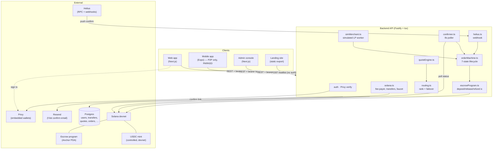

# Pay — Architecture & Flows

> A plain-English map of **how this product works, why each piece is built the way it is, what
> legal/compliance question it touches, and how finished it is.** Read top-to-bottom for the full
> picture, or jump to the integration you care about.

The product is a **consumer money app** — you hold a dollar balance, send money to friends, and pay
merchants — built on **stablecoins (USDC) on Solana** (mainnet on deployed envs, devnet for local
dev), with the crypto deliberately hidden.
The north star (`stablecoin-onofframp-architecture.pdf`) is *"a money product with protocol
advantages: expose certainty, hide complexity, failure-first then growth."*

---

## How to read these docs

Every integration/flow doc follows the **same six-part shape**, so you always know where to look:

| Section | Answers |
|---|---|
| **What it is** | one-paragraph definition |
| **Flow** | a diagram of how it actually moves |
| **Why this way** | the design decision + the tradeoff |
| **Legalities** | the regulatory question it touches, and how we handle or *defer* it |
| **Status** | how done it is — ✅ complete · 🟡 gray (partial/simulated) · ⬜ planned |
| **Key files** | where it lives in the repo |

### Status legend
- ✅ **Complete** — built, wired, and verified (at least headlessly).
- 🟡 **Gray** — exists but **simulated, partial, or cosmetic** (not production-real).
- ⬜ **Planned** — designed, not yet built.

### A note on 16 and up

Docs **01–15** describe the system as it stands and are kept current. Docs **16+** are *milestone
records* — what was planned and built at one point in time — so their file paths are as of that
milestone and are deliberately not rewritten. Renamed since they were written:

| Then | Now |
|---|---|
| `apps/backend/src/config.ts` | `apps/backend/src/envConfig.ts` |
| `apps/{web,admin}/src/services/env.ts` | `…/envConfig.ts` |
| `apps/web/src/lib/qr.ts` | `packages/shared/src/payTarget.ts` |

---

## The docs

| # | Doc | Covers | Status |
|---|---|---|---|
| 01 | [Architecture](01-architecture.md) | the whole system, monorepo layout, request + on-chain lifecycle | ✅ |
| 02 | [Auth & identity](02-auth-identity.md) | Privy email login, embedded wallet, `@handle`, enforced KYC tiers | ✅ / 🟡 vendor |
| 03 | [Custody & gas](03-custody-and-gas.md) | self-custody + fee-payer gas sponsorship (the key legal lever) | ✅ |
| 04 | [Money in](04-money-in.md) | funding the balance (faucet today → card/bank later) | 🟡 |
| 05 | [P2P send & request](05-p2p-send-request.md) | send money to a friend, request money | ✅ |
| 06 | [Payout order lifecycle](06-payout-order-lifecycle.md) | quote engine + the 7-state order machine | ✅ |
| 07 | [On-chain escrow](07-onchain-escrow.md) | the Anchor program that holds funds (M2) | ✅ |
| 08 | [Routing, scoring & the LP marketplace](08-routing-and-failover.md) | ranking, silent failover (M3) + live signals/float/KYB/bonds/disputes (M4) | ✅ |
| 09 | [Confirmation pipeline](09-confirmation-pipeline.md) | how the chain tells the app a payment landed | ✅ |
| 10 | [Data model](10-data-model.md) | the Postgres schema, table by table | ✅ |
| 11 | [Compliance & legalities](11-compliance-and-legalities.md) | the honest risk map: custody, KYC, MTL, FX, sanctions | 🟡 |
| 12 | [Status & roadmap](12-status-and-roadmap.md) | the M0→M7 heat-map of done vs. gray vs. planned | — |
| 13 | [Future milestones](13-future-milestones.md) | M7: real rails (the last milestone) | ⬜ |
| 14 | [Notifications & infra](14-notifications-and-infra.md) | in-app inbox, advisory lock, rate-limit, metrics (M6) | ✅ / 🟡 scale |
| 15 | [KYC testing runbook](15-kyc-testing-runbook.md) | sim vs Didit config, env vars, re-test flow | — |
| 16 | [Direct address send](16-direct-address-send-plan.md) | send to any Solana address; EVM detect ("coming soon"); tier-2 gate; idempotent prepare | ✅ |
| 17 | [UPI aliases, pagination & env](17-upi-aliases-pagination-env.md) | pay by @handle/phone (opt-in mapper), domain route split, keyset pagination, 3-tier env | ✅ |
| 18 | [Unified pay, chains & country](18-unified-pay-chains-country.md) | QR/address/handle/phone in one flow, country dialing default, CCTP chain list, chain-surface rule | ✅ |
| 19 | [Cross-chain USDC rails](19-crosschain-cctp-rails.md) | CCTP V2 behind a rail abstraction: outbound sends to Base/Eth/Arb + inbound deposits (smart-wallet, sponsored), full Sepolia staging | ✅ / 🟡 funding |
| 20 | [Waitlist & referral loop](20-waitlist-referral-loop.md) | the f list: one `?ref=` for two referrer kinds, HMAC-derived share codes, double opt-in confirm email | ✅ / ⬜ landing |
| 21 | [Scan & pay rails](21-scan-and-pay-rails.md) | reading EMVCo merchant QRs, naming the processing network, and which rail each scan lands on | ✅ |
| 22 | [Indonesia corridor + Asia research](22-indonesia-corridor-and-asia-research.md) | QRIS/IDR as currency-generalization, provider/cost research, ranked next corridors | ✅ |
| 23 | [Settlement models & provider registry](23-settlement-models-and-provider-registry.md) | `lp` vs `provider` per corridor, the platform settlement row, DB provider registry + its safety invariants, corridor economics | 🟡 |

**Deployment is not a numbered doc** — the runbooks live at the repo root, next to the code they
deploy: [`DEPLOY.stage.md`](../DEPLOY.stage.md) (Railway backend + per-env Vercel frontends, every
setting/variable/domain/test step) and [`DEPLOY.md`](../DEPLOY.md) (prod/mainnet). One
architecture fact worth knowing from them: the web app ships server-side code (the access-key
deploy gate — `src/middleware.ts` + `/gate`), so it deploys as a Next server, not a static export.

---

## The system at a glance



**One-line mental model:** the **client** asks the **backend** to *build* a transaction, the **user**
signs it (via Privy), the **fee-payer** sponsors the gas, the **chain** executes it, and a
**confirmer + webhook** tell the backend it landed so the **order machine** can advance. Money that's
"in flight" for a merchant payout sits in an **on-chain escrow** until it's released or refunded.

See [01-architecture](01-architecture.md) for the detailed walk-through.

---

## The PDF & regenerating it

`payments-architecture.pdf` is the whole set as one diagram-rich document (~37 pages). It's built
from the Markdown with **no installed packages** — `marked` + `mermaid` load from a CDN at view time:

```bash
# 1. assemble the self-contained, print-ready HTML (Node only, no npm install)
node docs/build-architecture-html.mjs

# 2a. render to PDF with an already-installed Chrome (no package install):
"/Applications/Google Chrome.app/Contents/MacOS/Google Chrome" \
  --headless --disable-gpu --virtual-time-budget=30000 --no-pdf-header-footer \
  --print-to-pdf="$(pwd)/docs/payments-architecture.pdf" \
  "file://$(pwd)/docs/architecture.html"

# 2b. …or just open docs/architecture.html in any browser → Print → Save as PDF.
```

Edit the `.md` files (the source of truth), then re-run step 1 (+2) to refresh the PDF.
